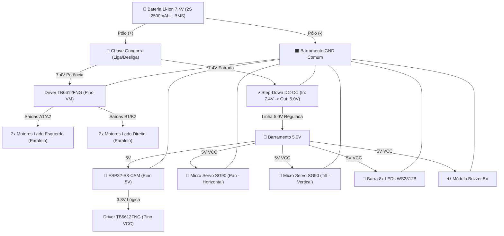

# ⚡ Projeto Elétrico, Distribuição de Energia & Pinagem

Este documento detalha toda a arquitetura elétrica do robô móvel, projetada com base nos componentes efetivamente adquiridos. O objetivo é permitir que você prepare os chicotes, conectores e planejamento elétrico antes mesmo de todas as peças chegarem.

---

## 🧰 1. Lista de Componentes Comprados (Hardware Base)

* **Cérebro Principal / Visão:** ESP32-S3-CAM (Mercado Livre) e ESP32-CAM (RoboCore).
* **Co-processador Disponível:** Arduino Nano V3.
* **Driver de Motores:** TB6612FNG (Ponte H dupla com MOSFETs de alta eficiência).
* **Motores de Tração:** 4x Micromotores de redução metálica (série JGA-050 / N20 / GA12).
* **Mecanismo Pan & Tilt:** 2x Micro Servos 9g SG90 + suporte articulado 2 eixos.
* **Alimentação:** Pack Bateria Li-Ion 2S 7.4V 2500mAh com BMS integrado.
* **Chave Geral:** Chave gangorra liga/desliga (KCD11 ou similar).
* **Regulação:** Conversor DC-DC Step-Down (ajustado para 5.0V).
* **Sinalização Visual:** Régua com 8 LEDs RGB endereçáveis WS2812B.
* **Sinalização Sonora:** Módulo Buzzer passivo 5V.

---

## 🔌 2. Arquitetura de Distribuição de Energia (Sem Brownouts)

Motores DC e micro servos geram transientes de corrente elevados (picos de partida) e ruído indutivo. Se o ESP32 compartilhar diretamente a mesma linha desregulada ou se os servos forem alimentados pelo pino 5V/3.3V do ESP32, a placa sofrerá **brownout** (reinicialização instantânea por queda de tensão).

Para garantir estabilidade industrial:
1. **Linha de Potência Bruta (7.4V Bateria):** Alimenta diretamente o pino `VM` do driver TB6612FNG (para os 4 motores) e a entrada `VIN` do Step-Down.
2. **Linha de Lógica & Servos (5.0V Regulados):** A saída do Step-Down fornece 5.0V limpos para os micro servos SG90, a régua de LEDs WS2812B e a entrada `5V` (ou `VIN`) da placa ESP32.
3. **GND Unificado:** Todos os pontos de GND (Negativo da bateria, Step-Down, ESP32, TB6612FNG, Servos e LEDs) são estritamente interligados em uma estrela comum de terra.

---

## 🚗 3. Conexão do Driver TB6612FNG

O **TB6612FNG** é infinitamente superior ao clássico L298N:
* Possui transistores MOSFET com baixíssima resistência interna ($R_{DS(on)}$), quase não dissipa calor e não "rouba" 2V da bateria.
* Suporta 1.2A contínuos por canal (3.2A de pico), ideal para até 2 motores por canal em paralelo.
* Aceita nível lógico de 3.3V na entrada, dispensando circuitos de conversão de nível lógico para o ESP32.

### Pinagem do TB6612FNG:
| Pino no Módulo | Conectar em | Função |
|---|---|---|
| **VM** | 7.4V (Pós Chave Gangorra) | Tensão de alimentação dos motores (2.5V a 13.5V) |
| **VCC** | 3.3V (Saída do ESP32 ou 5V) | Alimentação da lógica interna do chip |
| **GND** | GND Geral | Referência comum de terra |
| **STBY** | 3.3V ou GPIO do ESP32 | Standby (HIGH = Ativo, LOW = Motores livres). Pode ser ligado direto ao VCC |
| **PWMA** | GPIO do ESP32 (PWM) | Controle de velocidade do lado esquerdo (0 a 100%) |
| **AIN1** | GPIO do ESP32 | Direção motor esquerdo |
| **AIN2** | GPIO do ESP32 | Direção motor esquerdo |
| **PWMB** | GPIO do ESP32 (PWM) | Controle de velocidade do lado direito (0 a 100%) |
| **BIN1** | GPIO do ESP32 | Direção motor direito |
| **BIN2** | GPIO do ESP32 | Direção motor direito |
| **AO1 / AO2** | 2x Motores Esquerdos | Saída para os motores esquerdos em paralelo |
| **BO1 / BO2** | 2x Motores Direitos | Saída para os motores direitos em paralelo |

> [!TIP]
> **Economia de 1 Pino:** Ligue o pino **`STBY`** diretamente ao **`VCC`** (ou 3.3V). Dessa forma, a ponte H fica sempre habilitada quando o circuito estiver ligado, economizando 1 GPIO precioso do ESP32!

---

## 🧭 4. Mapeamento de Pinos (GPIOs) no ESP32-S3-CAM

No **ESP32-S3-CAM**, os pinos da câmera OV5640 ocupam a maior parte do barramento DVP de alta velocidade. Abaixo está a alocação dos pinos externos livres disponíveis nos headers da placa:

| Periférico | Sinal | GPIO Recomendado (ESP32-S3) | Observação |
|---|---|:---:|---|
| **TB6612FNG (Tração)** | PWMA (Velocidade Esq.) | **GPIO 1** | Canal LEDC PWM hardware |
| | AIN1 (Direção Esq.) | **GPIO 2** | Nível lógico alto/baixo |
| | AIN2 (Direção Esq.) | **GPIO 42** | Nível lógico alto/baixo |
| | PWMB (Velocidade Dir.) | **GPIO 41** | Canal LEDC PWM hardware |
| | BIN1 (Direção Dir.) | **GPIO 40** | Nível lógico alto/baixo |
| | BIN2 (Direção Dir.) | **GPIO 39** | Nível lógico alto/baixo |
| **Pan & Tilt** | Servo PAN (Horizontal) | **GPIO 47** | Pulso 50Hz PWM (0° a 180°) |
| | Servo TILT (Vertical) | **GPIO 48** | Pulso 50Hz PWM (-30° a +45°) |
| **Feedback Visual** | LED RGB WS2812B (Data) | **GPIO 21** | Barramento RMT / Neopixel 800kHz |
| **Feedback Sonoro** | Buzzer Passivo | **GPIO 38** | Frequências de tom (LEDC tone) |

> [!NOTE]
> **Opção com Arduino Nano (Arquitetura Híbrida):**
> Caso deseje isolar 100% o processamento da câmera do acionamento dos motores e servos, o Arduino Nano comprado pode ser configurado como co-processador:
> * O ESP32-S3 se comunica com o Nano via **Serial UART** (apenas 2 fios: TX/RX + GND).
> * O Nano gerencia todos os 6 pinos do TB6612FNG e os 2 pinos dos servos SG90.
> * O sketch do ESP32-S3 fica super enxuto, focando apenas no stream MJPEG e WebSockets.

---

## 🛠️ 5. O que Você Já Pode Deixar Preparado (Facilitação da Elétrica)

Enquanto as peças estão em transporte, você pode adiantar:

1. **Mini Placa de Distribuição de Energia (Power Bus):**
   * Em uma pequena placa padrão perfurada (ou mini protoboard de 170 furos), solde duas barras de pinos macho (uma linha para **5V** e uma linha para **GND**).
   * Isso evitará ter que emendar vários fios no mesmo ponto para alimentar os 2 servos, o ESP32 e a barra de LEDs.
2. **Chicote da Chave Gangorra:**
   * Prepare o rabicho da chave liga/desliga com fios soldados nos terminais e protegidos com espaguete termorretrátil.
   * Conector JST fêmea para plugar direto no pack Li-Ion 7.4V.
3. **Pares de Fios para os Motores JGA-050:**
   * Corte 4 pares de fios flexíveis (vermelho e preto) com cerca de 10 a 12 cm cada.
   * Se tiver capacitor cerâmico 100nF (104), reserve para soldar em paralelo nos terminais dos motores para filtragem de ruído elétrico.
4. **Alívio de Tensão para o Pan/Tilt:**
   * O mecanismo de Pan/Tilt necessita de fios bem flexíveis (fios de silicone 26 a 28 AWG são os melhores). Jumpers duros podem limitar o giro suave do servo.
