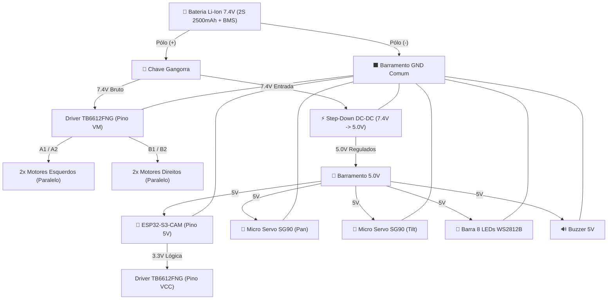

# 🤖 Robô Móvel ESP32-S3 (4WD & Pan/Tilt) — 100% Impressão 3D

Plataforma robótica móvel didática com **tração 4WD**, **câmera com mecanismo Pan & Tilt de 2 eixos em tempo real**, **iluminação RGB** e **saída sonora**, controlada via Wi-Fi pelo microcontrolador **ESP32-S3 CAM**.

Toda a parte estrutural, chassi, berço de componentes e suporte da câmera foi concebida para ser **100% fabricada em Impressão 3D (PLA / PETG)**.

Este documento funciona como a **memória viva do projeto**, reunindo o histórico de decisões, especificações dos componentes comprados, projeto do case 3D, esquema elétrico e diretrizes de montagem.

---

## 📦 1. Hardware Comprado e Consolidado

A fase de compras foi concluída. O robô será montado com o seguinte conjunto de peças:

* **Cérebro / Visão:** **ESP32-S3-CAM N16R8** (Mercado Livre - 16MB Flash, 8MB PSRAM, USB-C, Câmera OV5640 5MP) + **ESP32-CAM** (RoboCore).
* **Co-processador Disponível:** **Arduino Nano V3** (pode atuar como co-processador de tempo real se necessário).
* **Tração 4WD:** 4x Micromotores metálicos com redução (série **JGA-050**) + Rodas emborrachadas de alta aderência + Suportes em L.
* **Driver de Motores:** **TB6612FNG** (Ponte H dupla com MOSFETs de alta eficiência, sem dissipador pesado e sem perda de tensão).
* **Mecanismo Pan & Tilt:** 2x Micro Servos 9g **SG90** (giro horizontal Pan e vertical Tilt).
* **Alimentação:** Pack Bateria **Li-Ion 2S 7.4V 2500mAh com BMS integrado** + **Chave Gangorra** liga/desliga.
* **Regulação de Tensão:** Conversor DC-DC **Step-Down** (ajustado em 5.0V estáveis).
* **Sinalização Visual:** Régua com **8 LEDs RGB endereçáveis WS2812B**.
* **Sinalização Sonora:** Módulo **Buzzer passivo 5V**.
* **Conexões:** Jumpers flexíveis, cabos de força e conectores JST.

---

## 🧠 2. Memória das Conversas e Decisões Técnicas

1. **Definição da Arquitetura ESP32:**
   * Optou-se por concentrar visão e controle no ESP32-S3, eliminando a complexidade e o custo de um computador de placa única (como Raspberry Pi), mantendo o Arduino Nano como recurso extra caso se queira desacoplar os pulsos dos servos e motores da CPU de vídeo.
2. **Solução Mecânica do Pan & Tilt (Proteção do Flat Cable):**
   * O cabo flat da câmera OV5640 é extremamente curto e quebra facilmente por fadiga sob torção repetitiva.
   * **Decisão:** A placa inteira (ESP32-S3-CAM) é montada diretamente no suporte móvel do Tilt. Como a placa pesa apenas ~16g e o servo SG90 tem torque de ~1.6 kg·cm, o servo a movimenta com total facilidade e o cabo flat fica **100% imóvel e seguro**.
   * Os fios de alimentação que descem da placa móvel para o chassi formam uma **alça flexível em "U"** (alívio de tensão), torcendo livremente sem travar o giro do Pan.
3. **Adoção do Driver TB6612FNG:**
   * Em vez dos drivers clássicos bipolares (L298N) que aquecem muito e derrubam quase 2V da bateria, o TB6612FNG opera com transistores MOSFET com baixíssima resistência, tamanho ultracompacto e lógica compatível com 3.3V do ESP32.
4. **Isolamento de Linha de Alimentação (Prevenção de Brownout):**
   * A linha de 7.4V da bateria vai direto para o TB6612FNG (motores) e para a entrada do Step-Down.
   * A saída de 5.0V do Step-Down alimenta os servos, o ESP32 e os LEDs.
   * **Regra inviolável:** Nunca puxar alimentação dos servos a partir dos pinos da placa ESP32.
5. **Decisão de Fabricação:**
   * Todo o chassi, berço da bateria e articulação Pan/Tilt serão **100% impressos em 3D**, permitindo encaixes sob medida, passagens de cabos limpas e visual unificado.

---

## 🏎️ 3. Projeto Mecânico e Case (100% Impressão 3D)

O chassi será modelado e impresso em **dois andares (conveses)** com colunas/espaçadores:

```
                      +-----------------------------+
                      |   🎥 ESP32-S3 no PAN/TILT   |
                      +--------------+--------------+
                                     | (Eixo Pan)
        +============================V===========================+
        |  CONVÉS SUPERIOR (Impresso em 3D)                      |
        |  • Step-Down 5V    • Driver TB6612FNG   • Mini Bus 5V  |
        |  • Módulo Buzzer   • Fiação de Sinal                   |
        +============================+===========================+
                                     | (Colunas M3 / Torres 3D)
        +============================V===========================+
        |  CONVÉS INFERIOR (Impresso em 3D)                      |
        |  [Motor Esq 1]   🔋 Bateria 7.4V 2500mAh  [Motor Dir 1]|
        |  [Motor Esq 2]   🔘 Chave Gangorra (Trás) [Motor Dir 2]|
        +========================================================+
             (O)                                            (O)
             Roda                                           Roda
```

### 📍 Piso Inferior (Massa & Tração)
* **Alojamento da Bateria:** Localizada exatamente no centro geométrico entre os 4 eixos dos motores JGA-050. Como a bateria pesa ~100g, seu posicionamento central garante tração idêntica nas 4 rodas e giro no próprio eixo (*skid-steer*) simétrico e suave.
* **Fixação dos Motores JGA-050:** Encaixes ou furações para os suportes em L de alumínio nas 4 extremidades.
* **Painel Traseiro:** Rasgo retangular sob medida para travar a chave gangorra liga/desliga.

### 📍 Convés Superior & Mecanismo Pan/Tilt
* **Posição Frontal Avançada:** O mecanismo Pan/Tilt fica na ponta dianteira do robô, evitando que o chassi ou as rodas dianteiras fiquem no campo de visão quando a câmera for inclinada para baixo.
* **Farol Direcional:** A régua de 8 LEDs WS2812B pode ser parafusada diretamente no berço do Tilt, logo abaixo da lente da câmera, fazendo o feixe luminoso acompanhar automaticamente para onde a câmera estiver apontando.
* **Roteamento Interno:** Rasgos no piso superior permitem que os fios passem de um andar para o outro de forma embutida e protegida.

---

## ⚡ 4. Esquema Elétrico & Pinagem

### Diagrama de Distribuição de Energia



### Tabela de Pinagem Recomendada (ESP32-S3-CAM)

| Periférico | Linha de Sinal | Pino no ESP32-S3 | Finalidade |
|---|---|:---:|---|
| **TB6612FNG (Tração)** | PWMA | **GPIO 1** | Velocidade lado esquerdo (PWM) |
| | AIN1 | **GPIO 2** | Direção lado esquerdo |
| | AIN2 | **GPIO 42** | Direção lado esquerdo |
| | PWMB | **GPIO 41** | Velocidade lado direito (PWM) |
| | BIN1 | **GPIO 40** | Direção lado direito |
| | BIN2 | **GPIO 39** | Direção lado direito |
| | STBY | *Ligar ao VCC* | Habilitado permanentemente (economiza 1 GPIO) |
| **Pan & Tilt** | Servo PAN | **GPIO 47** | Eixo horizontal (0° a 180°, centro 90°) |
| | Servo TILT | **GPIO 48** | Eixo vertical (50° a 130°, centro 90°) |
| **Feedback Visual** | WS2812B DIN | **GPIO 21** | Controle de cor individual dos 8 LEDs |
| **Feedback Sonoro** | Buzzer | **GPIO 38** | Tons sonoros e beeps de status |

---

## 🎮 5. Dinâmica de Pilotagem (Carrinho + Pan/Tilt Concomitantes)

Na aplicação Web embarcada no ESP32 (acessada pelo celular ou computador sem instalar nenhum aplicativo):

1. **Visão em Primeira Pessoa (FPV):**
   * O centro da tela exibe a transmissão em tempo real da câmera OV5640 via MJPEG.
2. **Controle de Tração (Skid-Steer):**
   * Joystick virtual esquerdo: acelerador proporcional para frente e ré, curvas dinâmicas e giro 360° no próprio eixo.
3. **Controle de Pan & Tilt (Mira da Câmera):**
   * Joystick virtual direito ou **arrasto direto na tela sobre o vídeo**: a câmera segue o movimento dos dedos instantaneamente.
4. **Funções Rápidas de Apoio:**
   * **Botão "Alinhar":** Traz o Pan e Tilt para 90° (olhando reto para a frente do robô).
   * **Botão "Farol":** Alterna os LEDs WS2812B entre desligado, luz branca de navegação noturna e sinalização colorida.
   * **Botão "Buzina":** Aciona bips no buzzer passivo.

---

## 🛠️ 6. O que Você Já Pode Adiantar na Bancada

Enquanto as encomendas não são entregues:

1. **Barramento de Energia:** Em uma placa perfurada padrão ou mini protoboard, solde uma linha de pinos macho para 5V e outra para GND.
2. **Chicote da Chave Gangorra:** Soldar os fios com espaguete termorretrátil nos terminais da chave e crimpar/soldar o conector da bateria.
3. **Fios dos Motores JGA-050:** Deixar preparados 4 pares de fios flexíveis de 10 a 12 cm.
4. **Alívio dos Cabos da Câmera:** Separar fios de silicone bem maleáveis (26 a 28 AWG) para ligar a placa móvel ao barramento fixo inferior.
