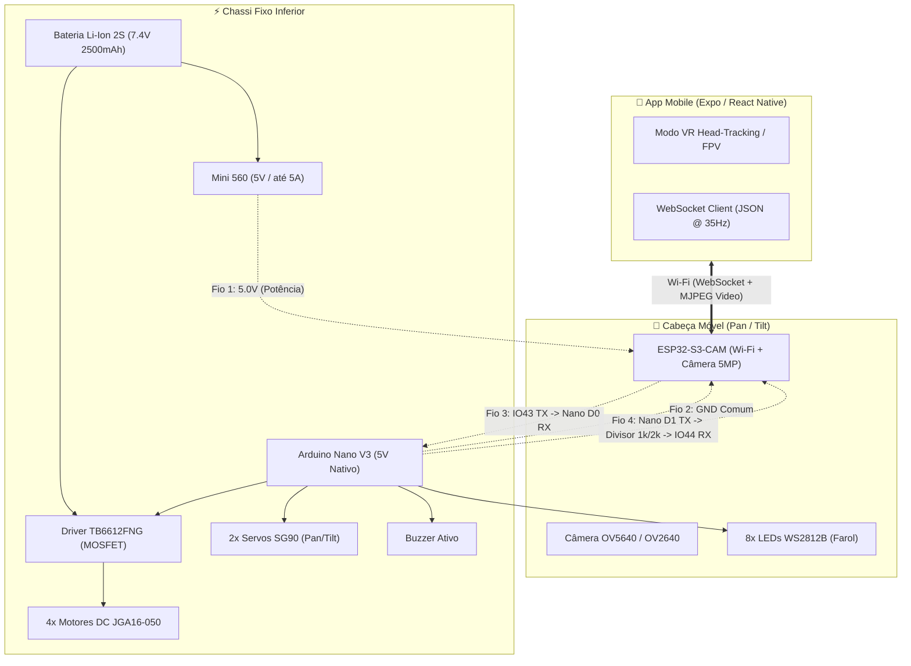

# 🤖 Rover Móvel ESP32-S3 4WD & Pan/Tilt VR

Robô explorador terrestre com **tração integral 4WD**, cabeça articulada **Pan/Tilt** com streaming de vídeo de baixa latência e controle mobile imersivo via **Realidade Virtual (VR Head-Tracking)**.

---

### 🟢 Status do Projeto: **Testes de Bancada Ativos**
* **Hardware:** Todos os componentes adquiridos e recebidos (em mãos).
* **Fase Atual:** Validação de comunicação serial ESP32 $\leftrightarrow$ Nano, sintonia dos servos com o giroscópio do app Expo e preparação para modelagem CAD 3D do chassi.

---

## 🏗️ Arquitetura do Sistema

O projeto adota uma arquitetura **distribuída em 2 microcontroladores**, interligados por um chicote ultra-flexível de **apenas 4 fios**:



---

## 📂 Organização da Codebase

```
rover/
├── README.md                      # Este arquivo (visão geral, quickstart e arquitetura)
├── AGENTS.md                      # Regras e diretrizes obrigatórias para agentes de IA
├── style.md                       # Perfil de engenharia, tom de voz e regras de comunicação
│
├── hardware/                      # Projetos e esquemáticos CAD eletrônico
│   └── kicad/
│       └── rover_serial_bridge/   # Projeto KiCad do chicote e interface serial ESP32 <-> Nano
│
├── docs/                          # Documentação técnica central
│   ├── context.md                 # 📖 Memória técnica contínua e histórico completo do projeto
│   ├── hardware/                  # Especificações técnicas, desenhos milimétricos e pinagens
│   │   ├── ESPECIFICACOES_TECNICAS.md
│   │   ├── tabela_pinagem_esp32_nano.xlsx
│   │   └── *.png                  # Desenhos técnicos oficiais (JGA-050, SG90, StickyMAX, Pinouts)
│   ├── guides/                    # Guias de engenharia e tutoriais aprofundados
│   │   ├── controle_servos_head_tracking_vr.md # Guia didático sobre servos, giroscópio e filtros
│   │   ├── http_vs_websocket_redes.md          # Análise comparativa de redes e latência
│   │   └── streaming_video_baixa_latencia.md   # Pipeline de vídeo, resoluções e 4G/Wi-Fi
│   └── references/                # Fotos reais dos produtos e montagens maker de inspiração
│       └── INSPIRACOES_CASE_E_PAN_TILT.md
│
├── src/                           # Código-fonte do projeto
│   ├── app_mobile/                # Aplicativo Expo / React Native (VR Head-Tracking, FPV, Dashboard)
│   └── firmware/                  # Códigos C++ / Arduino para os microcontroladores
│       ├── controle_pinos_nano_web/       # Firmware de controle genérico de pinos via Web/Serial
│       └── teste_serial_led_esp32_nano/   # Firmware de validação do link serial entre placas
│
└── tools/                         # Ferramentas auxiliares e scripts utilitários
    └── scratch/                   # Geradores de diagramas, planilhas e cálculos
```

---

## ⚡ Quickstart: Como Executar

### 1. Aplicativo Mobile (`src/app_mobile`)
Requer Node.js e o app **Expo Go** instalado no smartphone:
```bash
cd src/app_mobile
npx expo start
```
Escaneie o QR Code no terminal com o **Expo Go** para abrir o app com suporte a VR Head-Tracking, painel de calibração e joystick virtual.

### 2. Firmware de Bancada (`src/firmware`)
* **Nano:** Abra [`nano_pinos_serial.ino`](file:///home/usuario/Documentos/rover/src/firmware/controle_pinos_nano_web/nano_pinos_serial/nano_pinos_serial.ino) ou [`nano_rx_led.ino`](file:///home/usuario/Documentos/rover/src/firmware/teste_serial_led_esp32_nano/nano_rx_led/nano_rx_led.ino) na Arduino IDE e grave selecionando **Arduino Nano**.
  *(Lembre-se de soltar o jumper do pino RX durante o upload USB).*
* **ESP32:** Abra [`esp32_painel_web.ino`](file:///home/usuario/Documentos/rover/src/firmware/controle_pinos_nano_web/esp32_painel_web/esp32_painel_web.ino) ou [`esp32_web_tx.ino`](file:///home/usuario/Documentos/rover/src/firmware/teste_serial_led_esp32_nano/esp32_web_tx/esp32_web_tx.ino) e grave selecionando a placa **ESP32S3 Dev Module**.

---

## ⚙️ Componentes Físicos Adquiridos

| Componente | Modelo / Especificação | Função no Rover |
| :--- | :--- | :--- |
| **Motores de Tração** | 4x **JGA16-050** (16mm, redução metálica, eixo D 3mm) | Tração 4WD com torque elevado |
| **Rodas** | 4x **StickyMAX S20 Macia (22mm)** com cubo alumínio | Pneu de sumô de alta aderência |
| **Placa de Visão** | **ESP32-S3-CAM N16R8** (16MB Flash, 8MB PSRAM, OV5640) | Câmera, Wi-Fi e WebSocket Server |
| **Placa de Potência** | **Arduino Nano V3** (ATmega328P, 5V nativo) | Comanda TB6612, servos, buzzer e LEDs |
| **Driver de Motores** | **TB6612FNG** (Ponte H MOSFET dupla, 1.2A/canal) | Controle de velocidade e sentido 4WD |
| **Mecanismo Pan/Tilt** | 2x Micro Servos **SG90 9g** (Torque 1.6 kgf·cm) | Orientação horizontal e vertical da câmera |
| **Regulador de Tensão** | Step-Down **Mini 560** (5V / até 5A) | Linha de 5V estável para placas e servos |
| **Bateria** | Li-Ion **2S 7.4V 2500mAh** com BMS | Alimentação geral do robô |

> 📌 **Vão Livre ao Solo (Ground Clearance):**
> $$\text{Raio da Roda (11 mm)} - \text{Raio do Motor JGA (8 mm)} = \mathbf{3{,}0\text{ mm}}$$
> *O chassi plástico não pode ter assoalho sob os motores; o motor deve ser abraçado por cima e laterais.*

---

## 📚 Documentação Complementar

* [**Memória Técnica & Contexto Completo**](file:///home/usuario/Documentos/rover/docs/context.md): Registro contínuo de todas as decisões tomadas desde o início do projeto.
* [**Especificações Técnicas de Hardware**](file:///home/usuario/Documentos/rover/docs/hardware/ESPECIFICACOES_TECNICAS.md): Desenhos técnicos de engenharia com cotas milimétricas.
* [**Planilha Oficial de Pinagem**](file:///home/usuario/Documentos/rover/docs/hardware/tabela_pinagem_esp32_nano.xlsx): Mapeamento pino a pino de ambas as placas.
* [**Guia de Servos & VR Head-Tracking**](file:///home/usuario/Documentos/rover/docs/guides/controle_servos_head_tracking_vr.md): Explicação didática de como funciona o rastreamento de cabeça e filtro contra tremedeira.
