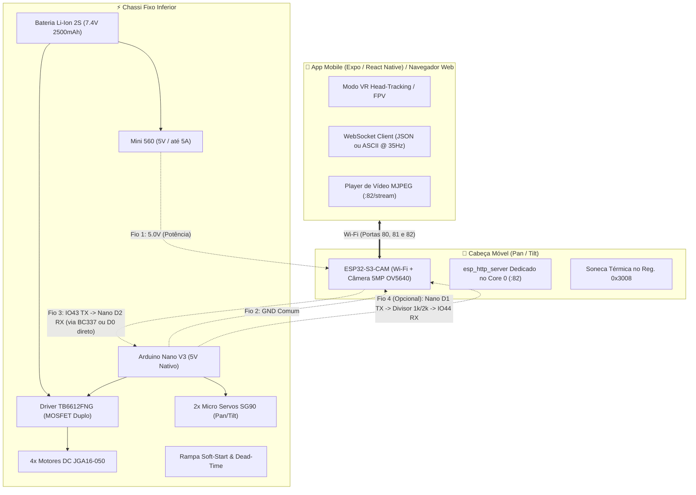

# 🤖 Rover Móvel ESP32-S3 4WD & Pan/Tilt VR

Robô explorador terrestre com **tração integral 4WD**, cabeça articulada **Pan/Tilt** com streaming de vídeo de baixa latência e controle mobile imersivo via **Realidade Virtual (VR Head-Tracking)**.

---

### 🟢 Status do Projeto: **Suíte de 6 POCs Validadas & Bancada Ativa**
* **Hardware:** Todos os componentes recebidos e operacionais na bancada de testes.
* **Firmware:** Suíte modular de **6 POCs incrementais** implementada e compilada com 100% de sucesso no PlatformIO, isolando testes de enlace serial, anti-rebolado dos servos, câmera fria (OV5640), transmissão e tração 4WD com rampa anti-reset.
* **Próximo Passo:** Testes de rodagem no chão e finalização da modelagem CAD 3D do chassi.

---

## 🏗️ Arquitetura do Sistema

O projeto adota uma arquitetura **distribuída em 2 microcontroladores**, interligados por um chicote ultra-flexível de **apenas 3 a 4 fios**:



---

## 🔬 Suíte dos 6 POCs (Testes de Bancada Independentes)

Cada subsistema foi desacoplado para testes isolados e seguros:

| POC | Descrição | Placa & Ambiente | O que testa / resolve |
|---|---|---|---|
| **POC 1** | [Enlace Serial RX/TX](file:///c:/Users/caihe/Documents/develop/rover/docs/pocs/GUIA_EXECUCAO_POCS.md#poc-1-teste-de-enlace-serial-rxtx-com-servidor-web) | `poc1_esp32` + `poc1_nano` | Medição de ping/RTT, taxa de entrega de 100% e diagnóstico de reset do Nano |
| **POC 2** | [Pan/Tilt Controlado (Sem Vídeo)](file:///c:/Users/caihe/Documents/develop/rover/docs/pocs/GUIA_EXECUCAO_POCS.md#poc-2-pantilt-controlado-sem-v%C3%ADdeo) | `poc2_esp32` + `poc2_nano` | Eliminação do "rebolado" via interpolação em microssegundos (50 Hz) e varredura lenta |
| **POC 3** | [Transmissão de Vídeo Fria](file:///c:/Users/caihe/Documents/develop/rover/docs/pocs/GUIA_EXECUCAO_POCS.md#poc-3-transmiss%C3%A3o-de-v%C3%ADdeo-fria-esp32-isolado) | `poc3_esp32` | Soneca no reg. `0x3008`, XCLK adaptativo (8–12 MHz) e servidor no Core 0 (câmera fria) |
| **POC 4** | [Pan/Tilt + Transmissão](file:///c:/Users/caihe/Documents/develop/rover/docs/pocs/GUIA_EXECUCAO_POCS.md#poc-4-pantilt--transmiss%C3%A3o-desempenho-da-imagem) | `poc4_esp32` + `poc2_nano` | Operação simultânea com modo Eco automático (cai para 5 FPS parado) e zero bloqueio |
| **POC 5** | [Teste Automático dos Motores](file:///c:/Users/caihe/Documents/develop/rover/docs/pocs/GUIA_EXECUCAO_POCS.md#poc-5-teste-autom%C3%A1tico-de-motores-4wd-bancada-com-rodas-no-ar) | `poc5_nano` (baud 115200) | Sequência autônoma de vai-e-volta, giros e rampa com medição de queda (*sag*) de bateria |
| **POC 6** | [Motores Controlados](file:///c:/Users/caihe/Documents/develop/rover/docs/pocs/GUIA_EXECUCAO_POCS.md#poc-6-motores-controlados-joystick-virtual--teclado) | `poc6_esp32` + `poc6_nano` | Pilotagem manual (joystick touch / teclado WASD), watchdog de 600ms e rampa anti-reset |

📖 **Consulte o [Guia Completo de Execução dos POCs](file:///c:/Users/caihe/Documents/develop/rover/docs/pocs/GUIA_EXECUCAO_POCS.md)** para instruções de compilação, gravação e checklist.

---

## 📂 Organização Limpa da Codebase

```
rover/
├── README.md                      # Visão geral, arquitetura e quickstart
├── AGENTS.md                      # Diretrizes obrigatórias e regras para agentes de IA
├── style.md                       # Perfil de engenharia, tom de bancada e preferências
├── platformio.ini                 # Configuração unificada de build de todos os ambientes
│
├── docs/                          # Documentação técnica central
│   ├── context.md                 # 📖 Memória técnica contínua e histórico completo do projeto
│   ├── pocs/                      # Documentação da suíte de 6 POCs incrementais
│   │   ├── README.md              # Índice dos POCs e tabela de ambientes
│   │   └── GUIA_EXECUCAO_POCS.md  # Manual prático de gravação e teste passo a passo
│   ├── hardware/                  # Especificações técnicas, desenhos com cotas e pinagens
│   │   ├── ESPECIFICACOES_TECNICAS.md
│   │   ├── tabela_pinagem_esp32_nano.xlsx
│   │   ├── PROJETO_CONEXOES_PLACA_PERFURADA.docx
│   │   ├── kicad/                 # Projetos de circuitos e esquemáticos KiCad
│   │   └── *.png                  # Desenhos técnicos oficiais (JGA-050, SG90, StickyMAX)
│   ├── guides/                    # Guias de engenharia aprofundados
│   │   ├── camera_calor_software.md          # ❄️ Otimização térmica do OV5640 via software
│   │   ├── ajuste_fino_servos_rebolado.md    # 🎯 Física e eliminação do rebolado nos servos SG90
│   │   ├── tracao_motores_anti_reset.md      # ⚡ Prevenção de Brown-Out e rampa 4WD na TB6612
│   │   ├── controle_servos_head_tracking_vr.md # Guia didático de servos e VR Head-Tracking
│   │   ├── http_vs_websocket_redes.md        # Análise comparativa de protocolos de rede
│   │   └── streaming_video_baixa_latencia.md # Pipeline de vídeo MJPEG e baixa latência
│   ├── compras/                   # Histórico de compras, orçamentos e fotos das lojas
│   └── references/                # Fotos reais dos produtos e montagens maker de referência
│
├── src/                           # Código-fonte do projeto
│   ├── firmware/                  # Códigos C++ / Arduino organizados por módulo
│   │   ├── comum/                 # Módulos compartilhados reutilizáveis (câmera, enlace, rampa, servos)
│   │   ├── pocs/                  # Códigos-fonte dos 6 POCs isolados
│   │   ├── gateway_app/           # Firmware de produção integrado ao App Mobile Expo
│   │   └── legado/                # Sketches e testes históricos arquivados
│   ├── app_mobile/                # Aplicativo Expo / React Native (VR, FPV e Dashboard)
│   └── servidor_relay/            # Servidor Node.js / Docker para teleoperação em nuvem
│
└── tools/                         # Ferramentas auxiliares e geradores Python
    └── scratch/                   # Scripts utilitários de apoio
```

---

## ⚡ Comandos de Compilação e Gravação (PlatformIO)

Substitua `COMx` pelas portas seriais reais conectadas:

```powershell
# Gravação do ESP32-S3 (Exemplo POC 4: Pan/Tilt + Câmera):
pio run -e poc4_esp32 -t upload --upload-port COM24

# Gravação do Arduino Nano (Exemplo POC 2/4: Servos Suaves):
pio run -e poc2_nano -t upload --upload-port COM18

# Teste autônomo dos motores (POC 5):
pio run -e poc5_nano -t upload --upload-port COM18
pio device monitor -e poc5_nano --port COM18
```

---

## ⚙️ Componentes Físicos Adquiridos & Validados

| Componente | Modelo / Especificação | Função no Rover |
| :--- | :--- | :--- |
| **Motores de Tração** | 4x **JGA16-050** (16mm, redução metálica, eixo D 3mm) | Tração 4WD com torque elevado |
| **Rodas** | 4x **StickyMAX S20 Macia (22mm)** com cubo alumínio CNC | Pneu de mini-sumô de altíssima aderência |
| **Placa de Visão** | **ESP32-S3-CAM N16R8** (16MB Flash, 8MB PSRAM, OV5640 5MP) | Câmera, Wi-Fi e WebSocket Server |
| **Placa de Potência** | **Arduino Nano V3** (ATmega328P, 5V nativo) | Comanda TB6612, servos, buzzer e lê bateria |
| **Driver de Motores** | **TB6612FNG** (Ponte H MOSFET dupla, 1.2A/canal contínuo) | Controle de velocidade PWM e sentido 4WD |
| **Mecanismo Pan/Tilt** | 2x Micro Servos **SG90 9g** (Torque 1.6 kgf·cm) | Orientação horizontal e vertical da câmera |
| **Regulador de Tensão** | Step-Down **Mini 560** (5V fixos / até 5A) | Linha de 5V estável para placas e servos |
| **Bateria** | Li-Ion **2S 7.4V 2500mAh** com placa BMS integrada | Alimentação geral do robô |

> 📌 **Vão Livre ao Solo (Ground Clearance):**
> $$\text{Raio da Roda (11 mm)} - \text{Raio do Motor JGA (8 mm)} = \mathbf{3{,}0\text{ mm}}$$
> *O chassi plástico não pode ter assoalho sob os motores; o motor deve ser abraçado por cima e laterais.*
