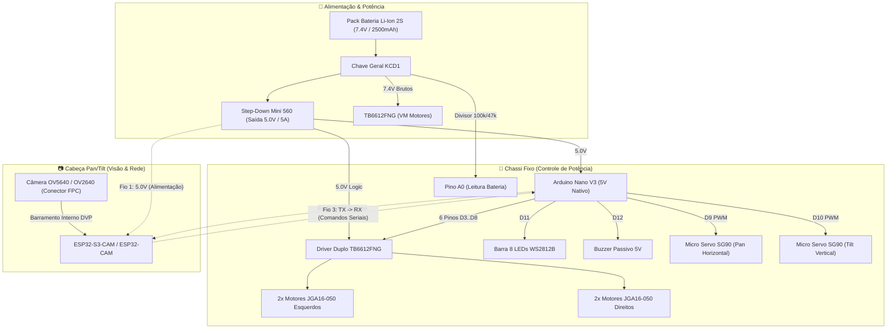

# 🤖 Robô Móvel ESP32 (4WD & Pan/Tilt)

Projeto de um robô móvel com tração nas 4 rodas e câmera com mecanismo Pan/Tilt, controlado via ESP32.

> **Regra Obrigatória para o Modelo / Memória Contínua do Projeto:**
> Este documento deve ser **incrementado e atualizado a cada troca de mensagens**. A ideia é que ele vá crescendo organicamente conforme conversamos e conforme o projeto anda.
> * Sempre registre aqui novas decisões, ideias validadas, respostas a dúvidas e o avanço real do projeto.
> * Mantenha os registros estritamente fiéis ao que foi de fato conversado, decidido ou testado (sem inventar esquemas elétricos prontos, pinagens definitivas ou códigos como se já estivessem funcionando enquanto ainda estamos na fase de planejamento).

---

## 📦 Componentes Comprados (Aguardando Chegada)

As compras foram finalizadas com os seguintes itens e especificações físicas:

* **Tração & Rodas (Dimensões Físicas):**
  * **4x Rodas:** Modelo **StickyMAX S20 Macia - 22 mm (RoboCore)**:
    * **Diâmetro externo:** **22 mm** (Raio = 11 mm do centro do eixo ao solo)
    * **Largura da banda:** **~12 mm**
    * **Furo de acoplamento:** **3 mm com perfil em D** (encaixe direto no eixo dos micromotores sem necessidade de parafusos adicionais)
    * **Pneu:** Silicone/borracha macia de altíssima aderência (padrão de mini sumô)
  * **4x Motores:** Motores DC com Caixa de Redução Metálica **série JGA-050 (JGA16-050)**:
    * **Diâmetro do motor:** Cilíndrico de **16 mm de diâmetro** (raio = 8 mm)
    * **Comprimento total:** ~30 mm a 35 mm (com caixa de redução toda metálica)
    * **Eixo de saída:** Aço com **perfil em D de 3 mm de diâmetro** e ~9 mm a 10 mm de comprimento
    * **Tensão nominal:** 6V a 12V (alimentado pelos 7.4V da bateria via TB6612FNG)
    * **Análise Geométrica com Rodas de 22 mm:**
      * Raio da roda de 22 mm = **11 mm** (altura do centro do eixo até o solo)
      * Raio do motor JGA-050 = **8 mm** (do centro do eixo ao fundo da carcaça)
      * **Vão livre sob o motor:** $11\text{ mm} - 8\text{ mm} = \mathbf{3\text{ mm}}$!
      * **Diretriz de Design 3D:** O chassi não deve ter assoalho fechado por baixo do motor; o motor deve ser abraçado por cima e pelas laterais, mantendo os **3 mm de folga livres** para o solo.
* **Placas de Controle:**
  * **ESP32-S3-CAM N16R8** (Mercado Livre - USB-C, 16MB Flash, 8MB PSRAM, Câmera 5MP OV5640)
  * **ESP32-CAM** (RoboCore - com câmera OV2640)
  * **Arduino Nano V3** (com cabo mini-USB)
* **Ponte H:**
  * Driver duplo MOSFET **TB6612FNG** (~20 mm x 20 mm, suporta até 1.2A contínuo por canal e lógica 3.3V)
* **Visão / Mecanismo Pan & Tilt:**
  * 2x Micro Servos **SG90 9g** (dimensões: 22.8 mm x 12.2 mm x 28.5 mm, torque de 1.6 kg·cm)
  * Suporte articulado de 2 eixos para os servos
* **Alimentação & Energia:**
  * **Pack Bateria Li-Ion 2S 7.4V 2500mAh com BMS integrado:** Dimensões aprox. **69 mm x 37 mm x 19 mm**, peso ~100g, com conector JST-RCY fêmea
  * **Regulador Step-Down Mini 560 5V:** Placa ultracompacta (30 mm x 18 mm x 5.5 mm) que rebaixa 7.4V para 5.0V fixos com até 5A
  * **Chave Geral Liga/Desliga:** Chave gangorra **KCD1-101 2T** (recorte para encaixe no painel 3D: **19 mm x 13 mm**)
* **Sinalização & Acessórios:**
  * Módulo **WS2812B com 8 LEDs RGB endereçáveis** (barra estreita de ~53 mm x 10 mm)
  * Módulo **Buzzer passivo 5V** (diâmetro ~12 mm)
  * Jumpers Fêmea-Fêmea e Macho-Macho (40 de cada)

---

## 📌 Decisões e Alinhamentos Feitos até Agora

1. **Linha ESP32:** Foco total no ecossistema ESP32 para controle e streaming de vídeo.
2. **Fabricação 100% em Impressão 3D:** Toda a estrutura física, chassi/case e suportes serão impressos em 3D.
3. **Mecânica do Pan & Tilt com a Câmera:**
   * O cabo flat da câmera é muito curto e frágil.
   * Decisão: Montar a própria placa ESP32 no berço móvel de inclinação vertical (Tilt), para que a câmera não sofra torção no cabo flat.
4. **Alimentação e Cuidados:**
   * Bateria de 7.4V precisa alimentar os motores (via TB6612FNG) e passar pelo Step-Down para gerar 5V para o ESP32 e servos.
   * Não sobrecarregar a placa tentando alimentar servos direto dos pinos do microcontrolador.
5. **Integração Carrinho + Pan/Tilt:**
   * O objetivo principal agora é fazer o carrinho se movimentar juntamente com a movimentação da câmera nos eixos Pan e Tilt.
6. **Separação de Imagens Técnicas vs. Inspirações Visuais:**
   * **Pasta de Imagens Importantes & Cotas ([`imagens_importantes/`](file:///home/usuario/Documentos/rover/imagens_importantes/ESPECIFICACOES_TECNICAS.md)):**
     * `desenho_tecnico_stickymax_22mm.png`: Desenho técnico oficial RoboCore com cotas do cubo de alumínio CNC, diâmetro externo (22 mm) e parafuso M3.
     * `desenho_tecnico_motor_jga16_050.png`: Planta de engenharia do motor JGA16-050 com diâmetro de 16 mm, eixo D 3 mm, furação M2 (10 mm) e o cálculo visual do vão livre de 3,0 mm.
     * `desenho_tecnico_micro_servo_sg90.png`: Cotas milimétricas completas do servo SG90 9g (22,8 x 12,2 x 28,5 mm, furação 28 mm).
     * `esquema_eletrico_chicote_esp32_nano.png`: Diagrama elétrico completo da separação Cabeça Pan/Tilt (ESP32) vs Chassi (Nano + TB6612 + Step-Down + Bateria 7.4V).
   * **Pasta de Inspirações Visuais & Produtos ([`inspiracoes/`](file:///home/usuario/Documentos/rover/inspiracoes/INSPIRACOES_CASE_E_PAN_TILT.md)):**
     * `roda_stickymax_s20_22mm.png`: Foto real do produto adquirido.
     * `motor_jga16_050_robocore.png`: Foto real do motor JGA16-050 adquirido na RoboCore (substituindo o antigo N20).
     * `suporte_pan_tilt_robocore.png`: Suporte articulado de 2 eixos para os servos SG90.
     * `pan_tilt_sg90_mechanism.jpg` e `esp32_cam_pan_tilt_assembled.jpg`: Montagens reais da comunidade maker como referência estética.
7. **Estilo Visual, Rodas 22 mm e Motores JGA-050 (Desafio dos 3 mm de Vão Livre):**
   * **Os motores JGA-050 cabem com as rodas de 22 mm, mas com folga justa de 3 mm:**
     * $11\text{ mm (roda)} - 8\text{ mm (motor JGA)} = 3\text{ mm}$ do chão.
     * **Solução na Impressão 3D:** O chassi abraça o motor de 16 mm por cima e pelos lados. A face inferior do motor fica exposta (sem plástico embaixo dele) para não "roubar" nenhum milímetro desses 3 mm.
     * **Compatibilidade Futura:** Como o eixo do JGA-050 é padrão de 3 mm com chanfro em D, se no futuro o usuário quiser andar em pisos irregulares ou tapetes mais altos, basta desencaixar as rodas de 22 mm e colocar rodas de 32 mm, aumentando o vão livre de 3 mm para 8 mm sem refazer o robô.
   * **Chassi Fechado/Carenado em 3D:** Corpo protegendo bateria e eletrônica internamente, com a cabeça móvel encapsulando o ESP32 (expondo apenas lente e barra de 8 LEDs).
8. **Cinemática Definida (Pan na Base e Tilt no Topo):**
   * **Ordem:** O servo de Pan (giro horizontal) fica parafusado na base do chassi, e o servo de Tilt (inclinação vertical) fica no braço móvel segurando a cabeça da câmera.
   * **Vantagens de Engenharia:**
     * Menor peso móvel: o servo de Tilt levanta apenas a caixinha da câmera (não precisa levantar o peso de outro motor).
     * Horizonte estável: ao virar para os lados mesmo com a câmera inclinada para baixo, o horizonte não tomba na diagonal (evita efeito indesejado de roll).
9. **Cubo de Alumínio e Proporção Visual das Rodas de 22 mm:**
   * **Cubo Já Incluso:** Verificado na ficha técnica da RoboCore que o item *StickyMAX Roda S20 22 mm* é um kit completo que já vem com o cubo usinado de alumínio 6351-T6 e o parafuso M3 sem cabeça.
   * **Dilema Estético (Proporção Roda vs Chassi):**
     * O chassi fechado terá cerca de 11 a 13 cm de comprimento e 4 a 5 cm de altura (para acomodar bateria de 19 mm, ESP32 e Pan/Tilt).
     * Rodas de **22 mm (2.2 cm)** resultam em proporção visual de "veículo tático sumô super rebaixado".
     * Se for desejada uma silhueta de "Rover de Exploração" mais imponente e com rodas maiores, a alternativa é imprimir aros de 32 mm a 36 mm em 3D diretamente para o eixo D de 3 mm com anéis O-ring ou TPU.
10. **Montagem da Roda Invertida (Sem Englobar a Caixa de Redução):**
    * **Orientação do Professor/Orientador:** Montar o cubo e a roda virados **para fora** do chassi.
    * **O que significa:** O motor JGA-050 e sua caixa de redução metálica de 16 mm ficam 100% alojados dentro do chassi; apenas o eixo D de 3 mm sai pela lateral. A roda é fixada na ponta do eixo, projetada para fora.
    * **Vantagem:** Elimina completamente o conflito de espaço entre o diâmetro da caixa de redução do motor e o miolo interno da roda, além de aumentar a bitola (estabilidade lateral) do robô.
11. **Arquitetura de Comunicação ESP32 + Arduino Nano (Serial RX/TX):**
    * **Por que a Câmera consome tantos pinos (16 GPIOs)?**
      * Câmeras como OV2640 e OV5640 usam o barramento paralelo DVP (Digital Video Port). A cada pulso de clock, 1 byte inteiro de pixel trafega por 8 pinos de dados paralelos (Y2 a Y9 / D0 a D7), somados a 3 pinos de sincronismo (PCLK, VSYNC, HREF), clock de 20MHz (XCLK), controle serial I2C (SIOD/SIOC) e pinos de energia (PWDN/RESET).
      * *Fonte Oficial:* Repositório oficial da Espressif [`espressif/esp32-camera` (`camera_pins.h`)](https://github.com/espressif/esp32-camera/blob/master/conversions/include/camera_pins.h).
      * No ESP32-CAM clássico, sobram literalmente apenas os pinos de Serial (GPIO 1 e 3) e o GPIO 16 livres.
    * **A Solução do Chicote Limpo de 3/4 Fios:**
      * O ESP32 fica na cabeça móvel (Pan/Tilt).
      * Em vez de descer uma dúzia de fios de motores, servos e chassi pela articulação móvel, descem **apenas 3 a 4 fios finos e flexíveis**:
        1. `5V` (Alimentação)
        2. `GND` (Terra comum)
        3. `TX` do ESP32 $\rightarrow$ ligado ao `RX` do Arduino Nano
        4. *(Opcional)* `RX` do ESP32 $\leftarrow$ vindo do `TX` do Nano (apenas se houver telemetria)
      * O **Arduino Nano fica fixo dentro do chassi**, recebendo os comandos seriais e comandando os 6 pinos do TB6612FNG, os 2 servos SG90, buzzer e iluminação sem qualquer disputa de pinos com a câmera.

## 🔌 12. Arquitetura Eletrônica & Planilha Oficial de Pinagem ([`tabela_pinagem_esp32_nano.xlsx`](file:///home/usuario/Documentos/rover/tabela_pinagem_esp32_nano.xlsx))

A planilha oficial separa explicitamente **o que é interno à placa (zero fios externos)**, **o que utiliza fios externos** e **campos técnicos de hardware (PWM, ADC, Nível Lógico, Boot/Strapping)**, deixando a coluna de observações 100% livre para anotações manuais pelo usuário:

* 📊 **Arquivo Oficial:** [`tabela_pinagem_esp32_nano.xlsx`](file:///home/usuario/Documentos/rover/tabela_pinagem_esp32_nano.xlsx)
  * **Aba 1: `S3_CAM_Sem_Nano`** $\rightarrow$ Configuração *Single-Board*: o ESP32-S3-CAM controla sozinho os 4 motores (modo 4 pinos TB6612), os 2 servos Pan/Tilt, a leitura analógica de bateria (ADC1) e os 8 LEDs WS2812B.
  * **Aba 2: `S3_CAM_Com_Nano`** $\rightarrow$ Configuração *Distribuída*: o ESP32-S3-CAM fica na cabeça móvel e envia comandos seriais via chicote ultra-leve de **3 fios** (`5V`, `GND`, `TX -> Nano RX`), deixando 6 GPIOs livres na cabeça.
  * **Aba 3: `ESP32_CAM_RoboCore`** $\rightarrow$ Mapeamento completo dos 16 pinos físicos do modelo clássico AI-Thinker / OV2640.
  * **Aba 4: `Arduino_Nano_Chassi`** $\rightarrow$ Mapeamento do Nano concentrando a potência e sensores no chassi em 5V nativo, com 8 pinos livres para expansões.

---

### 🗺️ Comparativo Visual das Arquiteturas

#### Opção A: Arquitetura Distribuída (Recomendada: ESP32 na Cabeça + Arduino Nano no Chassi)



* **Vantagens Principais:**
  * Pela articulação do Pan/Tilt passam **estritamente 3 fios finos e flexíveis** (`5V`, `GND` e `TX`).
  * Carga zero sobre os servos SG90 de 9g.
  * O Arduino Nano opera em 5V nativo (perfeito para os servos, LEDs e buzzer).
  * Sobram **7 GPIOs livres no ESP32** e **8 GPIOs livres no Nano** para sensores futuros.

---

#### Opção B: Arquitetura Single-Board (Apenas ESP32-S3-CAM, Sem Nano)

```mermaid
graph TD
    subgraph Bateria_Alimentacao ["🔋 Alimentação & Potência"]
        BAT["Pack Bateria Li-Ion 2S (7.4V)"]
        SW["Chave Geral KCD1"]
        STEP["Step-Down Mini 560 (5.0V / 5A)"]
        BAT --> SW --> STEP
        SW -->|7.4V| TB_VM["TB6612FNG (VM Motores)"]
    end

    subgraph ESP32_S3 ["🧠 ESP32-S3-CAM N16R8 (Central Única)"]
        STEP -->|5.0V| ESP_PWR["Pino 5V"]
        CAM["Câmera OV5640 (Trilhas Internas J2)"]
        
        %% Mapeamento dos 8 GPIOs Livres
        ESP_IO41["IO41 (PWM)"] -->|AIN1| TB["TB6612FNG (Modo 4 Pinos)"]
        ESP_IO42["IO42 (PWM)"] -->|AIN2| TB
        ESP_IO43["TX / IO43 (PWM)"] -->|BIN1| TB
        ESP_IO44["RX / IO44 (PWM)"] -->|BIN2| TB
        TB --> MOT_ALL["4x Motores JGA16-050"]
        
        ESP_IO21["IO21 (PWM 50Hz)"] --> SERVO_P["Servo SG90 Pan"]
        ESP_IO3["IO3 (PWM 50Hz)"] --> SERVO_T["Servo SG90 Tilt"]
        ESP_IO1["IO1 (ADC1_CH0)"] <--|Divisor 100k/33k| SW
        ESP_IO2["IO2 (DIN Digital)"] --> LEDS_RGB["Barra 8 LEDs WS2812B"]
    end
```

---

### 🧐 Análise Detalhada dos Pinos do ESP32-S3-CAM: Ocupados de Fábrica vs. Livres

A placa **ESP32-S3-CAM N16R8** possui 24 pinos nos seus dois headers (12 no Header J1 esquerdo + 12 no Header J2 direito). A divisão física e de hardware do circuito é a seguinte:

#### 1. Pinos Ocupados Naturalmente de Fábrica (16 Pinos):
* **Câmera OV5640 (Header J2 - 8 pinos de dados e sincronismo):**
  * `IO4` (SIOD / SDA I2C), `IO5` (SIOC / SCL I2C)
  * `IO6` (VSYNC), `IO7` (HREF)
  * `IO8` (D2), `IO9` (D1), `IO10` (D3), `IO11` (D0)
  * *Por que não podem ser usados para outra coisa?* O sensor OV5640 transmite vídeo em alta frequência pelo barramento paralelo DVP (Digital Video Port). Se qualquer fio de motor ou servo for soldado nesses pinos, o sinal elétrico de clock e imagem se corrompe e a câmera entra em falha imediata (`Camera init failed`).
* **Memória Octal PSRAM de 8MB:** A versão N16R8 utiliza PSRAM de 8 bits (OPI), que consome internamente os pinos `GPIO 33, 34, 35, 36 e 37` (esses pinos nem saem nos headers).
* **Porta USB-C Nativa:** Consome os pinos `IO19 (D-)` e `IO20 (D+)` para programação e Serial Monitor.
* **Botão BOOT Onboard:** Consome `IO0` (com resistor de pull-up soldado no PCB).
* **Alimentação & GND:** `5V`, `3V3` e 3 pinos de `GND`.

#### 2. Pinos que NÃO Estão Ocupados Naturalmente (Exatamente 8 GPIOs):
No Header J1 (lado esquerdo), os únicos pinos livres para periféricos do usuário são:
$$\mathbf{IO1,\ IO2,\ IO3,\ IO41,\ IO42,\ TX\ (IO43),\ RX\ (IO44)\ e\ IO21}$$

#### 3. O Dilema: O que acontece na prática?
* **Se você optar por NÃO usar o Arduino Nano:**
  * Você é obrigado a **usar 100% dos 8 pinos livres** do S3 (4 nos motores via TB6612, 2 nos servos, 1 no ADC da bateria e 1 na fita de LEDs).
  * **Zero pinos de folga:** Não sobra nenhum pino livre para adicionar sensores novos no futuro, e o buzzer sonoro precisa ser descartado.
* **Se você optar por USAR o Arduino Nano (Recomendado):**
  * O ESP32-S3 utiliza apenas **1 pino livre** (`TX`) para enviar as ordens de movimento ao Nano.
  * **Sobram 7 pinos livres no ESP32-S3** (na cabeça móvel, perfeitos para colocar sensor de distância a laser ToF VL53L0X, microfone I2S ou display).
  * **Sobram 8 pinos livres no Arduino Nano** (no chassi, para faróis adicionais, encoders nas rodas ou sensores de toque/fim de curso).

---

### ⚡ Engenharia Elétrica & Compatibilidade de Sinais

1. **Alimentação:**
   * **Bateria:** Pack Li-Ion 2S 7.4V nominal (8.4V totalmente carregada) com placa BMS de proteção integrada.
   * **Step-Down Mini 560:** Rebaixa de 7.4V/8.4V para **5.0V fixos com até 5A** de capacidade de corrente contínua/pico. Alimenta com folga o ESP32, o Nano, os servos SG90 e a barra de LEDs.
   * **Alimentação dos Motores:** O pino `VM` do TB6612FNG é ligado diretamente nos 7.4V da bateria (após a chave geral KCD1), aproveitando o torque máximo dos motores JGA16-050.
2. **Níveis Lógicos Serial (ESP32 3.3V $\rightarrow$ Arduino Nano 5V):**
   * O ESP32-S3 opera em **3.3V TTL**.
   * O microcontrolador ATmega328P do Arduino Nano (alimentado a 5.0V) possui tensão mínima de nível alto garantida ($V_{IH, min}$) de:
     $$V_{IH, min} = 0.6 \times V_{CC} = 0.6 \times 5.0\text{V} = \mathbf{3.0\text{V}}$$
   * Como a saída HIGH do ESP32 é de **3.3V** ($3.3\text{V} > 3.0\text{V}$), o Nano reconhece perfeitamente os pulsos seriais em seu pino RX **sem necessidade de qualquer conversor de nível lógico**.
   * Ao adotar o chicote simplex (apenas comandos do ESP32 para o Nano), o pino TX do Nano permanece desconectado, **eliminando a necessidade do divisor resistivo** de retorno.
3. **Divisores de Tensão para Medição de Bateria (ADC):**
   * **No ESP32-S3 (ADC1_CH0 no pino IO1):** Divisor com $R_1 = 100\text{ k}\Omega$ e $R_2 = 33\text{ k}\Omega$. Em 8.4V, a tensão na entrada ADC atinge $\approx 2.08\text{V}$, muito segura e dentro da faixa linear do conversor de 3.3V.
   * **No Arduino Nano (Pino A0):** Divisor com $R_1 = 100\text{ k}\Omega$ e $R_2 = 47\text{ k}\Omega$. Em 8.4V, a tensão na entrada atinge $\approx 2.68\text{V}$ (segura para o conversor de 5.0V de 10 bits).

---

### 📋 Estrutura das Colunas da Planilha Oficial

A planilha [`tabela_pinagem_esp32_nano.xlsx`](file:///home/usuario/Documentos/rover/tabela_pinagem_esp32_nano.xlsx) segue este padrão em todas as suas 4 abas:

| Coluna | Descrição Técnica |
|---|---|
| **Pino Físico** | Identificação física do conector na placa (ex: `J1-01`, `J2-05`, `P01`, `D3`, `A0`). |
| **Silk na Placa** | Nome impresso em serigrafia na placa (ex: `3V3`, `IO1`, `TX`, `RX0`). |
| **GPIO Nativo** | Identificador de hardware do chip (ex: `GPIO 1`, `PD3`, `-`). |
| **Ligação** | Classificação direta: **`Interno`** (trilhas da câmera, USB, botões), **`Fio Externo`** (chicote ou conectores), ou em branco se livre. |
| **Uso** | Função ativa do pino no robô (em branco para os pinos disponíveis). |
| **Suporta PWM?** | Capacidade de modulação PWM por hardware (`Sim (LEDC/MCPWM)` no S3; `Timer 0/1/2` no Nano; ou `Não`). |
| **ADC (Analógico)** | Capacidade analógica: destaca os pinos **`ADC1`** (compatíveis com Wi-Fi ativo) vs. `ADC2` (incompatíveis com Wi-Fi). |
| **Nível Lógico** | Tensão nominal do sinal (`3.3V`, `5.0V`, ou `Alimentação`). |
| **Boot / Strapping** | Alertas sobre pinos que afetam a inicialização (`IO0 Pull-up`, `Touch`, `JTAG`). |
| **Observações** | **100% em branco**, reservada para anotações personalizadas do usuário. |

---

## 🤖 13. Instruções para Agentes de IA ([`AGENTS.md`](file:///home/usuario/Documentos/rover/AGENTS.md))

Diretrizes permanentes documentadas no repositório para agentes de IA:
* **Política de Git:** Não execute comandos Git de forma automática a cada resposta durante as sessões de trabalho para preservar o histórico manual do usuário. O versionamento (`git add`, `git commit`, `git push`) deve ser realizado exclusivamente ao final das sessões quando comandado pelo usuário.
* **Memória Central:** Manter o `README.md` como a fonte central de verdade do projeto, atualizado a cada evolução.
* **Componentes Validados:** Motores JGA16-050 cilíndricos de 16 mm (nunca N20), rodas StickyMAX 22 mm com cubo CNC de alumínio incluso, vão livre de 3,0 mm, TB6612FNG e alimentação com Step-Down Mini 560.
* **Estrutura de Arquivos:** `imagens_importantes/` para especificações técnicas e desenhos com cotas milimétricas; `inspiracoes/` para fotos reais de produtos.

---

## 📚 14. Base de Conhecimento de Redes & Vídeo ([`knowledge/`](file:///home/usuario/Documentos/rover/knowledge/))

Artigos técnicos aprofundados sobre arquitetura de redes e otimização para controle em tempo real do robô:

* [**Protocolos de Rede no Robô: HTTP vs. WebSocket vs. WebRTC**](file:///home/usuario/Documentos/rover/knowledge/http_vs_websocket_redes.md):
  * **Não é FPV:** Arquitetura de teleoperação estritamente digital em redes IP (Wi-Fi local ou celular 4G/LTE).
  * Análise das três abordagens de rede: **HTTP/1.1** (REST e MJPEG), **WebSocket** (Full-Duplex TCP) e **WebRTC/RTSP** (UDP Datagramas).
  * Como cada protocolo se comporta tanto nos comandos de pilotagem quanto no streaming de vídeo.
  * Por que o WebSocket se consolidou como a arquitetura campeã no ESP32: equilibra latência mínima (**5-18 ms** em comandos e **40-65 ms** em vídeo com descarte de frames) sem sobrecarregar a CPU com criptografia pesada DTLS/ICE do WebRTC.
  * **Matriz de Trade-offs Completa:** Tabela comparando lado a lado transporte, overhead, latências, comportamento em perdas de pacotes no 4G/CGNAT e consumo de memória RAM do microcontrolador.
* [**Streaming de Vídeo de Baixa Latência**](file:///home/usuario/Documentos/rover/knowledge/streaming_video_baixa_latencia.md):
  * Diagramas e comparativos visuais de engenharia:
    * [`topologia_redes_wifi_local_vs_4g_remoto.png`](file:///home/usuario/Documentos/rover/knowledge/images/topologia_redes_wifi_local_vs_4g_remoto.png): Comparativo direto entre Wi-Fi Local (LAN direta) e Teleoperação 4G (com servidor Relay na nuvem para contornar CGNAT).
    * [`fluxo_streaming_mjpeg_buffer_vs_drop.png`](file:///home/usuario/Documentos/rover/knowledge/images/fluxo_streaming_mjpeg_buffer_vs_drop.png): Por que o descarte de frames atrasados (*Drop-Frame*) é mandatório no 4G para não pilotar o robô "olhando para o passado".
    * [`comparativo_visual_resolucoes_esp32.png`](file:///home/usuario/Documentos/rover/knowledge/images/comparativo_visual_resolucoes_esp32.png): Painel real 2x2 simulando a exibição em tela de celular/PC para QQVGA, QVGA, CIF e VGA.
    * [`comparativo_zoom_detalhe.png`](file:///home/usuario/Documentos/rover/knowledge/images/comparativo_zoom_detalhe.png): Zoom de 300% na pata da cadeira e no piso mostrando o grau exato de pixelização de borda em cada resolução.
  * Por que o ESP32 usa MJPEG por hardware dos sensores OV2640/OV5640 em vez de H.264.
  * Tabela de resoluções (QQVGA a UXGA), tamanhos de frame, FPS e latência (destaque para **QVGA 320x240 @ 25-30fps** como ideal para teleoperação e **CIF 400x296** para maior definição).
  * Otimizações de firmware: desativação do Wi-Fi Power Save (`WIFI_PS_NONE`), eliminação do algoritmo de Nagle (`TCP_NODELAY`), duplo buffer na PSRAM e separação de núcleos no FreeRTOS.

---

## 💻 15. Códigos de Teste & Firmware de Bancada ([`codes/`](file:///home/usuario/Documentos/rover/codes/))

Repositório de códigos e testes práticos de validação antes da montagem final:

* [**Teste de Comunicação Serial ESP32 ➔ Nano (LED)**](file:///home/usuario/Documentos/rover/codes/teste_serial_led_esp32_nano/README.md):
  * Firmware do ESP32 ([`esp32_web_tx.ino`](file:///home/usuario/Documentos/rover/codes/teste_serial_led_esp32_nano/esp32_web_tx/esp32_web_tx.ino)) criando rede Wi-Fi direta (`Rover-Control-Test`) e servindo interface web moderna com dark mode.
  * Firmware do Arduino Nano ([`nano_rx_led.ino`](file:///home/usuario/Documentos/rover/codes/teste_serial_led_esp32_nano/nano_rx_led/nano_rx_led.ino)) escutando na porta Serial física (pino RX / D0) a 115200 baud e chaveando o LED embutido D13.
  * Validação física da arquitetura de comunicação distribuída usando apenas 2 jumpers na bancada.
* [**Teste de Streaming de Vídeo Remoto ESP32 (WebSocket Relay)**](file:///home/usuario/Documentos/rover/codes/teste_streaming_remoto_esp32/README.md):
  * Extensão do `CameraWebServer` para envio de imagens do ESP32 via cliente WebSocket para um Servidor Relay intermediário (Node.js).
  * Permite visualizar a transmissão da câmera ao vivo de **qualquer outra rede ou internet celular 4G/LTE**, contornando o CGNAT da operadora.
  * Servidor Relay ([`server.js`](file:///home/usuario/Documentos/rover/codes/teste_streaming_remoto_esp32/server/server.js)) em Node.js e Express/WebSockets com interface em dark mode e HUD de telemetria (FPS, banda, resolução, latência, descarte de frames).
  * Firmware do ESP32 ([`esp32_camera_relay.ino`](file:///home/usuario/Documentos/rover/codes/teste_streaming_remoto_esp32/esp32_camera_relay/esp32_camera_relay.ino)) com suporte a ESP32-CAM e ESP32-S3-CAM (`camera_pins.h`).

---

## 🎯 Próximos Passos (Modelagem CAD 3D)

Com a eletrônica, pinagem e chicote 100% dimensionados, o próximo foco é o desenho das peças 3D:
1. **Chassi Inferior:**
   * 4 berços dos motores JGA16-050 abraçando-os por cima e pelas laterais, mantendo o vão livre inferior de 3,0 mm totalmente desobstruído.
   * Berço interno para a bateria Li-Ion 2S (69 x 37 x 19 mm).
   * Alojamento para o Step-Down Mini 560, driver TB6612FNG e Arduino Nano.
   * Encaixe traseiro para a chave gangorra KCD1-101 (recorte de 19 x 13 mm).
2. **Cabeça Pan/Tilt:**
   * Fixação do servo Pan no chassi e servo Tilt no braço móvel.
   * Caixa fechada para a placa ESP32, expondo apenas a lente da câmera e o rasgo frontal para os 8 LEDs WS2812B.
   * Canaleta central para passagem suave dos 3 fios do chicote flexível.


