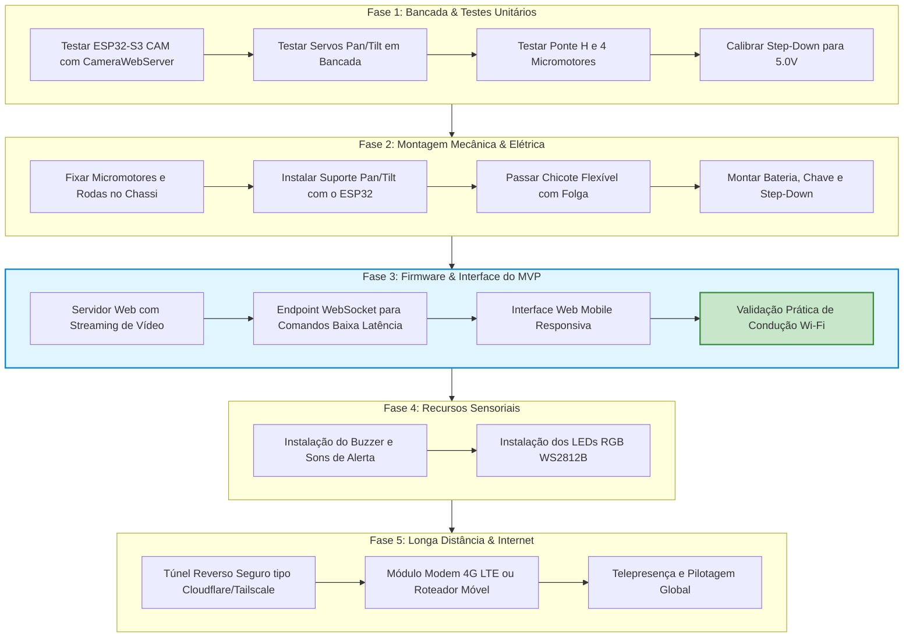

# 🗺️ Roadmap de Desenvolvimento - Robô Móvel ESP32-S3

Este documento estabelece o **plano de execução e marcos (milestones)** para o desenvolvimento do robô móvel. O foco primordial é a entrega rápida de um **MVP (Produto Mínimo Viável)** 100% funcional em rede Wi-Fi local antes de avançar para funcionalidades secundárias ou conexão de longa distância.

> 📚 **Documentos Relacionados:**
> * ⚡ [**`PROJETO_ELETRICA_E_PINAGEM.md`**](file:///home/usuario/Documentos/rover/PROJETO_ELETRICA_E_PINAGEM.md): Esquemático elétrico, barramentos de energia, pinagem do TB6612FNG e ESP32-S3.
> * 🏎️ [**`PROJETO_MECANICA_E_CASE.md`**](file:///home/usuario/Documentos/rover/PROJETO_MECANICA_E_CASE.md): Projeto do case de 2 andares, fixação mecânica do Pan/Tilt e alívio de cabos.
> * 🧠 [**`MEMORIA_DO_PROJETO.md`**](file:///home/usuario/Documentos/rover/MEMORIA_DO_PROJETO.md): Histórico completo de conversas, decisões técnicas e registros de engenharia.
> * 🏠 [**`README.md`**](file:///home/usuario/Documentos/rover/README.md): Visão geral do repositório.

---

## 🎯 1. Canvas do MVP (Visão Visual Rápida)

```
+---------------------------------------------------------------------------------------------------------+
|                                        CANVAS DO PROJETO - MVP                                          |
+------------------------------------+------------------------------------+-------------------------------+
| 1. OBJETIVO DO MVP                 | 2. HARDWARE DO MVP                 | 3. PILHA DE SOFTWARE          |
| • Robô 4WD comandado remotamente   | • ESP32-S3 CAM (N16R8 + OV5640)    | • Framework: Arduino/ESP-IDF  |
| • Streaming contínuo de vídeo      | • 4x Micromotores JGA-050 + Rodas  | • Web Server: AsyncWebServer  |
| • Câmera com Pan & Tilt 2 eixos    | • Driver TB6612FNG (MOSFET duplo)  | • Vídeo: Driver esp_camera    |
| • Operação em Wi-Fi Local (<60ms)  | • 2x Micro Servos 9g SG90          | • Interface: HTML5/JS Web App |
|                                    | • Li-Ion 7.4V 2500mAh + Step-Down  | • Comunicação: WebSockets     |
+------------------------------------+------------------------------------+-------------------------------+
| 4. INTERFACE DE CONTROLE (WEB APP) | 5. CRITÉRIO DE SUCESSO DO MVP      | 6. RECURSOS COMPRADOS         |
| • Joystick/botões na tela          | • Pilotagem fluida pelo celular    | • Iluminação RGB (WS2812B)    |
| • Janela de vídeo ao vivo (MJPEG)  | • Câmera apontando em tempo real   | • Feedback sonoro (Buzzer)    |
| • Controle tátil para Pan e Tilt   | • Zero travamentos ou brownouts    | • Arduino Nano como co-proc.  |
| • Telemetria de sinal Wi-Fi        | • Cabo flat da câmera protegido    |   opcional para tempo real    |
+------------------------------------+------------------------------------+-------------------------------+
```

---

## 📊 2. Diagrama de Fluxo de Fases



---

## 📅 3. Cronograma Detalhado por Etapas

### 📍 Fase 1: Bancada & Validação Isolada (Zero Risco)
*Objetivo: Testar cada módulo separadamente na mesa antes de parafusar no chassi.*
* [ ] **1.1 Câmera no ESP32-S3:** Carregar o exemplo oficial `CameraWebServer` da Espressif no ESP32-S3 CAM, ajustar os pinos do modelo da placa e validar o streaming de vídeo no navegador do celular.
* [ ] **1.2 Controle de Servos:** Criar um sketch simples em C++ variando o ângulo de 0° a 180° nos GPIOs dos servos para calibrar o ponto central (90°).
* [ ] **1.3 Rotação dos Motores:** Ligar a ponte H na bancada e acionar os motores para frente, ré e viragem para verificar a polaridade correta dos fios.
* [ ] **1.4 Tensão Segura:** Ajustar o trimpot do regulador Step-Down com multímetro exatamente em **5.00V** antes de conectar qualquer componente eletrônico.

---

### 📍 Fase 2: Montagem Físico-Mecânica
*Objetivo: Integrar os componentes de forma firme, limpa e com proteção mecânica.*
* [ ] **2.1 Montagem da Tração:** Parafusar os 4 suportes em "L", acoplar os micromotores e prender as rodas emborrachadas.
* [ ] **2.2 Montagem do Pan/Tilt:** Montar a estrutura de 2 eixos com os servos SG90 e fixar o ESP32-S3 na base superior móvel.
* [ ] **2.3 Chicote Elétrico com Alívio de Tensão:** Descer os fios de alimentação e sinal em formato de alça (arco flexível) para que o movimento de rotação (Pan) e inclinação (Tilt) não estique nenhum conector.
* [ ] **2.4 Distribuição de Massa:** Posicionar as baterias 18650 na parte central/baixa do chassi para garantir centro de gravidade baixo e estabilidade nas curvas.

---

### 📍 Fase 3: Firmware & Interface Unificada (Marco do MVP 🚀)
*Objetivo: Entregar o robô 100% funcional e pilotável via Wi-Fi.*
* [ ] **3.1 Arquitetura de Software Pronta no ESP32:**
  * O ESP32-S3 já possui suporte nativo por hardware para captura de vídeo em MJPEG via PSRAM.
  * O firmware unificado combina:
    1. **Streamer de Vídeo:** Rota HTTP contínua (`/stream`).
    2. **Servidor de Páginas:** Hospeda uma página web única e leve em HTML5/CSS/JavaScript.
    3. **Comunicação em Tempo Real:** Via **WebSocket** (`/ws`) para receber comandos de direção e posição dos servos com latência quase nula (<50ms).
* [ ] **3.2 Controles na Interface Web:**
  * Teclas virtuais ou Joystick analógico (W, A, S, D ou botões na tela sensível ao toque);
  * Sliders ou controle tátil para Pan (esquerda/direita) e Tilt (cima/baixo);
  * Exibição da taxa de quadros (FPS) e nível de sinal Wi-Fi (RSSI).
* [ ] **3.3 Validação de Campo:** Pilotar o robô dentro de casa/sala de aula via Wi-Fi local.

---

### 📍 Fase 4: Recursos Sensoriais & Feedback (Refinamento)
*Objetivo: Adicionar personalidade e sinalização ao robô.*
* [ ] **4.1 Feedback Sonoro (Buzzer):**
  * Beep duplo ao ligar e conectar no Wi-Fi;
  * Beep de marcha à ré ou buzina acionável pela interface web.
* [ ] **4.2 Iluminação Visual (LEDs WS2812B):**
  * Faróis dianteiros (luz branca para iluminar a câmera no escuro);
  * Lanternas traseiras (vermelho aceso ao frear ou dar ré);
  * Efeito pulsante indicando busca de conexão Wi-Fi.

---

### 📍 Fase 5: Conexão de Longa Distância & Telepresença (Pós-MVP)
*Objetivo: Controlar o robô de qualquer lugar do planeta pela internet.*
* [ ] **5.1 Arquitetura sem IP Público (Túnel Reverso):**
  * Uso de túnel seguro (ex: ngrok, Cloudflare Tunnel, Husarnet ou Tailscale) para expor a interface web sem precisar abrir portas no roteador residencial.
* [ ] **5.2 Conectividade Móvel:**
  * Uso de roteador Wi-Fi 4G portátil embarcado no robô ou hotspot de celular para permitir pilotagem externa em ruas, pátios e parques.
