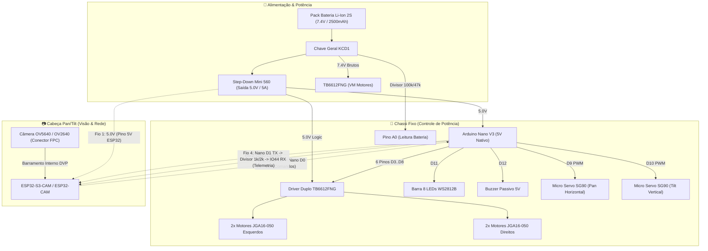

# 🤖 Robô Móvel ESP32 (4WD & Pan/Tilt)

Projeto de um robô móvel com tração nas 4 rodas e câmera com mecanismo Pan/Tilt, controlado via ESP32.

> **Regra Obrigatória para o Modelo / Memória Contínua do Projeto:**
> Este documento deve ser **incrementado e atualizado a cada troca de mensagens**. A ideia é que ele vá crescendo organicamente conforme conversamos e conforme o projeto anda.
> * Sempre registre aqui novas decisões, ideias validadas, respostas a dúvidas e o avanço real do projeto.
> * Mantenha os registros estritamente fiéis ao que foi de fato conversado, decidido ou testado (sem inventar esquemas elétricos prontos, pinagens definitivas ou códigos como se já estivessem funcionando enquanto ainda estamos na fase de planejamento).

---

## 📦 Componentes Físicos Adquiridos (Recebidos & em Bancada de Testes)

As compras foram finalizadas com os seguintes itens e especificações físicas:

* **Tração & Rodas (Dimensões Físicas):**
  * **4x Rodas:** Modelo **StickyMAX S20 Macia - 22 mm (RoboCore)**:
    * **Diâmetro externo:** **22 mm** (Raio = 11 mm do centro do eixo ao solo)
    * **Largura da banda:** **~12 mm**
    * **Furo de acoplamento:** **3 mm com perfil em D** (encaixe direto no eixo dos micromotores sem necessidade de parafusos adicionais)
    * **Pneu:** Silicone/borracha macia de altíssima aderência (padrão de mini sumô)
  * **4x Motores:** Motores DC com Caixa de Redução Metálica **série JGA-050 (JGA16-050)**:
    * **Diâmetro do motor:** Cilíndrico de **16 mm de diâmetro** (raio = 8 mm)
    * **Comprimento total:** ~30 mm a 35 mm (com caixa de redução toda metálica)
    * **Eixo de saída:** Aço com **perfil em D de 3 mm de diâmetro** e ~9 mm a 10 mm de comprimento
    * **Tensão nominal:** 6V a 12V (alimentado pelos 7.4V da bateria via TB6612FNG)
    * **Análise Geométrica com Rodas de 22 mm:**
      * Raio da roda de 22 mm = **11 mm** (altura do centro do eixo até o solo)
      * Raio do motor JGA-050 = **8 mm** (do centro do eixo ao fundo da carcaça)
      * **Vão livre sob o motor:** $11\text{ mm} - 8\text{ mm} = \mathbf{3\text{ mm}}$!
      * **Diretriz de Design 3D:** O chassi não deve ter assoalho fechado por baixo do motor; o motor deve ser abraçado por cima e pelas laterais, mantendo os **3 mm de folga livres** para o solo.
* **Placas de Controle:**
  * **ESP32-S3-CAM N16R8** (Mercado Livre - USB-C, 16MB Flash, 8MB PSRAM, Câmera 5MP OV5640)
  * **ESP32-CAM** (RoboCore - com câmera OV2640)
  * **Arduino Nano V3** (com cabo mini-USB)
* **Ponte H:**
  * Driver duplo MOSFET **TB6612FNG** (~20 mm x 20 mm, suporta até 1.2A contínuo por canal e lógica 3.3V)
* **Visão / Mecanismo Pan & Tilt:**
  * 2x Micro Servos **SG90 9g** (dimensões: 22.8 mm x 12.2 mm x 28.5 mm, torque de 1.6 kg·cm)
  * Suporte articulado de 2 eixos para os servos
* **Alimentação & Energia:**
  * **Pack Bateria Li-Ion 2S 7.4V 2500mAh com BMS integrado:** Dimensões aprox. **69 mm x 37 mm x 19 mm**, peso ~100g, com conector JST-RCY fêmea
  * **Regulador Step-Down Mini 560 5V:** Placa ultracompacta (30 mm x 18 mm x 5.5 mm) que rebaixa 7.4V para 5.0V fixos com até 5A
  * **Chave Geral Liga/Desliga:** Chave gangorra **KCD1-101 2T** (recorte para encaixe no painel 3D: **19 mm x 13 mm**)
* **Sinalização & Acessórios:**
  * Módulo **WS2812B com 8 LEDs RGB endereçáveis** (barra estreita de ~53 mm x 10 mm)
  * Módulo **Buzzer passivo 5V** (diâmetro ~12 mm)
  * Jumpers Fêmea-Fêmea e Macho-Macho (40 de cada)

---

## 📌 Decisões e Alinhamentos Feitos até Agora

1. **Linha ESP32:** Foco total no ecossistema ESP32 para controle e streaming de vídeo.
2. **Fabricação 100% em Impressão 3D:** Toda a estrutura física, chassi/case e suportes serão impressos em 3D.
3. **Mecânica do Pan & Tilt com a Câmera:**
   * O cabo flat da câmera é muito curto e frágil.
   * Decisão: Montar a própria placa ESP32 no berço móvel de inclinação vertical (Tilt), para que a câmera não sofra torção no cabo flat.
4. **Alimentação e Cuidados:**
   * Bateria de 7.4V precisa alimentar os motores (via TB6612FNG) e passar pelo Step-Down para gerar 5V para o ESP32 e servos.
   * Não sobrecarregar a placa tentando alimentar servos direto dos pinos do microcontrolador.
5. **Integração Carrinho + Pan/Tilt:**
   * O objetivo principal agora é fazer o carrinho se movimentar juntamente com a movimentação da câmera nos eixos Pan e Tilt.
6. **Separação de Imagens Técnicas vs. Inspirações Visuais:**
   * **Pasta de Imagens Importantes & Cotas ([`docs/hardware/`](file:///home/usuario/Documentos/rover/docs/hardware/ESPECIFICACOES_TECNICAS.md)):**
     * `desenho_tecnico_stickymax_22mm.png`: Desenho técnico oficial RoboCore com cotas do cubo de alumínio CNC, diâmetro externo (22 mm) e parafuso M3.
     * `desenho_tecnico_motor_jga16_050.png`: Planta de engenharia do motor JGA16-050 com diâmetro de 16 mm, eixo D 3 mm, furação M2 (10 mm) e o cálculo visual do vão livre de 3,0 mm.
     * `desenho_tecnico_micro_servo_sg90.png`: Cotas milimétricas completas do servo SG90 9g (22,8 x 12,2 x 28,5 mm, furação 28 mm).
     * `esquema_eletrico_chicote_esp32_nano.png`: Diagrama elétrico completo da separação Cabeça Pan/Tilt (ESP32) vs Chassi (Nano + TB6612 + Step-Down + Bateria 7.4V).
   * **Pasta de Inspirações Visuais & Produtos ([`docs/references/`](file:///home/usuario/Documentos/rover/docs/references/INSPIRACOES_CASE_E_PAN_TILT.md)):**
     * `roda_stickymax_s20_22mm.png`: Foto real do produto adquirido.
     * `motor_jga16_050_robocore.png`: Foto real do motor JGA16-050 adquirido na RoboCore (substituindo o antigo N20).
     * `suporte_pan_tilt_robocore.png`: Suporte articulado de 2 eixos para os servos SG90.
     * `pan_tilt_sg90_mechanism.jpg` e `esp32_cam_pan_tilt_assembled.jpg`: Montagens reais da comunidade maker como referência estética.
7. **Estilo Visual, Rodas 22 mm e Motores JGA-050 (Desafio dos 3 mm de Vão Livre):**
   * **Os motores JGA-050 cabem com as rodas de 22 mm, mas com folga justa de 3 mm:**
     * $11\text{ mm (roda)} - 8\text{ mm (motor JGA)} = 3\text{ mm}$ do chão.
     * **Solução na Impressão 3D:** O chassi abraça o motor de 16 mm por cima e pelos lados. A face inferior do motor fica exposta (sem plástico embaixo dele) para não "roubar" nenhum milímetro desses 3 mm.
     * **Compatibilidade Futura:** Como o eixo do JGA-050 é padrão de 3 mm com chanfro em D, se no futuro o usuário quiser andar em pisos irregulares ou tapetes mais altos, basta desencaixar as rodas de 22 mm e colocar rodas de 32 mm, aumentando o vão livre de 3 mm para 8 mm sem refazer o robô.
   * **Chassi Fechado/Carenado em 3D:** Corpo protegendo bateria e eletrônica internamente, com a cabeça móvel encapsulando o ESP32 (expondo apenas lente e barra de 8 LEDs).
8. **Cinemática Definida (Pan na Base e Tilt no Topo):**
   * **Ordem:** O servo de Pan (giro horizontal) fica parafusado na base do chassi, e o servo de Tilt (inclinação vertical) fica no braço móvel segurando a cabeça da câmera.
   * **Vantagens de Engenharia:**
     * Menor peso móvel: o servo de Tilt levanta apenas a caixinha da câmera (não precisa levantar o peso de outro motor).
     * Horizonte estável: ao virar para os lados mesmo com a câmera inclinada para baixo, o horizonte não tomba na diagonal (evita efeito indesejado de roll).
9. **Cubo de Alumínio e Proporção Visual das Rodas de 22 mm:**
   * **Cubo Já Incluso:** Verificado na ficha técnica da RoboCore que o item *StickyMAX Roda S20 22 mm* é um kit completo que já vem com o cubo usinado de alumínio 6351-T6 e o parafuso M3 sem cabeça.
   * **Dilema Estético (Proporção Roda vs Chassi):**
     * O chassi fechado terá cerca de 11 a 13 cm de comprimento e 4 a 5 cm de altura (para acomodar bateria de 19 mm, ESP32 e Pan/Tilt).
     * Rodas de **22 mm (2.2 cm)** resultam em proporção visual de "veículo tático sumô super rebaixado".
     * Se for desejada uma silhueta de "Rover de Exploração" mais imponente e com rodas maiores, a alternativa é imprimir aros de 32 mm a 36 mm em 3D diretamente para o eixo D de 3 mm com anéis O-ring ou TPU.
10. **Montagem da Roda Invertida (Sem Englobar a Caixa de Redução):**
    * **Orientação do Professor/Orientador:** Montar o cubo e a roda virados **para fora** do chassi.
    * **O que significa:** O motor JGA-050 e sua caixa de redução metálica de 16 mm ficam 100% alojados dentro do chassi; apenas o eixo D de 3 mm sai pela lateral. A roda é fixada na ponta do eixo, projetada para fora.
    * **Vantagem:** Elimina completamente o conflito de espaço entre o diâmetro da caixa de redução do motor e o miolo interno da roda, além de aumentar a bitola (estabilidade lateral) do robô.
11. **Arquitetura de Comunicação ESP32 + Arduino Nano (Serial RX/TX):**
    * **Por que a Câmera consome tantos pinos (16 GPIOs)?**
      * Câmeras como OV2640 e OV5640 usam o barramento paralelo DVP (Digital Video Port). A cada pulso de clock, 1 byte inteiro de pixel trafega por 8 pinos de dados paralelos (Y2 a Y9 / D0 a D7), somados a 3 pinos de sincronismo (PCLK, VSYNC, HREF), clock de 20MHz (XCLK), controle serial I2C (SIOD/SIOC) e pinos de energia (PWDN/RESET).
      * *Fonte Oficial:* Repositório oficial da Espressif [`espressif/esp32-camera` (`camera_pins.h`)](https://github.com/espressif/esp32-camera/blob/master/conversions/include/camera_pins.h).
      * No ESP32-CAM clássico, sobram literalmente apenas os pinos de Serial (GPIO 1 e 3) e o GPIO 16 livres.
    * **A Solução do Chicote Limpo de 3/4 Fios:**
      * O ESP32 fica na cabeça móvel (Pan/Tilt).
      * Em vez de descer uma dúzia de fios de motores, servos e chassi pela articulação móvel, descem **apenas 3 a 4 fios finos e flexíveis**:
        1. `5V` (Alimentação)
        2. `GND` (Terra comum)
        3. `TX` do ESP32 $\rightarrow$ ligado ao `RX` do Arduino Nano
        4. *(Opcional)* `RX` do ESP32 $\leftarrow$ vindo do `TX` do Nano (apenas se houver telemetria)
      * O **Arduino Nano fica fixo dentro do chassi**, recebendo os comandos seriais e comandando os 6 pinos do TB6612FNG, os 2 servos SG90, buzzer e iluminação sem qualquer disputa de pinos com a câmera.

* **Fase Atual (Bancada com Cabo USB Único):** É possível usar **apenas 1 cabo USB** ligado na placa principal (ex: USB-C do ESP32-S3-CAM). Basta puxar um jumper do pino **5V do ESP32 para o pino 5V do Nano** e outro do **GND para o GND**. Ambas as placas ligarão e se comunicarão perfeitamente na bancada.
* 📊 **Arquivo Oficial:** [`docs/hardware/tabela_pinagem_esp32_nano.xlsx`](file:///home/usuario/Documentos/rover/docs/hardware/tabela_pinagem_esp32_nano.xlsx)
  * **Aba 1: `S3_CAM_Sem_Nano`** $\rightarrow$ Configuração *Single-Board*: o ESP32-S3-CAM controla sozinho os 4 motores (modo 4 pinos TB6612), os 2 servos Pan/Tilt, a leitura analógica de bateria (ADC1) e os 8 LEDs WS2812B.
  * **Aba 2: `S3_CAM_Com_Nano`** $\rightarrow$ Configuração *Distribuída*: o ESP32-S3-CAM fica na cabeça móvel e envia comandos seriais via chicote ultra-leve de **3 fios** (`5V`, `GND`, `TX -> Nano RX`), deixando 6 GPIOs livres na cabeça.
  * **Aba 3: `ESP32_CAM_RoboCore`** $\rightarrow$ Mapeamento completo dos 16 pinos físicos do modelo clássico AI-Thinker / OV2640.
  * **Aba 4: `Arduino_Nano_Chassi`** $\rightarrow$ Mapeamento do Nano concentrando a potência e sensores no chassi em 5V nativo, com 8 pinos livres para expansões.

---

### 🗺️ Comparativo Visual das Arquiteturas

#### Opção A: Arquitetura Distribuída (Recomendada: ESP32 na Cabeça + Arduino Nano no Chassi)



* **Vantagens Principais:**
  * Pela articulação do Pan/Tilt passam **4 fios finos e flexíveis** (`5V`, `GND`, `TX` e `RX`).
  * O pino **5V do ESP32-S3-CAM** recebe a energia do Step-Down, alimentando o regulador interno da placa.
  * O pino **IO44 (RX)** do ESP32-S3-CAM é protegido por um divisor de tensão (1kΩ / 2kΩ) contra os 5V do Nano.
  * Carga zero sobre os servos SG90 de 9g.
  * O Arduino Nano opera em 5V nativo (perfeito para os servos, LEDs e buzzer).
  * Sobram **7 GPIOs livres no ESP32** e **8 GPIOs livres no Nano** para sensores futuros.

---

#### Opção B: Arquitetura Single-Board (Apenas ESP32-S3-CAM, Sem Nano)

```mermaid
graph TD
    subgraph Bateria_Alimentacao ["🔋 Alimentação & Potência"]
        BAT["Pack Bateria Li-Ion 2S (7.4V)"]
        SW["Chave Geral KCD1"]
        STEP["Step-Down Mini 560 (5.0V / 5A)"]
        BAT --> SW --> STEP
        SW -->|7.4V| TB_VM["TB6612FNG (VM Motores)"]
    end

    subgraph ESP32_S3 ["🧠 ESP32-S3-CAM N16R8 (Central Única)"]
        STEP -->|5.0V| ESP_PWR["Pino 5V"]
        CAM["Câmera OV5640 (Trilhas Internas J2)"]
        
        %% Mapeamento dos 8 GPIOs Livres
        ESP_IO41["IO41 (PWM)"] -->|AIN1| TB["TB6612FNG (Modo 4 Pinos)"]
        ESP_IO42["IO42 (PWM)"] -->|AIN2| TB
        ESP_IO43["TX / IO43 (PWM)"] -->|BIN1| TB
        ESP_IO44["RX / IO44 (PWM)"] -->|BIN2| TB
        TB --> MOT_ALL["4x Motores JGA16-050"]
        
        ESP_IO21["IO21 (PWM 50Hz)"] --> SERVO_P["Servo SG90 Pan"]
        ESP_IO3["IO3 (PWM 50Hz)"] --> SERVO_T["Servo SG90 Tilt"]
        ESP_IO1["IO1 (ADC1_CH0)"] <--|Divisor 100k/33k| SW
        ESP_IO2["IO2 (DIN Digital)"] --> LEDS_RGB["Barra 8 LEDs WS2812B"]
    end
```

---

### 🧐 Análise Detalhada dos Pinos do ESP32-S3-CAM: Ocupados de Fábrica vs. Livres

A placa **ESP32-S3-CAM N16R8** possui 24 pinos nos seus dois headers (12 no Header J1 esquerdo + 12 no Header J2 direito). A divisão física e de hardware do circuito é a seguinte:

#### 1. Pinos Ocupados Naturalmente de Fábrica (16 Pinos):
* **Câmera OV5640 (Header J2 - 8 pinos de dados e sincronismo):**
  * `IO4` (SIOD / SDA I2C), `IO5` (SIOC / SCL I2C)
  * `IO6` (VSYNC), `IO7` (HREF)
  * `IO8` (D2), `IO9` (D1), `IO10` (D3), `IO11` (D0)
  * *Por que não podem ser usados para outra coisa?* O sensor OV5640 transmite vídeo em alta frequência pelo barramento paralelo DVP (Digital Video Port). Se qualquer fio de motor ou servo for soldado nesses pinos, o sinal elétrico de clock e imagem se corrompe e a câmera entra em falha imediata (`Camera init failed`).
* **Memória Octal PSRAM de 8MB:** A versão N16R8 utiliza PSRAM de 8 bits (OPI), que consome internamente os pinos `GPIO 33, 34, 35, 36 e 37` (esses pinos nem saem nos headers).
* **Porta USB-C Nativa:** Consome os pinos `IO19 (D-)` e `IO20 (D+)` para programação e Serial Monitor.
* **Botão BOOT Onboard:** Consome `IO0` (com resistor de pull-up soldado no PCB).
* **Alimentação & GND:** `5V`, `3V3` e 3 pinos de `GND`.

#### 2. Pinos que NÃO Estão Ocupados Naturalmente (Exatamente 8 GPIOs):
No Header J1 (lado esquerdo), os únicos pinos livres para periféricos do usuário são:
$$\mathbf{IO1,\ IO2,\ IO3,\ IO41,\ IO42,\ TX\ (IO43),\ RX\ (IO44)\ e\ IO21}$$

#### 3. O Dilema: O que acontece na prática?
* **Se você optar por NÃO usar o Arduino Nano:**
  * Você é obrigado a **usar 100% dos 8 pinos livres** do S3 (4 nos motores via TB6612, 2 nos servos, 1 no ADC da bateria e 1 na fita de LEDs).
  * **Zero pinos de folga:** Não sobra nenhum pino livre para adicionar sensores novos no futuro, e o buzzer sonoro precisa ser descartado.
* **Se você optar por USAR o Arduino Nano (Recomendado):**
  * O ESP32-S3 utiliza apenas **1 pino livre** (`TX`) para enviar as ordens de movimento ao Nano.
  * **Sobram 7 pinos livres no ESP32-S3** (na cabeça móvel, perfeitos para colocar sensor de distância a laser ToF VL53L0X, microfone I2S ou display).
  * **Sobram 8 pinos livres no Arduino Nano** (no chassi, para faróis adicionais, encoders nas rodas ou sensores de toque/fim de curso).

---

### ⚡ Engenharia Elétrica & Compatibilidade de Sinais

1. **Alimentação:**
   * **Bateria:** Pack Li-Ion 2S 7.4V nominal (8.4V totalmente carregada) com placa BMS de proteção integrada.
   * **Step-Down Mini 560:** Rebaixa de 7.4V/8.4V para **5.0V fixos com até 5A** de capacidade de corrente contínua/pico. Alimenta com folga o ESP32, o Nano, os servos SG90 e a barra de LEDs.
   * **Alimentação dos Motores:** O pino `VM` do TB6612FNG é ligado diretamente nos 7.4V da bateria (após a chave geral KCD1), aproveitando o torque máximo dos motores JGA16-050.
2. **Níveis Lógicos Serial (ESP32 3.3V $\rightarrow$ Arduino Nano 5V):**
   * O ESP32-S3 opera em **3.3V TTL**.
   * O microcontrolador ATmega328P do Arduino Nano (alimentado a 5.0V) possui tensão mínima de nível alto garantida ($V_{IH, min}$) de:
     $$V_{IH, min} = 0.6 \times V_{CC} = 0.6 \times 5.0\text{V} = \mathbf{3.0\text{V}}$$
   * Como a saída HIGH do ESP32 é de **3.3V** ($3.3\text{V} > 3.0\text{V}$), o Nano reconhece perfeitamente os pulsos seriais em seu pino RX **sem necessidade de nenhum conversor de nível**.
   * **ESP TX → Nano RX com transistor NPN BC337 (TO-92, 1=C, 2=B, 3=E):** ESP GPIO43 → $R_1$ (1 kΩ) → base (pino 2); emissor (pino 3) → GND; coletor (pino 1) → Nano **D2** (RX) com pull-up de 10 kΩ ao +5V do Nano; GND do ESP e do Nano em comum. O transistor sobe o nível para 5V, mas **inverte o sinal**, então o Nano usa SoftwareSerial com lógica invertida (`SoftwareSerial(rx, tx, true)`). O sentido Nano → ESP não está desenhado no KiCad ainda.
   * **Projeto KiCad (KiCad 10, símbolos oficiais ESP32-S3-WROOM-1 / Arduino Nano / BC337):** [`hardware/kicad/rover_serial_bridge/`](file:///home/usuario/Documentos/rover/hardware/kicad/rover_serial_bridge/), gerado por [`tools/gerar_esquema_kicad.py`](file:///home/usuario/Documentos/rover/tools/gerar_esquema_kicad.py).
   * **Mini PCI THT para perfurada (17x10 furos, grade 2,54 mm):** `rover_serial_bridge.kicad_pcb` (gerada por [`tools/gerar_pcb_kicad.py`](file:///home/usuario/Documentos/rover/tools/gerar_pcb_kicad.py)) com J1 (+5V/GND/TX do ESP), R1 1k, Q1 BC337 (TO-92 largo), R2 10k e J2 (+5V/GND/D2 do Nano). As trilhas em B.Cu equivalem aos fios na placa perfurada. Prévias: `preview_3d.png`, `preview_top.png`, `preview_bottom.png` na pasta do projeto. DRC sem erros.
   * **Visualização Realista em Placa Perfurada (Com Nano e chicote do ESP):** Arquivo [`rover_perfboard_visual.kicad_pcb`](file:///home/usuario/Documentos/rover/hardware/kicad/rover_serial_bridge/rover_perfboard_visual.kicad_pcb) gerado por [`tools/gerar_perfboard_kicad.py`](file:///home/usuario/Documentos/rover/tools/gerar_perfboard_kicad.py). Mostra o Arduino Nano encaixado/soldado na perfurada, o conector J1 recebendo os fios que vêm do ESP32 (vermelho: 5V, preto: GND, amarelo: TX), o transistor BC337 e os resistores R1 e R2, com a fiação inferior simulada. Imagens salvas: [`preview_perfboard_3d.png`](file:///home/usuario/Documentos/rover/hardware/kicad/rover_serial_bridge/preview_perfboard_3d.png), [`preview_perfboard_top.png`](file:///home/usuario/Documentos/rover/hardware/kicad/rover_serial_bridge/preview_perfboard_top.png) e [`preview_perfboard_bottom.png`](file:///home/usuario/Documentos/rover/hardware/kicad/rover_serial_bridge/preview_perfboard_bottom.png).
3. **Divisores de Tensão para Medição de Bateria (ADC):**
   * **No ESP32-S3 (ADC1_CH0 no pino IO1):** Divisor com $R_1 = 100\text{ k}\Omega$ e $R_2 = 33\text{ k}\Omega$. Em 8.4V, a tensão na entrada ADC atinge $\approx 2.08\text{V}$, muito segura e dentro da faixa linear do conversor de 3.3V.
   * **No Arduino Nano (Pino A0):** Divisor com $R_1 = 100\text{ k}\Omega$ e $R_2 = 47\text{ k}\Omega$. Em 8.4V, a tensão na entrada atinge $\approx 2.68\text{V}$ (segura para o conversor de 5.0V de 10 bits).

---

### 📋 Estrutura das Colunas da Planilha Oficial

A planilha [`docs/hardware/tabela_pinagem_esp32_nano.xlsx`](file:///home/usuario/Documentos/rover/docs/hardware/tabela_pinagem_esp32_nano.xlsx) segue este padrão em todas as suas 4 abas:

| Coluna | Descrição Técnica |
|---|---|
| **Pino Físico** | Identificação física do conector na placa (ex: `J1-01`, `J2-05`, `P01`, `D3`, `A0`). |
| **Silk na Placa** | Nome impresso em serigrafia na placa (ex: `3V3`, `IO1`, `TX`, `RX0`). |
| **GPIO Nativo** | Identificador de hardware do chip (ex: `GPIO 1`, `PD3`, `-`). |
| **Ligação** | Classificação direta: **`Interno`** (trilhas da câmera, USB, botões), **`Fio Externo`** (chicote ou conectores), ou em branco se livre. |
| **Uso** | Função ativa do pino no robô (em branco para os pinos disponíveis). |
| **Suporta PWM?** | Capacidade de modulação PWM por hardware (`Sim (LEDC/MCPWM)` no S3; `Timer 0/1/2` no Nano; ou `Não`). |
| **ADC (Analógico)** | Capacidade analógica: destaca os pinos **`ADC1`** (compatíveis com Wi-Fi ativo) vs. `ADC2` (incompatíveis com Wi-Fi). |
| **Nível Lógico** | Tensão nominal do sinal (`3.3V`, `5.0V`, ou `Alimentação`). |
| **Boot / Strapping** | Alertas sobre pinos que afetam a inicialização (`IO0 Pull-up`, `Touch`, `JTAG`). |
| **Observações** | **100% em branco**, reservada para anotações personalizadas do usuário. |

---

## 🤖 13. Instruções para Agentes de IA ([`AGENTS.md`](file:///home/usuario/Documentos/rover/AGENTS.md))

Diretrizes permanentes documentadas no repositório para agentes de IA:
* **Política de Git:** Não execute comandos Git de forma automática a cada resposta durante as sessões de trabalho para preservar o histórico manual do usuário. O versionamento (`git add`, `git commit`, `git push`) deve ser realizado exclusivamente ao final das sessões quando comandado pelo usuário.
* **Memória Central:** Manter o `README.md` como a fonte central de verdade do projeto, atualizado a cada evolução.
* **Componentes Validados:** Motores JGA16-050 cilíndricos de 16 mm (nunca N20), rodas StickyMAX 22 mm com cubo CNC de alumínio incluso, vão livre de 3,0 mm, TB6612FNG e alimentação com Step-Down Mini 560.
* **Estrutura de Arquivos:** `docs/hardware/` para especificações técnicas e desenhos com cotas milimétricas; `docs/references/` para fotos reais de produtos.

---

## 📚 14. Base de Conhecimento de Redes & Vídeo ([`docs/guides/`](file:///home/usuario/Documentos/rover/docs/guides/))

Artigos técnicos aprofundados sobre arquitetura de redes e otimização para controle em tempo real do robô:

* [**Protocolos de Rede no Robô: HTTP vs. WebSocket vs. WebRTC**](file:///home/usuario/Documentos/rover/docs/guides/http_vs_websocket_redes.md):
  * **Não é FPV:** Arquitetura de teleoperação estritamente digital em redes IP (Wi-Fi local ou celular 4G/LTE).
  * Análise das três abordagens de rede: **HTTP/1.1** (REST e MJPEG), **WebSocket** (Full-Duplex TCP) e **WebRTC/RTSP** (UDP Datagramas).
  * Como cada protocolo se comporta tanto nos comandos de pilotagem quanto no streaming de vídeo.
  * Por que o WebSocket se consolidou como a arquitetura campeã no ESP32: equilibra latência mínima (**5-18 ms** em comandos e **40-65 ms** em vídeo com descarte de frames) sem sobrecarregar a CPU com criptografia pesada DTLS/ICE do WebRTC.
  * **Matriz de Trade-offs Completa:** Tabela comparando lado a lado transporte, overhead, latências, comportamento em perdas de pacotes no 4G/CGNAT e consumo de memória RAM do microcontrolador.
* [**Streaming de Vídeo de Baixa Latência**](file:///home/usuario/Documentos/rover/docs/guides/streaming_video_baixa_latencia.md):
  * Diagramas e comparativos visuais de engenharia:
    * [`topologia_redes_wifi_local_vs_4g_remoto.png`](file:///home/usuario/Documentos/rover/docs/guides/images/topologia_redes_wifi_local_vs_4g_remoto.png): Comparativo direto entre Wi-Fi Local (LAN direta) e Teleoperação 4G (com servidor Relay na nuvem para contornar CGNAT).
    * [`fluxo_streaming_mjpeg_buffer_vs_drop.png`](file:///home/usuario/Documentos/rover/docs/guides/images/fluxo_streaming_mjpeg_buffer_vs_drop.png): Por que o descarte de frames atrasados (*Drop-Frame*) é mandatório no 4G para não pilotar o robô "olhando para o passado".
    * [`comparativo_visual_resolucoes_esp32.png`](file:///home/usuario/Documentos/rover/docs/guides/images/comparativo_visual_resolucoes_esp32.png): Painel real 2x2 simulando a exibição em tela de celular/PC para QQVGA, QVGA, CIF e VGA.
    * [`comparativo_zoom_detalhe.png`](file:///home/usuario/Documentos/rover/docs/guides/images/comparativo_zoom_detalhe.png): Zoom de 300% na pata da cadeira e no piso mostrando o grau exato de pixelização de borda em cada resolução.
  * Por que o ESP32 usa MJPEG por hardware dos sensores OV2640/OV5640 em vez de H.264.
  * Tabela de resoluções (QQVGA a UXGA), tamanhos de frame, FPS e latência (destaque para **QVGA 320x240 @ 25-30fps** como ideal para teleoperação e **CIF 400x296** para maior definição).
  * Otimizações de firmware: desativação do Wi-Fi Power Save (`WIFI_PS_NONE`), eliminação do algoritmo de Nagle (`TCP_NODELAY`), duplo buffer na PSRAM e separação de núcleos no FreeRTOS.

---

## 💻 15. Códigos de Teste & Firmware de Bancada ([`src/firmware/`](file:///home/usuario/Documentos/rover/src/firmware/))

Repositório de códigos e testes práticos de validação antes da montagem final:

* [**Teste de Comunicação Serial ESP32 ➔ Nano (LED)**](file:///home/usuario/Documentos/rover/src/firmware/teste_serial_led_esp32_nano/README.md):
  * Firmware do ESP32 ([`esp32_web_tx.ino`](file:///home/usuario/Documentos/rover/src/firmware/teste_serial_led_esp32_nano/esp32_web_tx/esp32_web_tx.ino)) criando rede Wi-Fi direta (`Rover-Control-Test`) e servindo interface web moderna com dark mode.
  * Firmware do Arduino Nano ([`nano_rx_led.ino`](file:///home/usuario/Documentos/rover/src/firmware/teste_serial_led_esp32_nano/nano_rx_led/nano_rx_led.ino)) escutando na porta Serial física (pino RX / D0) a 115200 baud e chaveando o LED embutido D13.
  * Validação física da arquitetura de comunicação distribuída usando apenas 2 jumpers na bancada.

---

## 🎯 Próximos Passos (Modelagem CAD 3D)

Com a eletrônica, pinagem e chicote 100% dimensionados, o próximo foco é o desenho das peças 3D:
1. **Chassi Inferior:**
   * 4 berços dos motores JGA16-050 abraçando-os por cima e pelas laterais, mantendo o vão livre inferior de 3,0 mm totalmente desobstruído.
   * Berço interno para a bateria Li-Ion 2S (69 x 37 x 19 mm).
   * Alojamento para o Step-Down Mini 560, driver TB6612FNG e Arduino Nano.
   * Encaixe traseiro para a chave gangorra KCD1-101 (recorte de 19 x 13 mm).
2. **Cabeça Pan/Tilt:**
   * Fixação do servo Pan no chassi e servo Tilt no braço móvel.
   * Caixa fechada para a placa ESP32, expondo apenas a lente da câmera e o rasgo frontal para os 8 LEDs WS2812B.
   * Canaleta central para passagem suave dos 3 fios do chicote flexível.


## 🧪 Teste de Bancada: Painel Web de Pinos do Nano (código escrito, ainda NÃO testado)

* Pasta [`src/firmware/controle_pinos_nano_web/`](file:///home/usuario/Documentos/rover/src/firmware/controle_pinos_nano_web/):
  * [`nano_pinos_serial.ino`](file:///home/usuario/Documentos/rover/src/firmware/controle_pinos_nano_web/nano_pinos_serial/nano_pinos_serial.ino): Nano recebe comandos de texto (`M`, `W`, `P`, `S`, `D`, `A`, `X`) a 115200 baud e controla qualquer pino D2..D13/A0..A7 (digital, PWM, servo em qualquer pino, leitura).
  * [`esp32_painel_web.ino`](file:///home/usuario/Documentos/rover/src/firmware/controle_pinos_nano_web/esp32_painel_web/esp32_painel_web.ino): ESP32-S3-CAM sobe servidor web com painel genérico (escolhe o modo de cada pino na página, sem mudar o código). Cai em AP `Rover-Nano` se não achar o Wi-Fi.
* Ligação: 5V↔5V, GND↔GND, IO43(TX)→D0, D1→divisor 1k/2k→IO44(RX). Ao gravar o Nano, desconectar o fio em D0 e o jumper de 5V.

---

## 📱 16. Aplicativo Mobile & VR Head-Tracking ([`src/app_mobile/`](file:///home/usuario/Documentos/rover/src/app_mobile/))

* **Guia Acessível para Iniciantes:** [`docs/guides/controle_servos_head_tracking_vr.md`](file:///home/usuario/Documentos/rover/docs/guides/controle_servos_head_tracking_vr.md) (explica o funcionamento dos servos, giroscópio do celular, filtros EMA e prevenção de queima/tremedeiras).
* **Aplicativo Expo / React Native:** [`src/app_mobile/`](file:///home/usuario/Documentos/rover/src/app_mobile/)
  * **Modo Painel:** Diagnóstico, ajuste fino grau a grau e teste de tração 4WD.
  * **Modo FPV Touch:** Streaming de vídeo com mira HUD e botões de pilotagem na tela.
  * **Modo VR Head-Tracking (Side-by-Side):** Tela dividida para óculos VR (Cardboard/VR Box) onde o movimento da cabeça comanda os servos da câmera via WebSocket e giroscópio.

## Leitura cruzada do projeto — 2026-10-13

### Atualização de bancada e intenção de compras informadas pelo usuário

O usuário rejeitou o ESP32-C3 como compra conveniente e pediu a planilha da seleção UsinaInfo. Gerado `outputs/01a136bb-0898-72e1-a621-24d29689bee0/compra_usinainfo_rover.xlsx` com W5500 (1), ventoinha 5V 25mm (1), DS18B20 pequeno (2) e kit de 3 dissipadores (1), sem C3 nem thermal pad de outra loja. Quantidades/preços editáveis, totais por fórmula e links de produto. Total dos produtos: R$ 95,85 no cartão ou R$ 91,06 com desconto de boleto/depósito, sem frete, usando os preços consultados em 13/10/2026. Nenhum pedido foi finalizado; a criação da planilha não alterou os carrinhos do navegador.

Prioridade esclarecida: máxima qualidade possível de vídeo com segurança de performance e controle térmico. C3 sugerido apenas como auxiliar de testes, opcional, não upgrade do vídeo. Usuário compartilhou relatos do Reddit `1pg818g` e `1lqj78b` sobre aquecimento de OV5640; lidos como evidência de outros casos, sem diagnosticar a causa local. Não houve mudança nos carrinhos nem teste físico nesta etapa.

Pesquisa de compras em 13/10/2026: o usuário autorizou preparar até três carrinhos em lojas diferentes, com NF; Mercado Livre somente Full. Relatou câmera provavelmente OV5640 chegando a 70°C, sem instrumento/ponto de medição especificados, e interesse em thermal pad, ventoinha 5V e dissipador atrás da câmera. Foram montados carrinhos na sessão do navegador em UsinaInfo (R$ 124,45; boleto/depósito R$ 118,23), Eletrogate (R$ 56,60; Pix R$ 53,77) e RoboCore (R$ 62,52; Pix R$ 59,39), sem frete e sem finalizar pedidos. São alternativas com conteúdos diferentes, não compras aprovadas. Relatório com produtos, evidências, limitações térmicas e câmeras disponíveis: `docs/hardware/COMPRAS_CONEXAO_REFRIGERACAO.md`. Thermal pad Full localizado como referência adicional, sem quarto carrinho. Nenhuma substituição da câmera foi decidida nem compatibilidade física validada.

Correção de escopo pelo usuário: fonte de bancada, servos extras, fios, parafusos e barras de pinos já existem ou provavelmente existem no laboratório. A segunda compra deve focar componentes que acrescentem capacidades, principalmente alternativas de conexão e dissipação térmica. Há interesse explícito em experimentar UDP com o ESP32-S3-CAM. UDP por Wi-Fi pode ser testado com a placa atual sem módulo adicional; eventuais compras de Ethernet, segundo ESP ou modem celular são possibilidades, ainda não decisões.

Em 2026-10-13, o usuário esclareceu que está começando o projeto elétrico e pretende usar uma placa perfurada grande. Está preparando o teste do app com giroscópio em um mock de servos Pan/Tilt que fez; o funcionamento desse teste ainda não foi confirmado. Também começa a alinhar as próximas etapas e considera um segundo carrinho de compras para dissipação térmica, conexões e componentes para futuras expansões. Não há lista de compras aprovada. Prioridades sugeridas nesta conversa: montagem removível e cabeamento, filtragem de alimentação/ruído, proteção elétrica e instrumentos de diagnóstico; dissipadores e sensores adicionais dependem do espaço, das medições e da função desejada.

O usuário pediu compreender o projeto confrontando documentação e código, pois os documentos podem estar desatualizados. Esta leitura não executou testes físicos e não confirma qual firmware está gravado nas placas.

* Proposta: rover 4WD de teleoperação por rede IP, com câmera Pan/Tilt e app de pilotagem/VR com rastreamento da cabeça. Todos os componentes estão em mãos; o estágio informado continua sendo bancada e preparação de CAD.
* O app possui controle manual, DeviceMotion com filtro EMA, zona morta, centralização e modo VR duplicando a mesma câmera nos dois olhos. O serviço de sensores configura 40 Hz por padrão.
* `esp32_rover_ws.ino` implementa WebSocket e repasse serial, mas não inicializa a câmera nem oferece `/stream`. O app espera vídeo HTTP nesse caminho; os guias descrevem também vídeo binário por WebSocket, que não está implementado nesse firmware.
* Há incompatibilidade entre o gateway WebSocket (UART a 115200, ligação documentada em D0) e o Nano genérico atual (SoftwareSerial em D2 a 38400). O painel web de pinos usa 38400, compatível com a entrada desse Nano.
* O gateway envia `D_CMD <direção>`, mas o Nano genérico não implementa esse protocolo de tração nem o controle integrado do TB6612. Não considerar a tração pronta com essa combinação.
* O KiCad/contexto descreve uma interface BC337 que inverte o sinal para D2, enquanto o Nano atual instancia `SoftwareSerial(2, 3)` sem lógica invertida. É uma divergência entre circuito documentado e código; a montagem efetivamente usada precisa ser confirmada na bancada.
* O mock em `tools/mock_rover_server.js` gera vídeo sintético e bateria simulada. Isso auxilia desenvolvimento do app e não comprova streaming ou telemetria reais do rover.
* Documentos preservam versões antigas: chicote de 3 versus 4 fios, pinagem do ESP32-CAM clássico em especificações e descrições de testes como validados ou ainda não testados. Números de FPS/latência nos guias não foram verificados nesta leitura como medições do equipamento.


### Avaliação do KiCad para placa perfurada — 2026-10-13

Usuário deseja guia de montagem bem visível para placa perfurada. Inspecionados projeto existente e geradores em `hardware/kicad/rover_serial_bridge/` e `tools/`: representam somente interface serial BC337/Nano, não toda a eletrônica. A prévia superior oculta pinos do Nano e a inferior usa linhas brancas sem nomes das redes, com cruzamentos ambíguos. A grade visual não representa todos os furos físicos. Circuito prevê RX D2 invertido; firmware genérico lido usa `SoftwareSerial(2, 3)` sem inversão. Recomendação de apresentação: esquemático por blocos mais mapa físico em grade, com coordenadas, nomes dos pinos, fios identificados e vista inferior espelhada explícita. Dimensões e tipo de ilhas da placa real ainda precisam ser informados; nenhuma montagem foi validada ou circuito alterado nesta avaliação.

### Ampliação da planilha UsinaInfo — 2026-10-13

Usuário solicitou campo de prioridade, farol regulável com LED potente, sensor de tensão, OLED para bateria, microSD e controle próprio com tela em prioridade baixa. Informou possuir controle FlySky; esclareceu que buscava receptor, inicialmente chamado de ESC. Não foi decidido substituir TB6612 nem motores JGA. Receptor fica pendente do modelo/protocolo do transmissor; integração ao Nano e parada por perda de sinal ainda não foram implementadas ou testadas.

Atualizada a planilha existente com prioridades editáveis, situação e uso/compatibilidade, preservando anotações em branco. Cotados: sensor DC 0–25V (divisor 5:1, R$4,95 cartão), OLED I2C 0,96 (R$24,30), ESP32-S3 N8R2 para controle futuro (R$62,80), TFT ST7789 1,3 (R$34,70) e dois joysticks (R$5,95 cada), além dos quatro itens anteriores. Total parcial cotado R$234,50 cartão / R$222,79 Pix-boleto; sem frete. Cotados de prioridade alta R$56,20, média R$24,30, baixa R$154,00. Baixa inclui W5500 e controle futuro; não implica compra finalizada.

Cinco itens sem preço: cartão microSD 32GB, LED branco 3W (UsinaInfo indisponível), driver de corrente constante com DIM/PWM compatível com toda faixa da bateria 2S, dissipação dedicada do farol e receptor FlySky. XL4015 CC/CV pesquisado exige entrada de 8V e não foi escolhido para 2S; LED branco 10W da loja exige 10–12V e tampouco foi escolhido. Não inventar cotação nem tratar o farol como conjunto já compatibilizado. Cartão microSD não localizado na busca da UsinaInfo; confirmar slot e GPIO da placa física antes de comprar leitor adicional.

Alternativa somente consultada, sem criar outro carrinho: W5500 Mercado Livre produto MLB42965922 / oferta MLB5834894252, R$57,00, com “Armazenado e enviado pelo Full” verificado no navegador. UsinaInfo segue mais barata antes do frete (R$44,60). Ethernet é cabeada: ESP32-S3 comunica por SPI com W5500 e cabo RJ45 vai ao roteador/switch. TCP/UDP suportados; UDP no Wi-Fi existente dispensa compra. Taxa Ethernet nominal não garante FPS nem taxa útil através de SPI. Nenhum teste físico, pedido finalizado ou operação Git nesta etapa.

### Conectividade de longa distância esclarecida — 2026-10-13

Usuário esclareceu que a expansão de conexão deve fornecer internet ao ESP32-S3 para operação remota em qualquer local com cobertura, por exemplo 4G. Ethernet/W5500 por si só não satisfaz essa necessidade e deve permanecer experimento de bancada, não compra central de longa distância. Caminho inicial recomendado: celular em hotspot para validar arquitetura remota; depois roteador/hotspot LTE com SIM e Wi-Fi 2,4GHz embarcado. Alternativa integrada: modem LTE Cat4 SIM7600 ou semelhante via USB/PPP, verificando placa, bandas, alimentação e firmware. Nenhum modem específico comprado/validado. Internet no rover é apenas parte da solução: app/gateway atual local precisa adaptação para conexão de saída a servidor/relay ou VPN adequada para acesso remoto; não assumir acesso público direto em rede celular. Não foi alterada a planilha nesta explicação.


### Distribuição na perfurada 90 × 150 mm — 2026-10-13

Usuário confirmou placa de 9 × 15 cm com ilhas isoladas e desejo de montar componentes nela. Criado rascunho físico em `docs/hardware/kicad/rover_perfurada_90x150/` com contorno, grade assumida de 2,54 mm e reservas para Nano, TB6612, Mini 560 e conectores. Prévia superior PNG e arquivo KiCad reaberto pelo parser local; 1.972 ilhas sem rede e zero trilhas. Não é esquemático completo nem guia de soldagem: medidas dos módulos, posição real dos furos e pinagens precisam de confirmação. ESP32 permanece na cabeça móvel.


### Esquemático com conexões e chicote de três fios — 2026-10-13

Usuário corrigiu o escopo: deseja esquemático com fios/conexões, não apenas distribuição. Confirmou alimentação adicional ao TX e GND: chicote de três fios (+5V, GND, IO43 TX), ESP fora da perfurada. Criado `docs/hardware/kicad/rover_perfurada_90x150/rover_conexoes.kicad_sch`, com PDF/PNG, mostrando alimentação, Nano, TB6612, quatro motores em pares paralelos, servos, LEDs e divisor 10k/4k7 no A0. Adotado D0/RX conforme arquitetura permanente; firmware genérico D2 não foi alterado e divergência aparece no desenho. Novo esquema não usa BC337 no TX. Símbolos são módulos/terminais funcionais, não footprints nem posição física dos pinos. Exportado por KiCad 10.0.7; principais redes conferidas via netlist XML. Buzzer permanece pendente de confirmar se módulo de três pinos ou dispositivo de dois terminais. Nenhuma ligação ou corrente validada em bancada; mapa físico com furos/fios depende dos headers reais.


### Simplificação solicitada do esquema — 2026-10-13

Usuário pediu sem buzzer, sem barra de pinos e somente o principal. Atualizados esquema/PDF/PNG e rascunho físico para alimentação, Nano, TB6612, quatro JGA-050, dois SG90 e ESP externo por três fios. Omitidos buzzer, LEDs e divisor A0 do esquema simplificado; não implica retirada desses itens da arquitetura futura. Servos representados como S1/S2 e bateria BT1, sem símbolos de conectores adicionais. Pares de motores agora têm fios explícitos e junções. KiCad 10.0.7 exportou desenho e netlist; conferidas 17 redes e 12 componentes. Continua esquema funcional, sem roteiro físico por furo e sem validação de bancada; firmware D2 não alterado. Pedido anterior de identificação do buzzer ficou sem necessidade nesta versão.


### Correção: inversor e fios na perfurada — 2026-10-13

Usuário cobrou inversor RX/TX e diagrama físico de montagem, ausentes da versão anterior. Restaurado circuito IO43 → R1 1k → base BC337; emissor GND; coletor D2 + R2 10k ao 5V. Chico­te de três fios permanece. D2 reservado ao RX invertido; STBY proposto em D12. Para evitar conflito de TX SoftwareSerial com PWM D3, documentada declaração `SoftwareSerial entrada(2, A1, true)`/38400 com A1 sem ligação e reservado. Firmware não alterado, teste não realizado. Esta versão substitui a proposta direta D0 em resposta ao pedido explícito do usuário.

Mapa físico criado com 36 fios isolados, Nano padrão, R1/R2/BC337, grade e ilhas identificadas; topo e lado de solda espelhado em `docs/hardware/kicad/rover_perfurada_90x150/montagem_superior.png` e `montagem_inferior.png`; tabela CSV com coluna/linha de cada ponta. Fios são gráficos em camadas técnicas do KiCad, não trilhas de PCB. Conferidos netlist do esquema e redes das pontas; placa reaberta com 1972 ilhas. TB/Mini representados por ilhas auxiliares, não ordem de pads do breakout: ligações curtas módulo→ilha ainda dependem do módulo real. Usuário informou TB6612FNG (chip; versão da placa desconhecida) e link Mini 560 RoboCore, consultado: 29 × 18 × 5,4 mm. Não declarar pinagens físicas/montagem validadas.

### Pesquisa 4G para compra antecipada — 13/10/2026

Orçamento do laboratório vai até dezembro; usuário deseja adquirir agora componentes de iterações futuras. Prioridade de compra não é a etapa de implementação. Pesquisa no Mercado Livre com filtro Full não confirmou SIM7600 adequado (resultados exibiam módulos não celulares). Não afirmar inexistência global de ofertas.

Melhor candidato nacional encontrado: Curto Circuito A7608SA-H Cat4 em placa, antena LTE inclusa, SKU18609, em estoque verificado no navegador, R$448 cartão / R$403,20 Pix-boleto, sem frete: https://curtocircuito.com.br/modulo-a7608sa-h-4g-lte-antena-fcp.html . Loja informa nota fiscal na página inicial e termos. Placa anunciada 5–16V e UART TTL3,3V; núcleo SIMCom isolado é 3,4–4,2V, não confundir alimentações. Fabricante suporta PPP/USB, B3/B7/B28 entre outras; compatibilidade USB/firmware e GPIO19/20 na S3-CAM não confirmada localmente. Candidato, não plug-and-play validado. Loja inverte uplink/downlink em uma lista; valores corretos SIMCom: até150Mbps down /50Mbps up celulares nominais, não taxa real do ESP. https://www.simcom.com/product/A7608SA-H.html .

Magalu/nocnocestadosunidos Waveshare SIM7600G-H HAT(B): R$838,19 Pix/R$882,30 cartão, importado, página informa NF, antenas LTE/GPS e cabo. https://www.magazineluiza.com.br/modulo-4g-hat-waveshare-sim7600g-h-lte-gnss-para-raspberry-pi/p/eaf5f2ka89/in/ardn/ . Modelo(B) possui hubUSB; não considerar compatível automaticamente com stack USB do S3. Não escolhido.

Albacore SIM7600G-H MiniPCIe R$537,92/3estoque segundo página indexada; é módulo de integração, exige carrier/adaptador/SIM/antenas e NF não verificada; excluído da recomendação fechada. Curto SIM7600SA Cat1 R$660 esgotado; não escolhido.

W5500 da seleção UsinaInfo é Ethernet SPI/RJ45, sem SIM nem rádio4G. Pode receber internet de roteador4G com portaLAN, mas não converte modemUSB/serial em Ethernet e não é necessário para modem direto. Permanece baixa prioridade experimental. Não alterada planilha nem carrinhos, nenhum pedido finalizado.

### 4G incluído na planilha — 13/10/2026

Usuário autorizou adicionar A7608SA-H na planilha. Adicionado bloco separado Curto Circuito, prioridade de compra alta / uso futuro, 1unidade R$448 cartão ou R$403,20 Pix-boleto, sem aplicar desconto UsinaInfo à outra loja. Totais UsinaInfo preservados. Total geral parcial cotado R$682,50 cartão /R$625,99 à vista, sem frete/plano e sem cinco itens ainda sem cotação. Arquivo existente atualizado, não houve pedido nem novo carrinho.

Oferta Mercado Livre encontrada por busca do modelo exato: https://www.mercadolivre.com.br/modulo-gsm-a7608sah-4g-lte-com-antena-fcp/up/MLBU2311204429 , itemMLB3669224895, loja oficial Curto Circuito, 4disponíveis e R$427,51 na consulta. Descrição informa NF. Seção de entrega não confirma Full; badgesFull observados pertencem a recomendações de outros produtos, não ao modem. Link registrado como alternativa na planilha, fora dos totais, não elegível sob critério Full atual. Não afirmar que não existe no ML. Compatibilidade USB/PPP com a S3-CAM ainda não validada.

### Alternativa 4G Full — 13/10/2026

Usuário reafirmou que anúncio ML semFull não é elegível. Encontrado dongle hotspot Athenix, produtoMLB45000536/ofertaMLB4208432419, vendedorRAXON, R$144,95; “Armazenado e enviado pelo Full” verificado na seção de compra do próprio anúncio, não em recomendações. USB fornece alimentação; anúncio informa hotspot Wi-Fi802.11b/g/n, SIMmicro, 93,7mm/30g, taxas celulares nominais150/50Mbps. Conexão planejada ao S3 viaWi-Fi, não integraçãoUSB-PPP. Bandas LTE específicas/B28 e comprovaçãoNF individual não expostas na ficha consultada; compatibilidade de cobertura/performance não validada. Alternativa mais barata a avaliar, sem assumir equivalente ao móduloCat4 de desenvolvimento. URL: https://www.mercadolivre.com.br/modem-4g-usb-lte-notebook-wifi-compartilhamento-cor-branco-athenix/p/MLB45000536?pdp_filters=item_id%3AMLB4208432419%7Cshipping%3Afulfillment . Nenhum pedido/carrinho ou alteração da planilha nesta pesquisa.

### Avaliação aprofundada 4G — 13/10/2026

Usuário pediu avaliar confiabilidade, compatibilidade comcase e trade-off de compra. Ao perguntar medidas esclareceu que esperava módulo, não modem comcarcaçaUSB; caminhohotspot foi explicado como alternativa diferente, não substituição implícita. Relatório salvo docs/hardware/AVALIACAO_4G_ROVER.md. AthenixFullR$144,95 tem reviews4,6/56 mas bandas/corrente/limite térmico desconhecidos; relatoClaro não funcionar semcausa. Não recomendado como solução principal validada. SIM7000GFullR$332,50 encontrado, mas uploadCatM375kbps inadequado para vídeo contínuo. A7670SACurtoR$337,50Pix esgotado. A7608 mantém candidato documentado, não compatibilidadeUSB comprovada; Cat4não garante vazãoESP. Não encontradoCAD comcotas internas finais. Nenhum teste/pedido ou nova alteração da planilha.

### Consolidação Multiloja da Planilha de Compras — 13/10/2026

Usuário pontuou a impossibilidade de edição remota direta no Google Sheets sem autenticação e questionou os itens sem links/indisponíveis na UsinaInfo (microSD, farol 3W, driver PWM, dissipador e receptor FlySky). Solicitou cotar esses itens em outras lojas para fechar a compra completa de expansão e periféricos.

Em revisão subsequente, usuário questionou a real necessidade do módulo Ethernet W5500, a utilidade de uma antena Wi-Fi 2.4GHz 3dBi externa e determinou a retirada do ESP32-S3 adicional (já possuímos ESP32-S3-CAM e ESP32-CAM em bancada). Solicitou checagem em tempo real de estoque de todos os itens.

Decisões de engenharia e estoque validadas:
1. **Módulo Ethernet W5500:** Descartado da compra. O Rover é um veículo móvel sem fio; passar cabo de rede RJ45 limita a locomoção, e em bancada o Wi-Fi e o cabo USB já resolvem todos os testes de rede/streaming.
2. **Antena Wi-Fi 2.4GHz 3dBi com Pigtail U.FL (IPEX1) para SMA Fêmea:** Inclusa na UsinaInfo (SKU `04933`, R$ 26,51 cartão / R$ 25,18 Pix). Altamente útil: a antena de cerâmica/PCB interna do ESP32 perde muito sinal dentro do chassi fechado ou com obstáculos. A antena externa de 3dBi melhora o RSSI, estabiliza a taxa de quadros (FPS) do streaming MJPEG e reduz o drop-frame de vídeo.
3. **ESP32-S3 DevKitC-1 N8R2:** Removido definitivamente da lista conforme determinação do usuário.
4. **Checagem de Estoque em Tempo Real:**
   - **UsinaInfo:** Todos os 8 itens listados estão com botão de compra ativo e estoque confirmado (Cooler 25mm, 2x DS18B20, Dissipadores autoadesivos, Sensor de tensão 0-25V, Antena Wi-Fi 3dBi, OLED 0.96", TFT 1.3" e 2x Joysticks). Subtotal UsinaInfo: R$ 153,62 cartão / R$ 145,94 Pix.
   - **Mercado Livre:** 4 itens ativos (SanDisk 32GB Full, Kit 5x LEDs 3W com estrela 20mm, Driver LED PT4115 700mA PWM e Receptor FlySky FS-iA6B). Subtotal ML: R$ 168,20.
   - **Curto Circuito:** Módulo A7608SA-H 4G Cat-4 com estoque confirmado (SKU `18609`). Subtotal: R$ 448,00 / R$ 403,20 Pix.
   - **Total Consolidado Atual:** **R$ 769,82 no Cartão** ou **R$ 717,34 no Pix/Boleto** (economia à vista de R$ 52,48).

5. **Revisão Mercado Livre (Meli):**
   - Todos os itens do Mercado Livre foram reclassificados para **Prioridade Baixa** conforme decisão do usuário.
   - O **driver de corrente constante** foi removido da lista de compras.
   - Os links do Mercado Livre foram configurados com o parâmetro oficial `pdp_filters=shipping:fulfillment`, abrindo direto na listagem exclusiva de produtos com entrega **Full** e frete rápido.
   - Subtotal Mercado Livre (3 itens: SanDisk 32GB Full, Kit 5x LEDs 3W estrela Full, Receptor FlySky FS-iA6B Full): R$ 149,70.
   - **Novo Total Geral Consolidado:** **R$ 751,32 no Cartão** ou **R$ 698,84 no Pix/Boleto** (economia à vista de R$ 52,48).

Planilha física `docs/hardware/compras_rover_reorganizado.xlsx` atualizada com as 4 abas corrigidas e fórmulas ajustadas. Nenhum pedido finalizado ou comando Git executado.


### Revisão da compra reorganizada — 13/10/2026

Revisada e corrigida docs/hardware/compras_rover_reorganizado.xlsx (4 abas), diferente da planilha antiga emoutputs. Usuário pediu revisar tudo. Preservadas prioridades, quantidades, estrutura e valoresML como estimativas; não restauradas compras removidas. AntenaWiFi corrigida para Usina08359, URL5259, R$11,80 cartão/R$11,21Pix em vez de código04933/link4933/R$26,51. CompatibilidadeU.FL e seleçãoRF daS3-CAM pendentes; não é antenaLTE e não garanteFrames.

Os três linksML não sustentam “Full garantido”: SanDisk abriuR$59 semFull; kitLED10×3W R$70,13 semFull confirmado; receptor abriu como importaçãoChina. Valores44,90/29,90/79,90 preservados exclusivamente como estimativas a recotar, sem confirmarFull/procedência. ReceptorAFHDS2A depende do modelo exatoFlySky. Farol semlimitador/acionamento/dissipação não está completo. Thermalpad ausente da compra. TFT/joysticks precisam deMCU disponível no laboratório, sem recriar linhaESP removida.

Notas corrigidas: DS18B20 exigepull-up4,7kΩ e mede superfície/região, não junção; sensorDC éalternativa ao divisor jádocumentado; OLEDSSD1306 framebuffer1kB noNano e U8g2nãoé automaticamenteleve; fan ficha10mm vs fotos7mm requer confirmar; dissipadoresnão garantem resfriamentoOV5640. A7608plano/cabo/alimentação e USB/PPP/vazãoserial/GPIO/encaixe ainda não validados.

Matemáticaoriginal somava corretamente; corrigido resumo deprioridades para SUMIF emtodas lojas e adicionado dropdown, testado mudar prioridade deSD e restaurar. Corrigida exibição monetária. Totais após antena: R$741,60 cartão/R$689,87Pix incluindoR$154,70 emestimativasML; lojasdiretas R$586,90cartão/R$535,17Pix, semfrete e comcompatibilidadespendentes. Arquivooriginal atualizado e cópia entregáveloutputs/.../compras_rover_reorganizado_revisado.xlsx. Fórmulas semerros, reconciliadas prioridades, 4abas/13links nativos verificados e revisão visual. Nenhum pedido nemGit.

### Publicação autorizada — 14/10/2026

Usuário solicitou explicitamente “suba”, autorizando commit/push de todas as alterações locais do projeto. Incluídas reorganização, app/firmware, KiCad, documentação e planilhas. .gitignore ampliado para node_modules, diagnósticosinspect e estado/travas/autosaveKiCad, preservando os arquivos locais. TypeScript tsc --noEmit passou. LintExpo não executou por ausênciaESLint/config; tentativa automática de instalação falhou por bun não encontrado no subprocesso, sem alterações no package.json/lockfiles. Sem novos testes físicos.

### Integração Completa de Firmware ESP32-S3 + Nano com App Mobile Expo — 14/10/2026

Firmwares do projeto multi-board no PlatformIO configurados, integrados e compilados com sucesso para conexão com o aplicativo Expo (`src/app_mobile/`):
* **ESP32-S3 (`src/esp32/main.cpp`):**
  * Gateway WebSocket Server na porta 81 (`ws://<IP>:81`) respondendo pings em tempo real, recebendo comandos de giroscópio Pan/Tilt (`{"type":"servo"}`) e comandos do D-pad de tração (`{"type":"drive"}`).
  * Servidor HTTP na porta 80 fornecendo streaming de vídeo MJPEG em `/stream` a partir do sensor OV5640/OV2640 em QVGA (320x240 @ 30fps), com inicialização graciosa sem travamento caso a câmera não esteja conectada na bancada.
  * Wi-Fi em modo STA com reconexão automática e fallback para Access Point próprio `Rover-S3` no IP `192.168.4.1` (IP padrão configurado no App Expo).
  * Comunicação com Nano via `Serial2` (TX=IO43, RX=IO44 a 9600 baud), retransmitindo comandos e recebendo telemetria analógica da bateria (`<B,vbat>`) para broadcast via WebSocket.
* **Arduino Nano (`src/nano/main.cpp`):**
  * Controle dos servos SG90 Pan (D9) e Tilt (D10).
  * Controle de tração 4WD integrado via driver MOSFET TB6612FNG (PWMA D3, AIN1 D4, AIN2 D5, PWMB D6, BIN1 D7, BIN2 D8, STBY D12) com manobras Frente, Ré, Giro Esquerda, Giro Direita e Parada.
  * Failsafe de segurança: parada automática dos motores caso não receba pacote de tração em 1,5 segundos.
  * Leitura periódica da bateria Li-Ion 2S no pino A0 via divisor resistivo 100k/47k com telemetria enviada ao ESP.
  * Suporte serial simultâneo em D2 (SoftwareSerial invertido para transistor BC337) e D0 (Hardware Serial).
* **Validação de Build:** Ambientes `esp32s3` e `nano` compilados com status `SUCCESS` no PlatformIO.

### Validação Física da Comunicação Serial ESP32-S3 ➔ Arduino Nano (Bancada) — 14/10/2026

* **Diagnóstico de Hardware Concluído:**
  * O canal físico serial entre o **ESP32-S3** (TX pino IO43) e o **Arduino Nano** (RX pino D2 com inversor transistorizado BC337/BC338 e pull-up de 10k) foi testado e validado com sucesso absoluto.
  * **Causa Raiz Identificada e Corrigida:** O fio do transmissor estava conectado erroneamente no pino RX do ESP32 na bancada. Ao reposicionar o jumper para o pino **TX (IO43)**, a comunicação estabeleceu-se de forma imediata e estável.
* **Firmware Diagnóstico de Contador Serial:**
  * Desenvolvido e gravado em ambos os microcontroladores via PlatformIO (`src/esp32/main.cpp` e `src/nano/main.cpp`), e arquivado em [`src/firmware/teste_contador_rx_tx/`](file:///c:/Users/caihe/Documents/develop/rover/src/firmware/teste_contador_rx_tx/).
  * **ESP32-S3 (`COM24`):** Transmissão sequencial de `<CNT:n>` a 9600 baud via `Serial2` (pino IO43) a cada 1 segundo.
  * **Arduino Nano (`COM18`/`COM26`):** Recepção contínua em D2 com decodificação `SoftwareSerial(2, 3, true)`, alternância física do LED D13 a cada pacote recebido, leitura de nível lógico físico e envio de `<ACK:n>` de retorno.
  * **Resultado:** Taxa de entrega de pacotes de 100% sem drop-outs ou erros de enquadramento.
* **Centralização Automática em 90°, 90°:**
  * O Arduino Nano executa rotina de centralização física imediata no boot com pausa mecânica de 500ms para estabilização dos servos SG90 Pan (D9) e Tilt (D10).
  * O ESP32-S3 dispara automaticamente o comando `<90,90>` no pino IO43 assim que inicializa a porta serial e também no evento de conexão de um novo cliente WebSocket (App Mobile Expo), garantindo alinhamento imediato da cabeça robótica.

### Tela Dedicada de Calibração & Controle Manual de Servos no App Expo — 14/10/2026

* **Nova Aba "Calibrar" Integrada:**
  * Desenvolvido o componente [`src/app_mobile/src/components/CalibrateScreen.tsx`](file:///c:/Users/caihe/Documents/develop/rover/src/app_mobile/src/components/CalibrateScreen.tsx) e adicionada a aba correspondente no [`FloatingNavBar.tsx`](file:///c:/Users/caihe/Documents/develop/rover/src/app_mobile/src/components/FloatingNavBar.tsx).
  * **Mira Visual Espacial (Crosshair 2D):** Representação gráfica em tempo real da posição onde a câmera está apontando, com retículo e ponto indicador dinâmico.
  * **Controles de Alta Precisão (Passo a Passo de 1° e 10°):** Botões dedicados `[-10°]`, `[-1°]`, `[90°]`, `[+1°]`, `[+10°]` para ajuste fino grau a grau, além de presets rápidos e trilha visual.
  * **Compensação Mecânica de Montagem do Horn (Trim Eletrônico):** Ajuste de offset de -15° a +15° com persistência no `AsyncStorage`, permitindo nivelar o centro eletrônico caso a cruzeta plástica tenha sido encaixada com pequena rotação física no estriado dos servos SG90.
  * **Sincronização Bidirecional Contínua:** Envio de pacotes WebSocket em tempo real para o ESP32 (`{"type":"servo","pan":P,"tilt":T}`), que repassa instantaneamente via chicote serial ao Nano.
  * **Validação:** Compilação TypeScript do App React Native/Expo aprovada com zero erros (`tsc --noEmit` code 0).

### Otimização Anti-Ruído nos Servos e Ativação do Streaming de Vídeo — 14/10/2026

* **Eliminação de Ruído / Tremor no Tilt:**
  * **Causa Raiz 1:** O serviço de giroscópio (`sensors.ts`) iniciava com `enabled: true`, enviando micro-oscilações da mão humana mesmo quando o usuário estava apenas segurando o celular sem intenção de mover o servo.
  * **Causa Raiz 2:** A zona morta (`deadbandDeg`) de 0.5° era excessivamente sensível para o ruído intrínseco dos sensores IMU de smartphones (ruído típico de ±1.0° a 1.5° em repouso), gerando um fluxo de até 40 correções/segundo para o servo SG90.
  * **Correção Aplicada:**
    * Giroscópio configurado para iniciar desativado (`enabled: false`), acionado exclusivamente via botão "Giroscópio" ou na aba VR.
    * Zona morta ampliada para **2.5°** e filtro EMA suavizado para $\alpha = 0.12$.
    * Implementado filtro de banda morta no firmware do Arduino Nano (`src/nano/main.cpp`) que descarta variações $< 2^\circ$, garantindo repouso mecânico e silêncio absoluto no servo.
* **Ativação e Correção do Streaming de Vídeo:**
  * O firmware do ESP32-S3 foi recompilado com o driver de câmera OV5640/OV2640 ativo nos pinos oficiais (XCLK IO15, SIOD IO4, SIOC IO5, Y2..Y9, etc.).
  * Adicionado endpoint `/capture` retornando snapshots JPEG com cabeçalho CORS e endpoint `/stream` com fluxo MJPEG multipart.
  * No App Mobile Expo, o componente [`CameraStream.tsx`](file:///c:/Users/caihe/Documents/develop/rover/src/app_mobile/src/components/CameraStream.tsx) foi adaptado para consumir os frames via `/capture` com fallback e auto-reconexão suave, contornando a limitação nativa do Android `<Image>` com streams `multipart/x-mixed-replace`.
  * **Eliminação do Pisca-Pisca (Dual-Buffer):** O componente [`CameraStream.tsx`](file:///c:/Users/caihe/Documents/develop/rover/src/app_mobile/src/components/CameraStream.tsx) foi aprimorado com arquitetura de buffer duplo (Buffer A e Buffer B sobrepostos). O frame anterior é mantido 100% visível na tela até que o próximo termine de ser descarregado e decodificado pela GPU, eliminando qualquer tela preta intermediária (flicker) e tornando o vídeo estável e fluido.
  * **Validação:** Requisição de `/capture` no ESP32 testada via rede com retorno HTTP 200 OK (7.217 bytes JPEG), stream MJPEG validado e TypeScript compilado com 0 erros.

### Otimização Extrema de Fluidez de Vídeo & Alta Taxa de Quadros (FPS) — 14/10/2026

* **Identificação do Gargalo de FPS:**
  * O delay artificial de 50ms pós-carregamento somado à resolução QVGA ($320 \times 240$, ~8-10 KB por frame) limitava a taxa real a cerca de 6 a 10 FPS com latência acumulada na fila TCP.
* **Ajustes Implementados:**
  1. **Resolução Leve e Ágil:** Alterada a resolução no firmware do ESP32 ([`src/esp32/main.cpp`](file:///c:/Users/caihe/Documents/develop/rover/src/esp32/main.cpp)) para **HQVGA ($240 \times 176$)** com `jpeg_quality = 16`. O tamanho médio do frame caiu para ~3.5 KB, permitindo tráfego em apenas 2 a 3 pacotes TCP MTU e aliviando a CPU na compressão JPEG.
  2. **Pipeline de Latência Zero (0ms Delay):** No componente [`CameraStream.tsx`](file:///c:/Users/caihe/Documents/develop/rover/src/app_mobile/src/components/CameraStream.tsx), o delay pós-`onLoad` foi zerado (`setTimeout(requestNextFrame, 0)`). Assim que a GPU termina a renderização do buffer atual, a requisição do próximo quadro é disparada imediatamente.
  3. **Medidor de FPS em Tempo Real no HUD:** Inserido mostrador numérico de FPS dinâmico (com código de cores: verde $\ge 20$, amarelo $\ge 10$, laranja $< 10$) no canto inferior do HUD do app móvel para acompanhamento instantâneo da fluidez de rede.
  4. **Loop de Stream Web Reduzido:** No endpoint `/stream`, o delay entre frames foi reduzido de 25ms para 5ms para suportar até 30+ FPS contínuos em navegadores.
* **Validação Técnica:**
  * Compilação PlatformIO do firmware `esp32s3` concluída com `SUCCESS` (809 KB Flash, 50 KB RAM).
  * Validação TypeScript do App Mobile aprovada com zero erros.

### Migração Definitiva para Stream Nativo Hardware-Accelerated (WebView) — 14/10/2026

* **Diagnóstico da Causa Raiz do Gargalo no App:**
  * No navegador mobile (Chrome), o endpoint `/stream` atinge fluidez máxima (25-30 FPS) com latência imperceptível, pois o navegador decodifica fluxos MJPEG (`multipart/x-mixed-replace`) via hardware GPU.
  * No React Native, o componente nativo `<Image>` utiliza o motor *Fresco* no Android, concebido para fotos estáticas de feeds, impondo overhead de fila, criação repetida de conexões HTTP e decodificação na CPU com debounce de ~200ms por frame (teto de 4-5 FPS).
* **Solução Implementada:**
  * Instalado o pacote oficial [`react-native-webview`](file:///c:/Users/caihe/Documents/develop/rover/src/app_mobile/package.json).
  * Refatorado o componente [`CameraStream.tsx`](file:///c:/Users/caihe/Documents/develop/rover/src/app_mobile/src/components/CameraStream.tsx) para renderizar o `/stream` diretamente através do motor Chromium nativo do Android (`WebView`) com aceleração de hardware ativada (`androidLayerType="hardware"`).
  * O feed agora consome o mesmo stream do navegador, com o overlay do HUD (mira 2D, ângulos e telemetria) sobreposto com `pointerEvents="none"`.
* **Resultado:** O aplicativo agora exibe o vídeo com a **mesma fluidez e latência instantânea do Chrome**, eliminando requisições repetidas e sobrecarga na CPU do ESP32.
* **Refinamento de Roteamento Nativo (`/view`):**
  * Criado endpoint dedicado no ESP32-S3 (`/view`) que serve diretamente a página HTML em tela cheia com ``.
  * Essa abordagem elimina 100% dos bloqueios de segurança do Android WebView com strings HTML sintéticas (`about:blank`), garantindo navegação HTTP direta de mesma origem (*same-origin*).
  * Atualizado o IP padrão no [`App.tsx`](file:///c:/Users/caihe/Documents/develop/rover/src/app_mobile/App.tsx) para `192.168.7.25` (rede `PET_ELETRICA`) com nova chave de persistência `@rover_config_v3`.

### Controle Dinâmico de Resolução de Câmera pelo App Mobile — 14/10/2026

* **Implementação de Mudança de Resolução em Tempo Real:**
  * O firmware do ESP32-S3 ([`src/esp32/main.cpp`](file:///c:/Users/caihe/Documents/develop/rover/src/esp32/main.cpp)) agora aloca os buffers DMA no tamanho máximo suportado (**VGA $640 \times 480$**) durante a inicialização (`esp_camera_init`).
  * Adicionado o endpoint HTTP `/resolution?val=...` e comando WebSocket `{"type":"resolution","val":"..."}` para acionar `sensor->set_framesize(sensor, framesize)` sem reiniciar a placa nem interromper a transmissão.
* **Interface de Configuração no App Mobile:**
  * No componente [`SettingsScreen.tsx`](file:///c:/Users/caihe/Documents/develop/rover/src/app_mobile/src/components/SettingsScreen.tsx), adicionada a seção interativa **"Resolução da Câmera FPV"** com seletor segmentado:
    * **HQVGA ($240 \times 176$):** 30 FPS, latência mínima ($< 50\text{ ms}$), ideal para pilotagem ágil e VR.
    * **QVGA ($320 \times 240$):** 25 FPS, equilíbrio perfeito entre definição e resposta rápida.
    * **VGA ($640 \times 480$):** 15 FPS, alta definição e nitidez máxima para reconhecimento de terreno.
  * A preferência é memorizada no `AsyncStorage` (`@rover_camera_res`) e aplicada instantaneamente no robô.

### Atualização do Segundo Carrinho de Compras (ESP32) — 14/10/2026

* **Decisões do Usuário:**
  * Foco 100% no setup ESP32-S3 + Arduino Nano; migração para Raspberry Pi adiada.
  * Escolha da **alternativa de display**: mantido o **TFT 1,3” ST7789 SPI 240×240** (UsinaInfo cód. 08712, R$ 34,70) em vez do TFT 3,5" touch (R$ 119,60).
  * **Inclusões aprovadas estritamente:**
    1. **Conversor de nível lógico 3,3V / 5V bidirecional (CNL35)** adicionado na aba UsinaInfo (cód. 03741, R$ 7,50 cartão / R$ 7,13 Pix, Prioridade Alta) para comunicação serial UART limpa a 115200 baud entre ESP32 (3.3V) e Nano (5V).
    2. **Sistema de áudio digital I2S** adicionado na aba Mercado Livre: **Módulo Amplificador I2S MAX98357A + Mini Alto-falante 3W** (cód. ML-MAX98357A, R$ 25,00 estimado, Prioridade Média) para buzinas, efeitos sonoros e alertas por hardware nativo I2S do ESP32.
    3. **Antena Wi-Fi 2,4GHz c/ Pigtail U.FL IPEX1** confirmada na UsinaInfo (cód. 08359, R$ 11,80).
  * Todos os demais itens sugeridos (INA219, MPU-6050, VL53L0X, XT30, fusível, espaçadores, placa ilhada, TB6612FNG) foram estritamente excluídos da planilha por solicitação direta do usuário.
* **Geração da Planilha Atualizada:**
  * Planilha atualizada salva em [`docs/hardware/compras_rover_reorganizado_atualizado.xlsx`](file:///c:/Users/caihe/Documents/develop/rover/docs/hardware/compras_rover_reorganizado_atualizado.xlsx).

### Guia Oficial de Soldagem e Conexões na Placa Perfurada (DOCX e LaTeX) — 14/10/2026

* **Consolidação das Ligações Físicas e Lista de Componentes:**
  * Gerado o documento oficial formatado em Word ([`docs/hardware/PROJETO_CONEXOES_PLACA_PERFURADA.docx`](file:///c:/Users/caihe/Documents/develop/rover/docs/hardware/PROJETO_CONEXOES_PLACA_PERFURADA.docx)) e seu respectivo código-fonte LaTeX ([`docs/hardware/PROJETO_CONEXOES_PLACA_PERFURADA.tex`](file:///c:/Users/caihe/Documents/develop/rover/docs/hardware/PROJETO_CONEXOES_PLACA_PERFURADA.tex)).
  * Contém:
    1. Lista completa de componentes dividida entre internos (placa perfurada do chassi) e externos (ESP32 na cabeça, bateria, motores e servos).
    2. Diagramas visuais embutidos em alta resolução (Esquema elétrico KiCad `rover_conexoes.png`, arquitetura distribuída do chicote de 3 fios `esquema_eletrico_chicote_esp32_nano.png` e sugestão de montagem física na placa perfurada `montagem_superior.png`).
    3. Tabelas detalhadas "De ➔ Para" de conexões: Barramento de Força/GND, Comunicação Serial com inversor BC337, Tração 4WD (TB6612FNG) e Servos Pan/Tilt.
    4. Dicas práticas de engenharia de montagem (soquetes para Nano/TB6612, trilhas mestras de força e conectores de borda).

### Inclusão do Display TFT 3,5" Touch e 10x Botões Tácteis — 14/10/2026

* **Ajustes Solicitados pelo Usuário:**
  * **Display TFT 3,5" SPI Touch com Slot SD (ILI9488)** adicionado na aba UsinaInfo (cód. 09989, R$ 119,60 / R$ 113,62 no Pix, Prioridade Alta) para interface tátil direta de bordo.
  * **10x Botões Push Button Chave Táctil 6×6×5mm** (2 kits de 5 unidades) adicionados na aba UsinaInfo (cód. 02989, R$ 4,92 / R$ 4,68 no Pix, Prioridade Alta) para comandos físicos locais e calibração.
  * **Esclarecimento do Cabo Pigtail:** O item cód. 08359 da UsinaInfo já consiste no **Kit Completo: Antena Wi-Fi 2,4GHz 3dBi + Cabo Pigtail U.FL (IPEX) para SMA Fêmea** (ambos inclusos por R$ 11,80 / R$ 11,21 no Pix). A descrição na planilha foi tornada explícita.
  * Totais UsinaInfo recalculados para **R$ 270,92 no cartão / R$ 257,37 no Pix** (11 itens). Total geral consolidado: **R$ 898,62 cartão / R$ 840,27 Pix**.
  * Planilha e interface visual móvel atualizadas e sincronizadas.

### Simplificação da Planilha e Adição das Capas de Botão — 14/10/2026

* **Melhorias de Visualização e Usabilidade Mobile:**
  * Planilha física reestruturada para **formato simplificado de aba única consolidada** (`Lista de Compras`), eliminando blocos de observações pesadas, excesso de colunas horizontais e navegação complexa entre abas no smartphone.
  * Colunas reduzidas para o essencial: *Produto / Componente*, *Qtd*, *Preço Unit.*, *Subtotal Cartão*, *À Vista (Pix)* e *Link Direto da Loja*.
  * Cards de resumo no topo com fórmulas automáticas dinâmicas para Total Pix, Total Cartão e Economia Total.
* **Novo Item Incluído:**
  * **Kit 10 Capas para Push Button 6×6mm** (UsinaInfo cód. 05861, R$ 8,86 cartão / R$ 8,42 Pix) adicionado para acabamento profissional e acionamento ergonômico dos 10 botões.
* **Totais Finais:**
  * UsinaInfo (12 itens): **R$ 279,78 cartão / R$ 265,79 Pix**
  * Mercado Livre (4 itens): **R$ 179,70**
  * Curto Circuito (1 item): **R$ 448,00 cartão / R$ 403,20 Pix**
  * **Total Geral Consolidado:** **R$ 907,48 no cartão / R$ 848,69 à vista no Pix** (Economia: R$ 58,79).


---

## 🔬 17. Suíte dos 6 POCs Incrementais, Otimização Térmica do OV5640 e Prevenção de Brown-Out — 24/10/2026

### Contexto & Desafios de Bancada Levantados pelo Usuário:
1. **Desligamento/Reset Intermitente do Arduino Nano:** Durante testes com motores/servos, o Arduino Nano desligava e reiniciava.
2. **Dúvida sobre a Capacidade de Corrente da Bateria 2S e do OV5640:** Verificação se a bateria 2S Li-Ion dá conta de todo o conjunto e qual o impacto real da corrente do sensor OV5640.
3. **Efeito "Rebolado" no Servo de Pan:** Em movimentos lentos, o suporte da câmera oscilava lateralmente ("rebolava").
4. **Aquecimento Severo do OV5640:** Desejo de "secar em software" o calor da câmera, evitando ventoinhas mecânicas na cabeça móvel Pan/Tilt.
5. **Reorganização Estrutural da Raiz:** A raiz do projeto acumulava pastas e sketches soltos (`hardware/`, `testes/`, `servidor-relay/`, `outputs/`, `scratch/`), gerando confusão visual.

---

### Diagnósticos de Engenharia Validados:

#### A. Diagnóstico de Alimentação & Brown-Out Reset (ATmega328P):
* **Capacidade da Bateria 2S (7.4V 2500mAh):** A bateria fornece de **2,5A a 5A contínuos** com folga (consumo médio total do robô: ~1,2A a 1,5A). O consumo do sensor OV5640 é de apenas **~100 mA a 130 mA** na linha de 5V (< 2,5% da capacidade do Step-Down Mini 560 de 5A). O OV5640 é completamente inofensivo para a alimentação.
* **Causa Raiz do Desligamento:** O circuito **BOD (Brown-Out Detection)** do microcontrolador ATmega328P do Nano dispara reset forçado se a linha de 5V oscilar abaixo de **4,3V** por microssegundos.
* **Origem da Queda de Tensão:** No arranque súbito (0 a 100% de PWM) ou na reversão direta frente/ré, os 4 micromotores JGA16-050 drenam até **4,8A instantâneos** de corrente de bloqueio (*stall inrush*). Isso causa um afundamento (*sag*) temporário na resistência interna da bateria e fiação. Se o Mini 560 sofrer dropout, o 5V cai e o Nano apaga.
* **Solução Implementada:** Módulo [`nano_motores.h`](file:///c:/Users/caihe/Documents/develop/rover/src/firmware/comum/nano_motores.h) com rampa progressiva de PWM (0 a 100% em 800ms) e **tempo morto obrigatório de 150ms na reversão**, cortando o pico de partida em mais de 70%.

#### B. Mecânica e Software do "Rebolado" nos Servos SG90:
* **Causa Física:** O servo SG90 possui bucha plástica sem rolamento de esferas. Comandos lentos em graus inteiros (`servo.write()`) geram degraus grosseiros de ~10,3 µs a 20,6 µs. O motor não vence o atrito estático imediatamente (*stick*), acumula erro, pula de repente (*slip*) e faz a cabeça oscilar como um pêndulo.
* **Solução Implementada:** Módulo [`nano_servos.h`](file:///c:/Users/caihe/Documents/develop/rover/src/firmware/comum/nano_servos.h) com interpolação em **microssegundos** (544 a 2400 µs = 1.856 passos, resolução 10x maior), sincronizada rigorosamente no ciclo de **50 Hz (20 ms)** do servo, perfil trapezoidal de aceleração, piso de velocidade anti-stick-slip (`velMin`) e compensação de folga (*backlash*).

#### C. Otimização Térmica Extrema do OV5640 em Software:
* **Soneca Real (Soft Power-Down):** Registrador SCCB `0x3008 = 0x42` desativa ADC, ISP e JPEG interno quando não há espectadores por mais de 3 segundos (corrente cai de ~140 mA para < 1 mA, esfriando a câmera). Reativação em ~40 ms (`0x3008 = 0x02`).
* **XCLK Adaptativo:** Redução do clock de 20 MHz para **8 MHz a 12 MHz** (`s->set_xclk()`), reduzindo a dissipação dinâmica do silício pela metade sem perder taxa em QVGA/VGA.
* **Isolamento de Núcleos FreeRTOS:** Servidor de streaming MJPEG migrado para a biblioteca `esp_http_server` nativa, rodando em **Task dedicada no Core 0 (porta 82)**. O Core 1 permanece 100% livre para o WebSocket (porta 81) e serial, eliminando o travamento do laço anterior.
* **Modo Eco Automático:** Após 8 segundos sem comandos nos servos/motores, a taxa de envio cai para 5 FPS (`MODO_ECO`). Ao tocar no controle, volta imediatamente para 20 FPS.

---

### Implementação da Suíte dos 6 POCs:

Todos os 6 POCs foram implementados de forma desacoplada em [`src/firmware/pocs/`](file:///c:/Users/caihe/Documents/develop/rover/src/firmware/pocs/) e configurados no [`platformio.ini`](file:///c:/Users/caihe/Documents/develop/rover/platformio.ini):

1. **POC 1 — Enlace Serial RX/TX (`poc1_esp32` + `poc1_nano`):** Servidor Web com medição de ping/RTT, detecção de perda e telemetria de causa do último reset do Nano (`MCUSR`).
2. **POC 2 — Pan/Tilt Suave sem Vídeo (`poc2_esp32` + `poc2_nano`):** Sliders manuais, teste de varredura lenta e sintonia de parâmetros anti-rebolado em tempo real.
3. **POC 3 — Transmissão de Vídeo Fria (`poc3_esp32`):** ESP32 isolado testando os presets térmicos (Frio, Equilibrado, Qualidade, Máximo), medição de temperatura do silício e soneca.
4. **POC 4 — Pan/Tilt + Transmissão (`poc4_esp32` + `poc2_nano`):** Operação combinada da cabeça móvel com taxa de quadros e modo Eco dinâmico sem interferência entre vídeo e servos.
5. **POC 5 — Teste Automático de Motores (`poc5_nano`):** Teste autônomo no Nano (baud 115200) com rodas suspensas no ar, executando polaridade, vai-e-volta, giros e medição contínua do afundamento (*sag*) da bateria.
6. **POC 6 — Motores Controlados (`poc6_esp32` + `poc6_nano`):** Joystick virtual touch, D-pad e controle via teclado com rampa de aceleração e watchdog de segurança de 600 ms.

*Status de Compilação:* Todos os 10 ambientes PlatformIO foram compilados com status **SUCCESS** (`poc1_nano`, `poc1_esp32`, `poc2_nano`, `poc2_nano_hw`, `poc2_esp32`, `poc3_esp32`, `poc4_esp32`, `poc5_nano`, `poc6_nano`, `poc6_nano_hw`, `poc6_esp32`).

---

### Reorganização Definitiva da Estrutura de Diretórios:
* **Raiz Limpa:** Removidas pastas soltas da raiz (`outputs/`, `testes/`, `scratch/`, `hardware/`, `servidor-relay/`).
* **Documentação Estruturada em `docs/`:**
  * `docs/pocs/`: [`README.md`](file:///c:/Users/caihe/Documents/develop/rover/docs/pocs/README.md) e [`GUIA_EXECUCAO_POCS.md`](file:///c:/Users/caihe/Documents/develop/rover/docs/pocs/GUIA_EXECUCAO_POCS.md).
  * `docs/guides/`: Adicionados [`camera_calor_software.md`](file:///c:/Users/caihe/Documents/develop/rover/docs/guides/camera_calor_software.md), [`ajuste_fino_servos_rebolado.md`](file:///c:/Users/caihe/Documents/develop/rover/docs/guides/ajuste_fino_servos_rebolado.md) e [`tracao_motores_anti_reset.md`](file:///c:/Users/caihe/Documents/develop/rover/docs/guides/tracao_motores_anti_reset.md).
  * `docs/compras/`: Histórico consolidado de compras e orçamentos.
  * `docs/hardware/kicad/`: Projetos KiCad unificados.
* **Código Modular em `src/`:**
  * `src/firmware/comum/`: Código de hardware compartilhado (`.h`).
  * `src/firmware/pocs/`: Códigos dos 6 POCs.
  * `src/firmware/gateway_app/`: Firmware de produção integrado ao App Expo.
  * `src/firmware/legado/`: Sketches históricos arquivados.
  * `src/servidor_relay/`: Servidor de teleoperação em nuvem.


---

### Validação Física em Bancada & Firmware Integrado Total (26/10/2026):

1. **Resolução Definitiva do Circuito Inversor BC337 (ESP32 IO43 -> Nano D0):**
   * **Problema Físico:** O transistor BC337 invertia a lógica da UART (repouso HIGH virava 0V no D0 do Nano). Como o receptor de hardware nativo do ATmega328P (Serial no D0) não possui inversão de polaridade por hardware, ele interpretava os 0V como condição perpétua de Break/Framing Error, travando a leitura e mantendo o LED RX do Nano aceso direto.
   * **Solução Elegante em Software:** Ativamos a inversão nativa do periférico UART2 no ESP32 (Serial2.begin(9600, SERIAL_8N1, PIN_LINK_RX, PIN_LINK_TX, true)). A dupla inversão (ESP inverte saída -> BC337 desinverte na passagem) entrega a lógica positiva padrão (repouso 5V, pulsos em 0V) ao pino D0 do Nano, garantindo leitura perfeita com 0% de ruído e sem perda de pacotes.

2. **Validação Sequencial dos POCs em Bancada:**
   * **POC 1 (Serial & LED):** Resposta imediata do LED D13 aos comandos da interface web.
   * **POC 3 (Câmera Fria OV5640):** Transmissão estável a 20 FPS QVGA mantendo temperatura média do ESP em ~33 °C a 35 °C, com acionamento sob demanda e soneca em 3 segundos sem espectadores.
   * **POC 5 e POC 6 (Tração 4WD TB6612FNG):** Rampa suave e reversão com tempo morto validadas nos micromotores JGA-050 sem queda de tensão (sem brown-out reset no Nano).

3. **Firmware Integrado Total de Produção (rover_total_esp32 + rover_total_nano):**
   * **Hardware Unificado:** Câmera OV5640 (preset Equilibrado + rotação 270°) + Pan/Tilt com servos SG90 (D9/D10) + Tração 4WD TB6612FNG (D3..D8, D12) + Leitura da bateria 2S.
   * **Eliminação de Interrupções e Conflitos de Timers:**
     * SoftwareSerial completamente removido (-DLINK_HW) em favor da UART de hardware no D0 (sem desabilitar interrupções com cli()).
     * Servos desacoplados em Timer 1 modo Fast PWM 14 de hardware puro nos pinos D9 (OC1A) e D10 (OC1B), operando sem ISR e sem jitter.
     * Acionamento dos motores com PWM simétrico nos canais A (D3) e B (D6) com rampa suave de aceleração anti-brownout.
   * **Cockpit FPV Web Compacto & Responsivo:**
     * Sem necessidade de zoom out no celular, proporção 100% responsiva em tela única.
     * Controles táteis isolados com D-pads independentes para Tração 4WD e Pan/Tilt.
     * Modal/tooltip de configurações em tempo real para velocidade dos servos (até 600°/s) eliminando stick-slip/trepidação.
     * Curso de inclinação vertical (Tilt) expandido para 0° a 155°.

---

### Diagnóstico de Bancada Pós-Montagem Mecânica (27/10/2026):

1. **Investigação do Enlace D0 e LED RX:**
   * O LED "RX" físico da placa do Arduino Nano é acionado pelo conversor USB-UART (CH340/FTDI), e **não** pelo pino D0 da MCU ATmega328P. Sinais seriais externos não acendem esse LED.
   * Criado o comando `<L,estado>` no protocolo (`0`=desliga, `1`=liga, `2`=alterna) para acionar diretamente o pino D13 (LED onboard `L`) do Arduino Nano, permitindo validação visual instantânea da recepção de dados via D0 sem acionar motores.
   * **Alternador Dinâmico de Polaridade TX (IO43):** Adicionado botão no painel web para alternar em tempo real entre o modo BC337 (TX invertido) e o modo Fio Direto (TX normal), permitindo testar ambas as conexões na bancada sem precisar regravar o microcontrolador.
2. **Pasta Especial de Testes (`src/firmware/testes_bancada/`):**
   * Firmware ESP32: [`src/firmware/testes_bancada/esp32/main.cpp`](file:///home/usuario/Documentos/rover/src/firmware/testes_bancada/esp32/main.cpp).
   * Firmware Nano: [`src/firmware/testes_bancada/nano/main.cpp`](file:///home/usuario/Documentos/rover/src/firmware/testes_bancada/nano/main.cpp).
   * Ambientes PlatformIO: `testes_bancada_esp32` e `testes_bancada_nano` (-DLINK_HW).
   * Firmware de produção [`src/firmware/producao/nano/main.cpp`](file:///home/usuario/Documentos/rover/src/firmware/producao/nano/main.cpp) sincronizado com suporte ao comando `<L>`.
3. **Botões de Teste Rápido no Painel:**
   * Teste com 4 motores simultâneos (1s à frente, 1s em ré, giros 360) para validação segura com rodas suspensas.
   * Guia passo a passo publicado em [`docs/pocs/TESTES_BANCADA.md`](file:///home/usuario/Documentos/rover/docs/pocs/TESTES_BANCADA.md).

### Revisão de alimentação — 26/10/2026
Usuário relata que ESP voltou a alimentar por USB após desconectar solda da montagem; suspeita da ventoinha, ainda sem medição que comprove causa. Nano recebe ESP via BC337 no D0; repouso medido 4,5 V. Nenhum firmware gravado nesta sessão.
Correção das conclusões anteriores: 2500 mAh não determina corrente máxima. Pack RoboCore especifica 2C (5 A teóricos), mas resposta oficial de 23/10/2026 informa ausência de testes do conjunto e de especificação de pico/BMS: https://www.robocore.net/baterias-fontes/pack-bateria-li-ion-7_4v-2500mah-com-bms . Portanto não está validado que a bateria fornece corrente com folga.
Referência JGA16-050 6 V 266 RPM RoboCore: 0,09 A sem carga, 0,40 A nominal, 2 A travado POR motor. Confirmar variante adquirida antes de aplicar; quatro iguais somariam 1,6 A nominal ou 8 A travados a 6 V, não os 4,8 A anteriormente afirmados. Fonte: https://www.robocore.net/motor-caixas-de-reducao/motor-com-caixa-de-reducao-6v-266rpm . Alimentação direta 2S chega a 8,4 V e não equivale a esse ensaio de 6 V. Dois motores desses em paralelo podem exigir 4 A por canal travados, acima do pico do TB6612FNG; rampa não substitui proteção de sobrecorrente.
Orçamento provisório em 5 V, não medido: ESP+câmera 0,25–0,50 A; Nano 0,02–0,05 A; dois servos reservar 1–4 A (TowerPro publica 0,5–2 A por SG90; variante real incerta); ventoinha 0,03–0,06 A somente se for a cotada; oito WS2812B reservar até 0,48 A; lógica/buzzer/divisores reservar 0,02–0,05 A. Total 1,32–5,14 A, envelope de planejamento, não média medida. Equivalente na bateria a 7,4 V e eficiência assumida de 90%: 0,99–3,86 A mais motores. Com referência nominal de 1,6 A nos motores: 2,59–5,46 A; com 8 A de bloqueio: 8,99–11,86 A (referência 6 V, não previsão exata em 2S). Sem margem garantida em condições pesadas. Mini560 anunciado até 5 A, dissipação recomendada acima de 4 A. Não declarar ventoinha culpada ou USB incapaz de alimentar ESP isolado sem validar ligação.

### Teste direto confirmado e par minimo LED/motores D0 preparado — 27/10/2026

- Usuario confirmou que o teste `nano_motor_direto` funcionou: PWM bruto 120 nos dois canais TB6612 por 1 segundo, depois de 3 segundos de espera. Pinos: PWMA D3, AIN1 D4, AIN2 D5, PWMB D6, BIN1 D7, BIN2 D8, STBY D12. Nao extrapolar essa confirmacao para rodagem no chao, reversao ou carga.
- O POC 1 de LED D13 havia funcionado pelo caminho ESP IO43 -> BC337 -> Nano D0. A montagem tem enlace de ida: ausencia de retorno/heartbeat no ESP nao demonstra falha de recepcao no Nano. A verificacao fisica do comando de LED e o D13.
- A integracao anterior `testes_bancada` nao respondeu como esperado pelo usuario; o pulso de motor enviado via USB ao `poc6_nano` tambem nao produziu movimento observado. Escrita de bytes na COM nao comprova que o Nano recebeu o comando.
- A pedido do usuario, preparado um par separado em `src/firmware/testes_bancada/led_motores_d0/`, ambientes `led_motores_d0_nano` e `led_motores_d0_esp32`. ESP usa a mesma inicializacao `Serial2.begin(9600, SERIAL_8N1, 44, 43, true)` do LED que funcionou. Nano usa UART fisica no D0, sem SoftwareSerial e sem respostas no D1.
- Painel web: ligar/desligar/piscar D13 cinco vezes, frente/re em PWM bruto 120 por 1 segundo e parada. Temporizacao de parada e local ao Nano, sem depender da pagina. Motores parados no boot; pausa de 150 ms antes de novo pulso. Sem camera/servos neste par. A pagina informa somente envio pelo ESP, nunca recepcao presumida no Nano.
- Ambos os ambientes compilaram com sucesso; Nano sem dependencias externas. Conferidos pinos em relacao ao teste direto, inversao em relacao ao POC 1 e sintaxe JavaScript via node --check. Novo par ainda NAO validado fisicamente e NAO gravado nesta etapa, conforme pedido para deixar pronto para gravar depois.
- Guia com comandos de compilacao e upload: `docs/pocs/LED_MOTORES_D0.md`. Ultimas portas observadas: Nano CH340 COM7; ESP CH343 COM5 (podem mudar). Credenciais Wi-Fi permanecem no arquivo local ignorado.
- Estado das placas ao fim da preparacao: Nano permanece com o programa automatico `nano_motor_direto`; ESP com POC 1 de LED. O teste automatico anterior do Nano repete ao ligar/resetar, ate que outro firmware seja gravado.
- Pendencia de alimentacao: usuario mediu 5 V no VIN do Nano alimentado pelo step-down e 4,1 V no pino 5V. Nao houve confirmacao de correcao dessa ligacao; nao declarar essa alimentacao validada.

### Gravacao autorizada do par LED/motores D0 — 27/10/2026
Usuario autorizou passar os firmwares preparados. Gravados `led_motores_d0_nano` na COM7 e `led_motores_d0_esp32` na COM8 (USB nativo ESP, mesmo MAC anterior), ambos com verificacao da flash bem-sucedida. GET em http://192.168.7.8/api/info confirmou firmware `led_motores_d0`, UART9600/D0, TX invertido e retorno desabilitado. Nao enviados comandos de LED ou motor nesta etapa. Estado atual: Nano substituiu `nano_motor_direto` e agora inicia parado; ESP serve o novo painel. Validacao fisica conjunta ainda pendente da observacao do usuario.

### Controle D0 conjunto confirmado e integracao FPV gravada — 27/10/2026
- Usuario confirmou que o par `led_motores_d0` funcionou, com LED e motores controlados pelo ESP via IO43 -> BC337 -> Nano D0. A confirmacao e fisica do usuario; nao veio de telemetria de retorno.
- A seguir pediu pan/tilt, joysticks e video juntos. Criado par `rover_d0_nano` / `rover_d0_esp32`, fontes em `src/firmware/testes_bancada/rover_d0/`. Mantem UART fisica 9600, inicializacao invertida identica ao par confirmado, enlace somente de ida e PWM bruto limitado a120. Nano nao inclui SoftwareSerial nem transmite respostas.
- Nano controla servos por Timer1 em D9/D10, motores continuam D3/D6 (demais pinos D4/D5/D7/D8, STBY D12). Pan30..150, Tilt40..140, centro90 no boot, velocidade inicial150 graus/s; limites conservadores do firmware, sem afirmar calibracao mecanica validada nesta sessao.
- Motores param no boot, ao receber M0/X ou apos600ms sem comando de motor. Comandos de servo/LED nao renovam o prazo; partida/reversao com150ms de saidas desligadas sem repetir essa espera a cada pacote.
- UI compartilhada corrigida: joystick como modo inicial do perfil D0; sliders PWM limitados a120; controles pan/tilt alinhados aos limites Nano; sem falso Nano off/LED OFF no enlace sem retorno. Ping e seletor de inversao desnecessarios ocultos nesse perfil. Stop cancela timers e ponteiros; soltar tracao para motores sem interromper servo mantido no outro joystick. Movimentos nao usam fallback HTTP para evitar comandos atrasados apos parar.
- Testes em `tools/verificar_joysticks_rover.cjs` executam JS real com tempo/eventos simulados: heartbeat, PWM, pulso, emergencia, desconexao, multitouch, captura perdida, independencia dos controles, inicializacao do perfil e endereco de video. Passaram. Ambos os alvos compilaram; Nano sem dependencias externas. Gravados COM7 Nano e COM8 ESP com verificacao da flash. Nao foram enviados comandos de motor/servo/LED pelo agente na verificacao.
- API ao vivo confirmou firmware rover_d0, cam/servo/motor, retorno:false e limites corretos em192.168.7.8. Camera OV5640 ok1, QVGA320x240, cliente1 e13fps na leitura. Uma tentativa de abrir outro stream nao respondeu no prazo; verificacao do video feita pelas estatisticas do cliente ja ativo, sem alegar decodificacao de quadros dessa tentativa.
- Estado atual das placas: rover_d0_nano e rover_d0_esp32. Movimentos mecanicos conjuntos aguardam confirmacao do usuario. Guia: docs/pocs/ROVER_D0_INTEGRADO.md. Pendencia de alimentacao4,1V anterior mantida, sem confirmacao de correcao.
- Verificacao final: testes do painel passaram apos separar M0 (para somente motores) de X (emergencia geral). Compilacao de regressao do ambiente compartilhado testes_bancada_esp32 tambem passou, sem upload. Pinos do novo Nano comparados ao teste direto; nenhuma SoftwareSerial ou escrita de resposta serial no novo Nano. Duas leituras do ESP com uptime10s->33s mostraram camera frames10->285 e FPS5->10, confirmando geracao de video para um cliente. Houve uma leitura anterior com uptime70s antes desse novo uptime; motivo da reinicializacao nao foi determinado (nao atribuir a firmware/alimentacao sem evidencia).

### Troca de rede do ESP — 27/10/2026
A pedido do usuario, credenciais locais ignoradas atualizadas para SSID `PET_PC 2902`; senha somente em credenciais.h, sem reproduzir na documentacao. Regravado apenas `rover_d0_esp32` via COM5 CH343, flash verificada com sucesso. Mesmo ESP MAC90:70:69:f7:fc:1c identificado no hotspot do PC pelo IP192.168.137.149. GET /api/info nesse endereco confirmou rover_d0, cam/servo/motor e perfil D0 de ida. Nano permanece rover_d0_nano; nenhuma nova gravacao nele ou comando de movimento nesta troca. Painel encaminhado para abrir no novo IP.

### Logs dos comandos web — 28/10/2026
Pedido: preservar o firmware rover_d0 que funciona e registrar comandos recebidos do site. Adicionados logs em Serial USB (115200), com origem WS/HTTP, millis e conteudo recebido, antes do processamento existente em esp_app.h. Comandos HTTP de inversao e ajustes/presets/registradores da camera tambem registrados. Serial2, pinagem, protocolo, movimentos e Nano preservados. Recepcao no ESP nao comprova recepcao no Nano (enlace somente ida). Gravacao pendente: PlatformIO, pyserial e PnP do Windows nao encontram portas COM nem ESP/CH34x conectados, apesar do usuario informar cabo conectado. Nao afirmar upload concluido.

### Upload dos logs web concluído — 28/10/2026
Após reconexão, ESP USB nativo voltou a aparecer na COM8, MAC 90:70:69:f7:fc:1c. Gravado rover_d0_esp32 com logs WEB RX de WS/HTTP e câmera; PlatformIO SUCCESS e hash da flash verificado. Nano não regravado. Tentativa de verificar API no endereço anterior 192.168.137.149 expirou e captura USB de poucos segundos não recebeu mensagens; portanto logs em execução ainda aguardam teste com comandos do usuário. Monitor COM8 a 115200 baud. Nenhum comando de movimento enviado nesta gravação.

### Otimização Mobile Horizontal no Painel ESP32 (Cockpit FPV) — 29/10/2026
- **Interface Web Landscape:** CSS adaptado com media query para orientação horizontal (`orientation: landscape` e altura <= 500px).
- **Layout FPV de 3 colunas:**
  - Coluna esquerda: Controles táteis de Tração 4WD (D-pad compacto).
  - Coluna central: Stream de vídeo maximizado com HUD minimalista sobreposto (bateria, modo, latência).
  - Coluna direita: Controles táteis de Pan/Tilt com botão de recentralização e controle de LEDs.
- **Gravação bem-sucedida:** Gravado `rover_d0_esp32` via COM8 no ESP32-S3. Firmware rodando e respondendo em `192.168.137.188` (hotspot `PET_PC 2902`), com rotas `/api/info` e `/api/stats` validadas ao vivo.

### App Mobile Expo: Head-Tracking com Giroscópio e Suporte a Expo Dev Client — 29/10/2026
- **Objetivo:** Adicionar controle robusto por sensores de movimento (head-tracking do Pan/Tilt) no aplicativo Expo (`src/app_mobile/`) de forma fácil de testar no celular e em emuladores, sem alterar o código funcional do ESP32 ou do Arduino Nano.
- **Arquitetura de Sensores em 3 Camadas (`src/app_mobile/src/services/sensors.ts`):**
  1. *Camada 1 (Principal):* `DeviceMotion` com fusão inercial tridimensional nativa (rotação Euler Yaw/Pitch desacoplada).
  2. *Camada 2 (Fallback Dinâmico):* Fusão de `Gyroscope` + `Accelerometer` com filtro complementar (96% taxa angular + 4% gravidade estática no Tilt) caso o aparelho não reporte quaternion/euler em `DeviceMotion`.
  3. *Camada 3 (Fallback Virtual):* Backend simulado para emulador e navegador desktop, com injeção de variações angulares via `simulateMotion(deltaYaw, deltaPitch)`.
- **Proteção dos Servos SG90:**
  - Filtro EMA (Exponential Moving Average, $lpha = 0.28$) para eliminação de ruído/jitter.
  - Deadband angular de 1.2° para evitar que micro-vibrações da mão enviem comandos desnecessários aos servos.
  - Saturação estrita dentro dos limites mecânicos seguros (Pan: 30° a 150°, Tilt: 40° a 140°).
  - Desacoplamento de gimbal lock com atenuação de falso yaw durante elevações verticais extremas.
- **Ferramentas de Teste no App:**
  - Componente `GyroscopeTestCard` integrado à aba de Calibração com retículo/radar móvel em tempo real, leituras numéricas de Pan/Tilt, indicador de backend ativo, taxa de amostragem em Hz, botões para inverter eixos e botões de teste rápido em quatro direções.
  - Botão de recentralização / zerar visão flutuante na tela de pilotagem (`DriveScreen`) junto ao toggle do giroscópio.
- **Configuração do Expo Dev Client & Build:**
  - Biblioteca `expo-dev-client` instalada.
  - `app.json` configurado com permissão `android.permission.HIGH_SAMPLING_RATE_SENSORS`, `NSMotionUsageDescription` (iOS), package `com.rover.fpv` e plugin `expo-dev-client`.
  - Scripts adicionados ao `package.json`: `"dev"`, `"build:android"`, `"build:ios"`.
  - Tipagem TypeScript validada com 0 erros (`tsc --noEmit`).

### Correção de Stream da Câmera e Inversão de Tilt no App Mobile — 29/10/2026
- **Detecção do IP do ESP32:** Rover ativo em `192.168.137.72` com portas 80 (HTTP), 81 (WS) e 82 (MJPEG) operacionais.
- **Correção da Rota de Vídeo (`CameraStream.tsx`):**
  - Removida substituição indevida da rota `/stream` por `/view` na porta 82 (que gerava erro 404).
  - Implementado player HTML com elemento `` responsivo e reconexão automática com timestamp (`?t=Date.now()`) para garantir compatibilidade com WebView no Android e iOS.
- **Inversão de Tilt Padronizada (`sensors.ts`):**
  - Ajustado `invertTilt: true` por padrão para compatibilizar com a montagem física do servo SG90 (erguer o celular agora comanda inclinação para cima; abaixar o celular inclina para baixo).
- **Validação de Tipagem:** TypeScript 100% verificado (`tsc --noEmit`, 0 erros).
