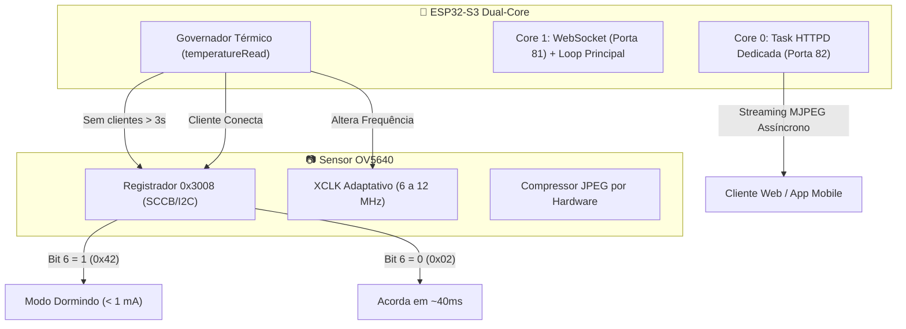

# ❄️ Engenharia Térmica & Alta Performance da Câmera OV5640 via Software

Este documento registra a estratégia técnica implementada no firmware do **ESP32-S3-CAM** para minimizar a temperatura de operação do sensor de 5MP **OV5640**, maximizar a fluidez de vídeo (FPS) e eliminar travamentos térmicos, dispensando o uso de ventoinhas mecânicas na cabeça móvel Pan/Tilt.

---

## 🔍 O Diagnóstico: Por que o OV5640 esquenta tanto?

Muitos projetos maker sofrem com o sensor OV5640 operando entre **55 °C e 75 °C** mesmo em bancada aberta. As causas de engenharia são:

1. **Pastilha de Silício Minúscula sem Dissipação:** O OV5640 integra matriz de pixels, pré-amplificadores analógicos, conversores A/D, processador de sinal de imagem (ISP) e motor de compressão JPEG em uma área menor que $6 \times 6\text{ mm}$ no topo de um cabo flat flexível de poliamida (que possui péssima condutividade térmica).
2. **Clock Mestre (XCLK) Fixado no Teto (20 MHz):** Os exemplos padrão da Espressif configuram `xclk_freq_hz = 20000000`. Em circuitos integrados CMOS, a potência dissipada cresce linearmente com a frequência:
   $$P_{\text{dinamica}} = C_{\text{pd}} \cdot V^2 \cdot f$$
   Operar o sensor a 20 MHz para gerar resoluções leves (como QVGA ou VGA a 15–20 FPS) faz o circuito PLL interno do sensor girar em velocidade máxima sem necessidade.
3. **Sensor Operando 100% do Tempo sem Espectador:** Por padrão da biblioteca `esp_camera`, ao chamar `esp_camera_init()`, o sensor começa a capturar e comprimir quadros no buffer DMA continuamente, mesmo com nenhum usuário assistindo.
4. **Taxa de Quadros Destravada (Unthrottled Stream):** Loops de streaming que utilizam `delay(5)` ou envios imediatos tentam extrair mais de 50 quadros por segundo, saturando o compressor JPEG da câmera e o rádio Wi-Fi do ESP32.

---

## 🛡️ Os 6 Artifícios de Software Implementados

Para combater esses efeitos na raiz sem adicionar peso ou vibração mecânica à articulação móvel, o módulo [`src/firmware/comum/esp_camera_frio.h`](file:///c:/Users/caihe/Documents/develop/rover/src/firmware/comum/esp_camera_frio.h) implementa:

---

### 1. Soneca Real por Software via Registrador `0x3008` (Soft Power-Down)

O sensor OV5640 possui o registrador de controle de sistema `SYSTEM_CTROL0` no endereço `0x3008`:
* **Valor `0x42` (Bit 6 = 1):** Coloca o sensor em *Software Power-Down*. Os conversores A/D analógicos, a matriz de pixels, o processador ISP e o compressor JPEG são desativados internamente. A corrente do sensor cai de **~140 mA para menos de 1 mA** quase instantaneamente.
* **Valor `0x02` (Bit 6 = 0):** Reativa o sensor mantendo todos os parâmetros de configuração salvos (resolução, ganho, exposição). A reinicialização ocorre em apenas **~40 ms** (muito mais rápido e seguro do que executar `esp_camera_deinit` / `esp_camera_init`).

**Lógica no Firmware:** Se nenhum cliente estiver conectado em `/stream` e não houver requisição recente em `/capture` por mais de 3 segundos, o firmware coloca o sensor automaticamente em `MODO_DORMINDO`. Ao entrar uma conexão, o sensor acorda de forma imperceptível para o usuário.

---

### 2. XCLK Adaptativo (Clock Dinâmico de 6 MHz a 12 MHz)

Em vez de 20 MHz fixos, o firmware ajusta a frequência do clock gerado pelo temporizador LEDC do ESP32 (`LEDC_TIMER_0`) em tempo real através da função `s->set_xclk(s, LEDC_TIMER_0, mhz)`:
* **Modo Ativo (Transmissão Normal):** **12 MHz** (redução de 40% na frequência, perfeitamente estável para até 20–25 FPS em QVGA/VGA).
* **Modo Eco (Robô Parado):** **8 MHz** (temperatura mínima mantendo 5 a 8 FPS).
* **Modo Térmico de Proteção:** **6 MHz** (mantém o streaming vivo com consumo de potência mínimo).

---

### 3. Teto de Taxa de Quadros (Frame Pacing)

O envio de vídeo não opera em "laço livre". O servidor HTTP calcula o intervalo alvo (`camIntervaloMs() = 1000 / FPS_ALVO`) com compensação de atraso:
* **Em Ação (Comandos Ativos):** Limite configurável em **15 a 20 FPS**.
* **Modo Eco (Sem Comandos há 8 segundos):** Redução automática para **5 FPS**. Enquanto o robô está parado sem ninguém pilotar, a taxa cai suavemente, esfriando a cabeça da câmera e liberando banda de rádio. Ao mover qualquer controle, o teto sobe imediatamente para o valor ativo.

---

### 4. Servidor de Vídeo Dedicado no Core 0 (`esp_http_server`)

No firmware antigo, o streaming MJPEG era servido dentro de um laço `while (client.connected())` na porta 80. Isso bloqueava o `loop()` do Arduino, impedindo a execução de `wsServer.loop()` e atrasando os comandos de motores e servos.

No novo projeto:
* O streaming de vídeo opera através da biblioteca nativa `esp_http_server` da Espressif, executando em uma **Task FreeRTOS própria, isolada na porta 82 e fixada no Core 0** (`cfg.core_id = 0`).
* O Core 1 permanece **100% dedicado** ao `loop()` principal, processando WebSockets, leitura de sensores e comunicação serial com o Nano a latência zero.

---

### 5. Governador Térmico Ativo do Silício

O firmware realiza a leitura periódica do sensor interno do chip ESP32-S3 através da função nativa `temperatureRead()`:
* **Alerta Térmico (Padrão 68 °C no chip):** Caso o chassi fechado acumule calor, o sistema reduz o XCLK para o valor térmico e limita resoluções pesadas a no máximo QVGA.
* **Corte de Emergência (Padrão 80 °C no chip):** Desliga o sensor preventivamente (`MODO_DORMINDO`) até que o conjunto resfrie com histerese de 8 °C, impedindo degradação física do hardware.

---

### 6. Qualidade JPEG e Resolução Configuráveis em Tempo Real

A alocação de buffers DMA na inicialização (`esp_camera_init`) é dimensionada para a maior resolução (`FRAMESIZE_HD`), permitindo chavear para qualquer tamanho menor instantaneamente com `s->set_framesize()` sem reinicializar o subsistema:
* A qualidade JPEG é calibrada em `20` (escala 8 a 45, onde números maiores comprimem mais a imagem). Um arquivo JPEG menor exige menos ciclos de compressão do sensor e trafega mais rápido no Wi-Fi com menos tempo de transmissão no rádio (menos calor gerado pelo amplificador RF).

---

## 📊 Tabela de Presets Térmicos Disponíveis no Painel Web

O usuário pode alternar entre os presets diretamente pelo painel web (`/api/cam/preset?n=...`):

| Preset | Resolução | Qualidade JPEG | XCLK Ativo | Teto FPS | Perfil Térmico | Aplicação Recomendada |
|---|---|---|---|---|---|---|
| **Frio** | QVGA ($320 \times 240$) | 26 | **8 MHz** | **12 FPS** | Câmera fria (< 42 °C) | Observação de longa duração e telemetria |
| **Equilibrado** | VGA ($640 \times 480$) | 20 | **12 MHz** | **15 FPS** | Temperatura controlada (~48 °C) | Pilotagem regular com ótima nitidez |
| **Qualidade** | SVGA ($800 \times 600$) | 12 | 16 MHz | 15 FPS | Calor moderado (~56 °C) | Inspeção de detalhes de terreno |
| **Máximo** | HD ($1280 \times 720$) | 10 | 20 MHz | 15 FPS | Calor elevado (> 65 °C) | Gravação de fotos/vídeos em alta definição |
