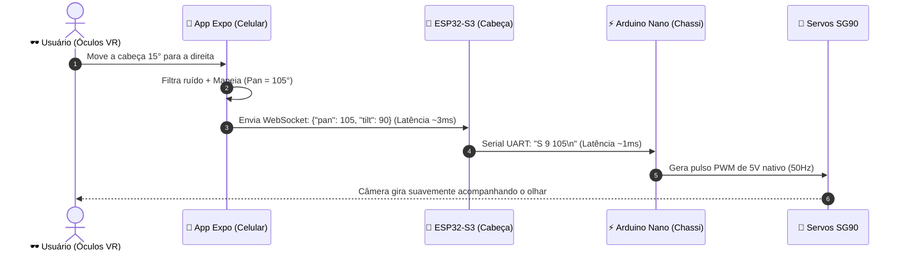

# 🕶️ Guia de Controle de Servos, Head-Tracking e VR para Iniciantes

Este documento explica, em linguagem simples e acessível, como funciona a mecânica dos **servomotores**, como o celular comanda a "cabeça" do robô usando **giroscópio/óculos VR**, e quais cuidados evitam que os servos queimem, travem ou fiquem tremendo.

---

## 🤖 1. O que é um Servomotor (e por que não é um motor comum)?

* **Motor DC Comum (como os das rodas):** Gira sem parar para frente ou para trás enquanto tiver energia.
* **Servomotor (SG90):** É um motor inteligente com engrenagens e um sensor interno (potenciômetro). Você não manda ele "girar", você manda ele **"ficar exatamente no ângulo X"** (por exemplo, 90 graus).

```
   [ Ângulo 0° ]   <------   [ Ângulo 90° (Centro) ]   ------>   [ Ângulo 180° ]
(Olhando p/ Esquerda)            (Olhando Reto)               (Olhando p/ Direita)
```

No nosso Rover, temos **2 servos** na cabeça:
1. **Servo Pan (Horizontal):** Gira a câmera para a esquerda e para a direita (como quando você diz "não").
2. **Servo Tilt (Vertical):** Inclina a câmera para cima e para baixo (como quando você diz "sim").

---

## 📱 2. Como o Celular "Sabe" para Onde Você Está Olhando?

Dentro de qualquer smartphone moderno existem micro-sensores chamados **Acelerômetro** e **Giroscópio**:
* O **Giroscópio** mede a velocidade com que o celular está rodando no espaço.
* A tecnologia de **Fusão de Sensores** do celular junta essas leituras e calcula 3 eixos de rotação da sua cabeça:

```
          Pitch (Tilt: Cima / Baixo)
                   ▲
                   │
  Yaw (Pan) ◄──────┼──────► Yaw (Pan: Esquerda / Direita)
                   │
                   ▼
          Roll (Inclinação lateral dos ombros - descartamos)
```

1. Quando você vira a cabeça para a **direita**, o eixo **Yaw** aumenta $\rightarrow$ o app calcula um ângulo maior para o **Servo Pan**.
2. Quando você olha para **cima**, o eixo **Pitch** muda $\rightarrow$ o app calcula o ângulo correspondente para o **Servo Tilt**.

---

## ⚡ 3. Os 4 Desafios Práticos (e Como Nós Resolvemos)

### Desafio 1: A "Tremedeira" da Mão e do Sensor (*Jitter*)
* **O Problema:** Nossos olhos e mãos nunca ficam 100% imóveis; o sensor do celular oscila dezenas de vezes por segundo em frações de milímetro. Se enviarmos essas micro-oscilações para o servo, ele ficará zumbindo, vibrando e esquentando.
* **A Solução (Filtro Suavizador EMA + Zona Morta):**
  * O app calcula uma média ponderada suave dos movimentos anteriores.
  * Se a cabeça se mexer menos de $0{,}5^\circ$, o app ignora. Se mexer de verdade, ele envia o comando suavemente.

### Desafio 2: A Deriva Natural (*Drift*)
* **O Problema:** Conforme você se mexe, o sensor do celular vai acumulando um pequeno erro e pode achar que "olhar para frente" agora é meio de lado.
* **A Solução (Botão "Zerar / Calibrar"):**
  * Colocamos um botão grande no app chamado **"Centralizar Visão"**.
  * Basta olhar para a frente confortavelmente e tocar na tela: o app grava aquela posição exata como o seu novo centro ($90^\circ$).

### Desafio 3: Limites Mecânicos (Não quebrar a peça 3D)
* **O Problema:** O servo tem força. Se mandarmos o servo Tilt ir para $0^\circ$ ou $180^\circ$, a câmera vai bater com força na carcaça do chassi e forçar as engrenagens de plástico.
* **A Solução (Travas de Software no App e no Nano):**
  * **Pan (Horizontal):** Limitado entre $20^\circ$ e $160^\circ$ (o centro é $90^\circ$).
  * **Tilt (Vertical):** Limitado entre $50^\circ$ e $130^\circ$ (o horizonte é $90^\circ$).

### Desafio 4: Consumo de Energia e Picos de Corrente
* **O Problema:** Quando um servo começa a se mexer de repente, ele dá um "puxão" de energia de quase 0,6 Amperes. Se o ESP32 estiver na mesma linha sem fonte forte, ele desliga e reinicia (chamado *brownout*).
* **A Solução da Nossa Eletrônica:**
  * O regulador **Mini 560 (5V / 5A)** fornece corrente com enorme sobra para os 2 servos e as placas sem nenhuma queda de energia.

---

## 🚀 4. Como os Dados Viajam (Do Olho ao Motor)



---

## 🥽 5. Modo de Realidade Virtual (VR Side-by-Side)

Para usar com óculos de realidade virtual para celular (tipo *Google Cardboard* ou *VR Box*):
1. A tela do celular é dividida em **duas metades iguais** (uma para o olho esquerdo e outra para o direito).
2. O vídeo da câmera do Rover aparece nas duas metades com uma leve separação focal.
3. Conforme você gira a cabeça no mundo real, a câmera do robô gira no mesmo instante, dando a sensação exata de estar sentado no cockpit do carrinho!
