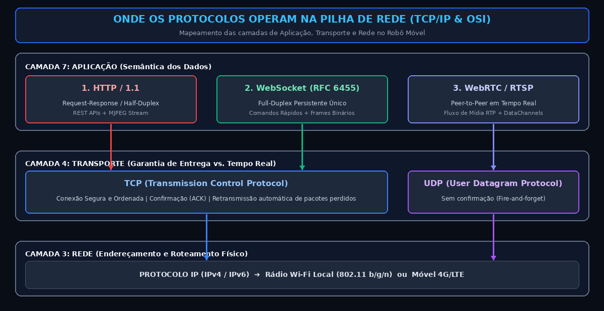
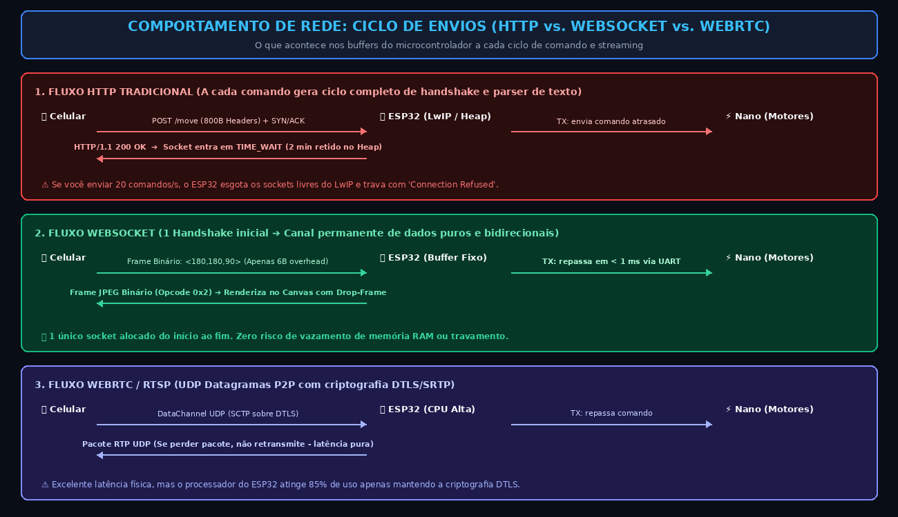
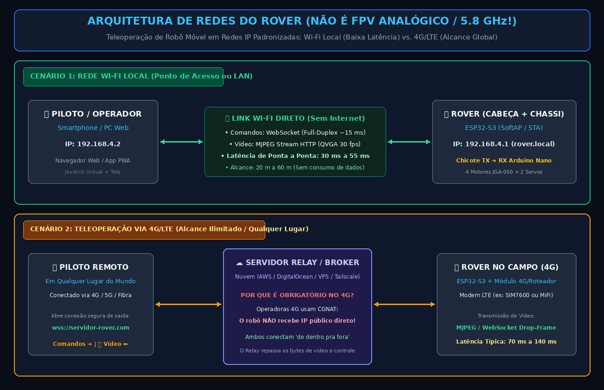

# 🌐 Protocolos de Rede no Robô: HTTP vs. WebSocket vs. WebRTC (Comandos & Streaming)

Este documento aprofunda os aspectos de arquitetura de redes, camadas de transporte (TCP/IP), modelo de estados, gerenciamento de buffers e protocolos de streaming que explicam os **trade-offs entre as três principais abordagens de comunicação em robótica móvel**: **HTTP/1.1**, **WebSocket** e **WebRTC / RTSP (UDP)**.

> ⚠️ **CONTEXTO DE REDES: TELEOPERAÇÃO IP (WI-FI & 4G/LTE) — NÃO É FPV ANALÓGICO!**
> Este projeto trata de um robô operado exclusivamente por protocolos digitais de rede (TCP/IP) locais (Wi-Fi) ou remotos (4G/LTE via Internet). Não utiliza tecnologia analógica de FPV/aeromodelismo (5.8 GHz).

---

## 1. Onde Operam no Modelo OSI / TCP-IP?

A diferença fundamental entre esses protocolos começa na **camada de transporte (Layer 4)** e na **máquina de estados imposta na camada de aplicação (Layer 7)**:

---

## 2. Protocolo 1: HTTP/1.1 (O Paradigma Request-Response)

O HTTP/1.1 foi concebido para transferência de hipertexto e documentos na web. Seu modelo é estritamente **Cliente-Servidor, Requisição-Resposta e Half-Duplex**.

### Como opera nos Comandos (Joystick/Motores):
1. O app envia um `POST /api/move` com cabeçalhos completos de texto (~800 bytes).
2. O ESP32 roda um parser de texto, aplica o comando e **deve obrigatoriamente responder** com um cabeçalho `HTTP/1.1 200 OK`.
3. Enquanto a resposta não chega, o navegador enfileira o próximo comando (*Head-of-Line Blocking*).
4. **Resultado:** Latência de **80 ms a 250 ms** por comando; 98% da banda gasta em texto inútil de cabeçalho.

### Como opera no Streaming de Vídeo (MJPEG over HTTP):
* Usa o cabeçalho `Content-Type: multipart/x-mixed-replace;boundary=frame`.
* A conexão HTTP fica aberta e o ESP32 cospe cada JPEG precedido por um delimitador de texto.
* **O Grande Problema:** Como trafega sobre **TCP**, se um único pacote falhar ou atrasar no rádio Wi-Fi/4G, a pilha de rede segura todos os quadros seguintes aguardando a retransmissão (*Buffer Lag*). O operador passa a assistir o vídeo acumulado com 1 a 3 segundos de atraso no passado.

---

## 3. Protocolo 2: WebSocket (O Canal TCP Persistente e Bidirecional)

O WebSocket (RFC 6455) realiza um único handshake HTTP (`Upgrade: websocket`) e imediatamente transforma o socket TCP em um **canal contínuo e bidirecional de dados puros**.

### Como opera nos Comandos (Joystick/Motores):
* A conexão permanece aberta 100% do tempo.
* Cada comando trafega em um **Frame binário de apenas 6 bytes de overhead** (ex: `<180,180,90>`).
* O dado sai da tela do celular e atinge o pino serial do Arduino Nano em **5 a 18 milissegundos**.

### Como opera no Streaming de Vídeo (Binary Frames com Drop-Frame):
* O ESP32 transmite cada foto JPEG como um payload binário (`Opcode 0x2`) através do mesmo canal.
* No celular/navegador, o JavaScript recebe o blob e renderiza via `<canvas>`.
* **A Grande Sacada do Descarte (Drop-Frame):** Se um frame atrasar devido a oscilação do 4G, o JavaScript **descarta o frame velho sumariamente** assim que o novo chega. Isso impede qualquer acúmulo de atraso: o piloto enxerga sempre a posição física real do robô no momento presente.

---

## 4. Protocolo 3: WebRTC / RTSP sobre UDP (O Padrão Ouro de Mídia)

O WebRTC é o padrão moderno da indústria para chamadas de vídeo em tempo real (Google Meet, Discord, Zoom) e teleoperação industrial.

### Como opera nos Comandos e no Vídeo:
* Utiliza **UDP (User Datagram Protocol)** como transporte através de protocolos como RTP/SRTP.
* **Perda sem Retransmissão:** Se um pacote de imagem for perdido no ar, o receptor simplesmente pula para o próximo sem congelar o fluxo. A latência é a menor teoricamente possível (**30 a 50 ms** mesmo em redes 4G).
* Suporta canal bidirecional de dados ultrarrápido (*DataChannels*).

### Por que NÃO é simples no ESP32? (O Trade-off do Hardware):
1. **Sem Encoder H.264 no Silício:** O WebRTC nativo de navegadores exige streams em formatos como H.264 ou VP8. O ESP32 só gera JPEG. Empacotar JPEG em WebRTC exige bibliotecas de software complexas que consomem quase toda a CPU.
2. **Criptografia Pesada (DTLS / SRTP):** Exige negociação contínua de chaves criptográficas que consomem centenas de kilobytes da escassa memória RAM do ESP32.
3. **Complexidade de Conexão (ICE / STUN / TURN):** Para furar o CGNAT do 4G, o WebRTC exige servidores STUN/TURN dedicados para descobrir rotas P2P, o que frequentemente falha em redes celulares brasileiras sem um servidor intermediário (*TURN Relay*).

---

## 5. Comparativo de Fluxo e Sockets no ESP32

---

## 6. O Fator Crítico em Redes Móveis 4G/LTE (CGNAT e Firewall Keep-Alive)

Quando o robô opera em redes móveis celulares (4G/LTE), a escolha do protocolo impacta diretamente na estabilidade da conexão:

1. **A Máquina de Estados do Rádio Celular (RRC):**
   * Em conexões celulares, o modem entra em modo de baixa energia (*RRC Idle*) quando não há tráfego contínuo.
   * Se você usa HTTP e envia requisições espaçadas, cada nova conexão força a torre celular e o modem a negociarem canais dedicados, gerando um atraso de **150 a 300 ms** antes do primeiro byte sair.
   * O WebSocket mantém o socket TCP aberto permanentemente, sustentando o rádio no estado ativo (*RRC Connected*) com latência estável.

2. **Manutenção do Túnel no Firewall CGNAT:**
   * Como as operadoras não fornecem IP público para chips 4G, tanto o robô quanto o celular se conectam a um **Servidor Relay na Nuvem**.
   * Os roteadores de borda das operadoras descartam mapeamentos NAT inativos após 30 a 60 segundos.
   * O WebSocket possui suporte nativo a quadros de **Ping/Pong (Heartbeat)** de apenas 2 bytes, mantendo o túnel aberto no firewall da operadora sem consumir franquia de dados móveis.

---

## 7. A Grande Matriz de Trade-offs: Comparativo dos 3 Protocolos

A tabela abaixo sintetiza a análise técnica completa para embasar qualquer decisão de engenharia de software e redes no robô:

| Critério de Engenharia | 1. HTTP/1.1 Tradicional (REST + MJPEG) | 2. WebSocket (RFC 6455) | 3. WebRTC / RTSP (sobre UDP) |
|---|---|---|---|
| **Camada de Transporte** | TCP (Orientado a conexão, cada envio fecha ou bloqueia) | TCP (Socket persistente único de longa duração) | UDP (Datagramas sem confirmação de entrega) |
| **Modelo de Comunicação** | Half-Duplex (Requisição $\rightarrow$ Resposta) | Full-Duplex (Bidirecional simultâneo) | Peer-to-Peer Full-Duplex (Áudio, Vídeo e Dados) |
| **Mecânica de Streaming** | `multipart/x-mixed-replace` (Stream infinito de JPEGs) | Frames Binários contínuos com descarte no cliente | Fluxo de pacotes RTP em tempo real (Nativo) |
| **Mecânica de Comandos** | Requisições `POST` / `GET` com dezenas de headers | Mensagens de texto ou binárias instantâneas | *DataChannels* (SCTP sobre DTLS/UDP) |
| **Overhead por Envio** | **500 a 1.200 bytes** (texto de cabeçalho) | **Apenas 2 a 6 bytes** de cabeçalho de frame | **~12 a 20 bytes** (cabeçalho RTP/UDP) |
| **Latência de Comandos** | **80 a 250 ms** (engasgos severos no joystick) | **5 a 18 ms** (resposta tátil imediata) | **5 a 15 ms** (resposta tátil imediata) |
| **Latência de Vídeo (Wi-Fi Local)** | 90 a 180 ms (acumula atraso se houver ruído) | **40 a 65 ms** (sincronismo real com drop-frame) | **30 a 50 ms** (menor latência física teórica) |
| **Latência de Vídeo (4G Remoto)** | 200 a 600 ms + efeito elástico acumulado | **75 a 120 ms** (mantém tempo real pelo descarte) | **50 a 90 ms** (excelente absorção de perdas) |
| **Comportamento na Perda de Pacote** | Trava o vídeo e acelera tudo depois (Buffer Lag) | Descarta o frame velho no navegador (Tempo Real) | Descarta o pacote no rádio sem esperar (Tempo Real) |
| **Impacto no Hardware do ESP32** | Alto consumo de Heap; risco de esgotar sockets LwIP | **Muito Leve e Estável** (Buffer pré-alocado fixo) | **Crítico / Extremo** (Consome 80%+ de CPU com DTLS/ICE) |
| **Suporte Nativo no Navegador** | 100% nativo (``) | 100% nativo (`new WebSocket("ws://...")`) | Nativo, mas exige API complexa de MediaStream |
| **Travessia de CGNAT (4G)** | Exige Proxy Reverso na nuvem | **Muito Simples** (Relay WebSocket em Node/Go na VPS) | Complexo (Exige servidores STUN e TURN dedicados) |
| **Complexidade no Firmware ESP32** | Muito Baixa (Biblioteca padrão do Arduino) | **Baixa a Média** (Bibliotecas oficiais testadas e leves) | **Altíssima / Instável** (Poucas libs C++ estáveis no ESP32) |
| **Veredito de Engenharia para o Rover** | ⚠️ Usar **apenas** para carregar a página HTML inicial | 🥇 **Vencedor Geral:** Melhor equilíbrio entre baixa latência, robustez e leveza no ESP32 | 🔬 Excelente na teoria, mas complexidade excessiva para microcontroladores sem H.264 |

---

### 💡 Conclusão e Recomendação para o Rover

* **O Erro Comum:** Tentar controlar o robô por requisições HTTP normais (`GET/POST`) ou achar que o vídeo em HTTP será em tempo real. Em poucos minutos de condução, o robô sofre com atraso acumulado ou congela o chip por esgotamento de conexões TCP.
* **A Arquitetura Campeã (Adotada no Projeto):**
  * O **HTTP** é utilizado uma única vez: quando o navegador abre o IP do robô para carregar o arquivo HTML, CSS e JavaScript da interface.
  * O **WebSocket** assume todo o resto: comandos de joystick, telemetria da bateria, botões do painel e o fluxo contínuo de quadros de vídeo com descarte de quadros velhos.
  * Essa combinação entrega **latência abaixo de 60 ms no Wi-Fi e abaixo de 120 ms no 4G**, mantendo o processador do ESP32 livre e sem risco de travamento de memória.
