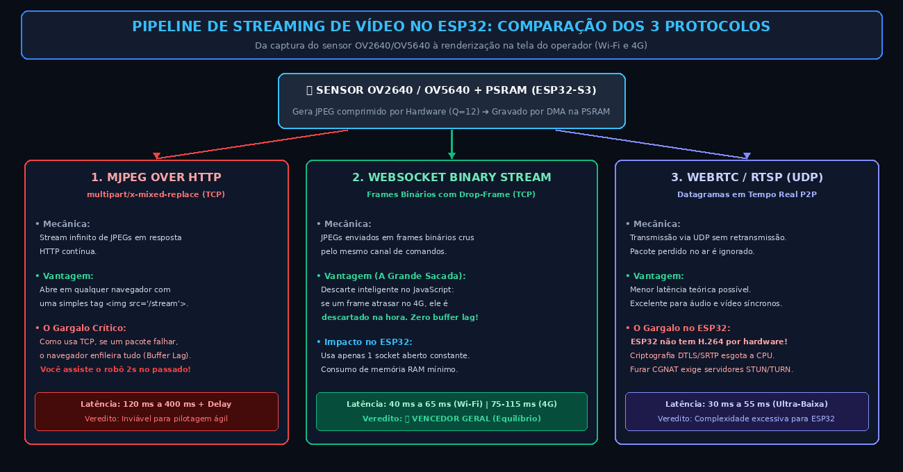
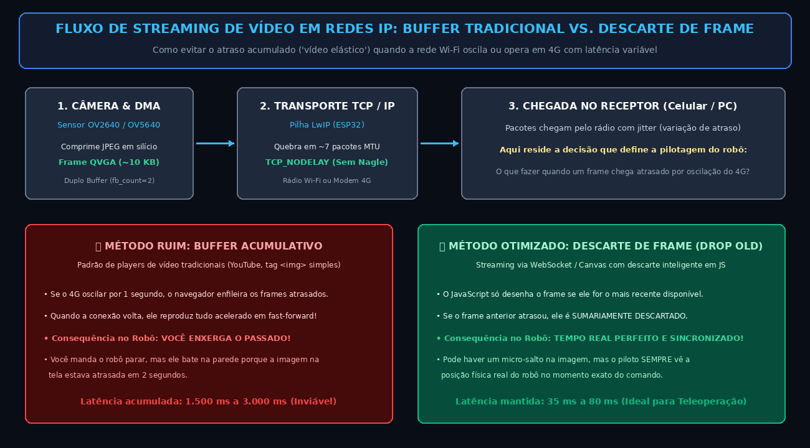
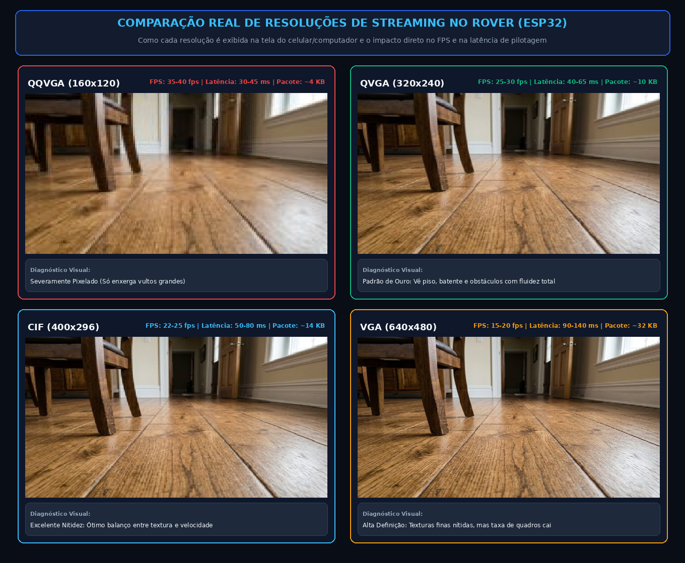
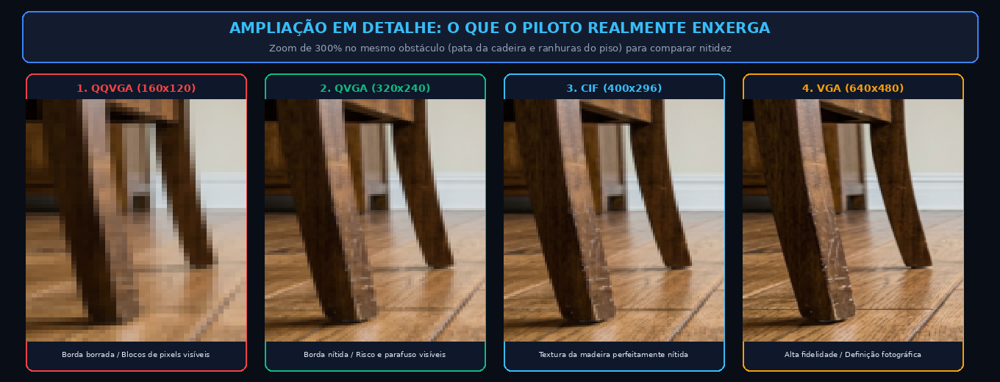

# 📹 Streaming de Vídeo e Redes: Teleoperação IP (Wi-Fi e 4G/LTE) no ESP32

Este documento detalha o funcionamento do streaming de vídeo nos chips **ESP32** e **ESP32-S3**, os cenários de rede (**Wi-Fi Local vs. Conexão Remota 4G/LTE**), as limitações físicas de hardware e as técnicas para manter o vídeo fluido e sincronizado em tempo real.

---

> ⚠️ **DIRETRIZ DE ARQUITETURA: NÃO É FPV ANALÓGICO / 5.8 GHz!**
> 
> * **O que NÃO é:** Não se trata de um sistema analógico de aeromodelismo/drones de corrida (FPV em 5.8 GHz com transmissores VTX, antenas de polarização circular e óculos analógicos).
> * **O que É:** Este projeto é um **Robô Móvel de Teleoperação Baseado em Redes IP Padrão (TCP/IP)**. A transmissão de vídeo e os comandos trafegam exclusivamente por pilhas de rede digitais:
>   1. **Modo Local:** Conexão direta por **Wi-Fi** (Ponto de Acesso ou LAN doméstica).
>   2. **Modo Remoto:** Teleoperação a qualquer distância através de **redes celulares 4G/LTE ou Internet**.

---

## 🗺️ 1. Diagrama de Topologia de Redes (Wi-Fi vs. 4G Remoto)


---

## 🌐 2. Os Dois Cenários de Rede no Mundo Real

### Cenário A: Wi-Fi Local (Ponto de Acesso ou Rede Doméstica)
* **Como opera:** O ESP32 cria sua própria rede Wi-Fi (`SoftAP`) ou se conecta ao roteador Wi-Fi da casa (`STA`). O celular ou computador do piloto conecta-se diretamente na mesma sub-rede (ex: `192.168.4.X`).
* **Vantagens:**
  * **Zero custo:** Não consome plano de dados móveis nem depende de provedores de internet.
  * **Latência mínima:** O trajeto do sinal é direto de antena para antena no mesmo ambiente ($\approx \mathbf{25\text{ a }50\text{ ms}}$).
* **Limitação:** Alcance físico limitado pelo rádio Wi-Fi (geralmente entre 15 a 50 metros com visada direta).

---

### Cenário B: Teleoperação Remota via 4G/LTE (Qualquer Lugar do Mundo)
* **Como opera:** O robô carrega um roteador 4G portátil (MiFi USB) ou um módulo celular LTE (como a série SIM7600), fornecendo acesso à internet móvel em qualquer ambiente externo.
* **O Desafio Obrigatório de Redes: O CGNAT das Operadoras Móveis:**
  * Em redes celulares 4G/5G, as operadoras (Claro, Vivo, TIM, etc.) **não entregam um endereço IP público** para o chip do robô. Elas utilizam **CGNAT (Carrier-Grade NAT)**.
  * *O que isso significa na prática?* O seu celular em casa **não consegue se conectar diretamente ao IP do robô na rua**, porque o firewall da operadora bloqueia qualquer tentativa de conexão vinda de fora (*inbound*).
* **A Solução da Arquitetura: Servidor de Relay / Broker na Nuvem:**
  1. Um servidor barato na nuvem (VPS, AWS, DigitalOcean, ou serviços P2P como Tailscale / ngrok) fica ouvindo em um IP público fixo.
  2. O robô em 4G abre uma conexão **de dentro para fora** (*outbound*) com o servidor usando um **WebSocket Seguro (`wss://`)**.
  3. O piloto no smartphone também abre uma conexão com esse mesmo servidor na nuvem.
  4. O servidor simplesmente atua como uma "ponte" (*relay*), repassando os pacotes de comando para o robô e os quadros de vídeo para o piloto.
* **Métricas em 4G:**
  * **Latência de Ponta a Ponta:** $\approx \mathbf{70\text{ a }140\text{ ms}}$ (perfeitamente ágil para conduzir um rover terrestre).
  * **Alcance:** **Global e Ilimitado** (você pode pilotar o carrinho em outra cidade ou país).

---

## ⚙️ 3. O Desafio do Hardware: Por que MJPEG e não H.264/H.265?

Smartphones e computadores transmitem vídeo usando codecs avançados como **H.264 (AVC)** ou **H.265 (HEVC)**, que analisam blocos em movimento entre quadros (inter-frame compression) e reduzem drasticamente o tamanho do arquivo.

* **O ESP32 não possui codificador H.264 por hardware.**
* Tentar codificar H.264 por software (via CPU Xtensa) exigiria centenas de megaflops de processamento matemático vetorial por segundo, o que levaria o ESP32 a produzir menos de **0,2 quadros por segundo** e travaria a CPU a 100%.
* **A Solução Maker:** Os sensores de câmera **OV2640** e **OV5640** possuem um circuito integrado de **compressão JPEG em silício (Hardware JPEG Encoder)**.
  * O sensor entrega a cada disparo um arquivo JPEG comprimido completo diretamente por DMA (Direct Memory Access) para a memória PSRAM do ESP32.
  * O microcontrolador não gasta ciclos de CPU comprimindo pixels: ele apenas recebe o JPEG pronto e o empacota na rede.
  * Por isso, o formato padrão de transmissão é o **MJPEG (Motion JPEG)**: uma sequência rápida de fotos JPEG individuais enviadas em série.

---

## 📡 4. Comparativo dos 3 Protocolos de Streaming de Vídeo no ESP32

Depois que o sensor da câmera gera o arquivo JPEG na memória PSRAM, como esse vídeo deve ser transmitido pela rede (Wi-Fi ou 4G)? Existem três caminhos possíveis:



### 1. MJPEG over HTTP (`multipart/x-mixed-replace`)
* **Mecânica:** O cliente faz um único `GET /stream`. O ESP32 responde mantendo a conexão aberta com o cabeçalho `Content-Type: multipart/x-mixed-replace;boundary=frame`. A cada novo frame capturado, o ESP32 manda um delimitador de texto seguido pelos bytes binários daquele JPEG.
* **Vantagem:** Compatibilidade universal. Qualquer navegador web exibe o vídeo instantaneamente com uma simples tag HTML: ``.
* **O Gargalo:** Como usa **TCP**, se um pacote Wi-Fi ou 4G falhar, a pilha segura todos os quadros seguintes aguardando retransmissão (*Buffer Lag*). O operador passa a assistir o vídeo acumulado com atraso no passado.

### 2. WebSocket Binary Streaming (Frames JPEG Crus + Drop-Frame)
* **Mecânica:** O ESP32 transmite cada foto JPEG como um payload binário (`Opcode 0x2`) através do mesmo canal permanente em que trafegam os comandos do joystick.
* **Vantagem (A Grande Sacada):** O JavaScript do app cliente descarta o frame velho sumariamente assim que o novo chega. Se houver oscilação de 4G, **não há acúmulo de atraso**: o piloto enxerga sempre o momento presente.
* **Impacto no ESP32:** Utiliza exatamente **1 socket aberto constante**, sem risco de esgotar a memória RAM do chip.

### 3. WebRTC / RTSP sobre UDP (Datagramas RTP)
* **Mecânica:** Transmissão via pacotes **UDP** sem confirmação de entrega. Pacotes perdidos no ar são sumariamente ignorados pelo receptor.
* **Vantagem:** A menor latência teórica possível (**30 a 50 ms**).
* **O Gargalo no ESP32:** O ESP32 não possui encoder H.264 por hardware; empacotar JPEG em WebRTC com criptografia pesada DTLS/SRTP e negociação ICE/STUN/TURN consome mais de 80% da CPU e frequentemente causa travamentos de memória.

---

### 📊 A Grande Matriz de Trade-offs dos 3 Protocolos

| Critério de Engenharia | 1. HTTP/1.1 (REST + MJPEG) | 2. WebSocket (RFC 6455) | 3. WebRTC / RTSP (UDP) |
|---|---|---|---|
| **Camada de Transporte** | TCP (Orientado a conexão, fecha/bloqueia) | TCP (Socket persistente único de longa duração) | UDP (Datagramas sem confirmação de entrega) |
| **Modelo de Comunicação** | Half-Duplex (Requisição $\rightarrow$ Resposta) | Full-Duplex (Bidirecional simultâneo) | Peer-to-Peer Full-Duplex (Mídia + Dados) |
| **Mecânica de Streaming** | `multipart/x-mixed-replace` (Stream infinito) | Frames Binários contínuos com Drop-Frame | Fluxo de pacotes RTP em tempo real |
| **Overhead por Envio** | **500 a 1.200 bytes** (texto de cabeçalho inútil) | **Apenas 2 a 6 bytes** de cabeçalho de frame | **~12 a 20 bytes** (cabeçalho RTP/UDP) |
| **Latência de Comandos** | **80 a 250 ms** (engasgos severos no joystick) | **5 a 18 ms** (resposta tátil imediata) | **5 a 15 ms** (resposta tátil imediata) |
| **Latência de Vídeo (Wi-Fi Local)** | 90 a 180 ms (acumula atraso se houver ruído) | **40 a 65 ms** (sincronismo real com drop-frame) | **30 a 50 ms** (menor latência física teórica) |
| **Latência de Vídeo (4G Remoto)** | 200 a 600 ms + efeito elástico acumulado | **75 a 120 ms** (mantém tempo real pelo descarte) | **50 a 90 ms** (excelente absorção de perdas) |
| **Comportamento na Perda de Pacotes** | Trava o vídeo e acelera tudo depois (Buffer Lag) | Descarta o frame velho no navegador (Tempo Real) | Descarta o pacote no rádio sem esperar (Tempo Real) |
| **Impacto no Hardware do ESP32** | Alto consumo de Heap; risco de esgotar sockets LwIP | **Muito Leve e Estável** (Buffer pré-alocado fixo) | **Crítico / Extremo** (Consome 80%+ de CPU com DTLS/ICE) |
| **Suporte Nativo no Navegador** | 100% nativo (``) | 100% nativo (`new WebSocket("ws://...")`) | Nativo, mas exige API complexa de MediaStream |
| **Travessia de CGNAT (4G)** | Exige Proxy Reverso na nuvem | **Muito Simples** (Relay WebSocket em Node/Go na VPS) | Complexo (Exige servidores STUN e TURN dedicados) |
| **Complexidade no Firmware ESP32** | Muito Baixa (Biblioteca padrão do Arduino) | **Baixa a Média** (Bibliotecas oficiais testadas e leves) | **Altíssima / Instável** (Poucas libs C++ estáveis no ESP32) |
| **Veredito de Engenharia para o Rover** | ⚠️ Usar **apenas** para carregar a página HTML inicial | 🥇 **Vencedor Geral:** Melhor equilíbrio entre baixa latência, robustez e leveza no ESP32 | 🔬 Excelente na teoria, mas complexidade excessiva para microcontroladores sem H.264 |

---

## 🔄 5. O Fluxo de Streaming e a Regra do Descarte de Frame

Em conexões celulares 4G ou Wi-Fi sujeito a interferências, o maior perigo para a pilotagem do robô é o **"Buffer Lag"** (efeito elástico). O diagrama abaixo ilustra o comportamento dos dois métodos de recepção:



### Por que o Descarte de Frame (Drop-Old) é Vital no Rover?
1. Se o sinal 4G tiver uma micro-queda de 1 segundo enquanto o robô se desloca, uma conexão de vídeo comum enfileira os quadros atrasados.
2. Ao restabelecer a velocidade, o navegador tenta exibir todos os quadros atrasados em sequência. O operador passa a **enxergar o robô 2 segundos no passado**.
3. Se houver um obstáculo à frente, o operador envia o comando de freio tarde demais e o robô colide.
4. **Com a lógica de descarte em WebSocket/Canvas:** Ao receber um novo frame, se o anterior ainda não foi desenhado, ele é imediatamente jogado fora. O operador **sempre visualiza a realidade presente**.

---

## 📊 6. Comparativo Visual de Resoluções: O que Realmente se Enxerga?

Para responder à dúvida: *"Será que 320x240 ou 400x296 não são pixelados demais para pilotar?"*, os painéis abaixo mostram exatamente o que o sensor da câmera do robô capta a 10 cm do chão quando exibido na tela do seu celular ou monitor:

### 🖼️ Painel Comparativo de Tela Completa (Visão do Piloto)


---

### 🔍 Ampliação em Detalhe (Zoom de 300% no Obstáculo / Pata da Cadeira)


---

### 🧐 Análise Prática de Cada Resolução na Pilotagem:

1. **QQVGA ($160 \times 120$):**
   * **Veredito:** **Sim, é severamente pixelado.**
   * Parece um jogo antigo de Atari ou webcam dos anos 90. Pequenos obstáculos no chão (um fio, um chinelo, um parafuso) viram borrões indistinguíveis.
   * *Quando usar:* Apenas em situações de emergência com sinal celular 3G/4G degradado ao extremo.

2. **QVGA ($320 \times 240$ - Padrão de Ouro na Robótica):**
   * **Veredito:** **Surpreendentemente nítido para condução em tempo real.**
   * Na tela de um celular (5 a 6 polegadas), a densidade de pixels compensa a resolução. Você enxerga perfeitamente o batente da porta, desníveis de tapetes, pernas de cadeiras e ranhuras do piso.
   * **A grande vantagem:** Cada foto pesa apenas **~10 KB**. O rádio Wi-Fi e a rede 4G conseguem empurrar **30 quadros por segundo fluidos**, eliminando qualquer sensação de atraso motor.

3. **CIF ($400 \times 296$ - O Meio-Termo Perfeito):**
   * **Veredito:** **O melhor remédio se você achar o 320x240 suave demais.**
   * Adiciona **54% mais pixels** que o QVGA. As bordas dos objetos e ranhuras de piso ficam bem mais definidas, mas o tamanho do frame sobe apenas para ~14 KB.
   * O **ESP32-S3** aguenta rodar CIF com tranquilidade a **22 a 25 FPS estáveis**.

4. **VGA ($640 \times 480$):**
   * **Veredito:** **Imagem com qualidade de foto de verdade, mas com custo no rádio.**
   * Os detalhes finos (textura da madeira, frestas, parafusos) aparecem com altíssima fidelidade.
   * **O gargalo:** O frame pula para **35 a 45 KB**. O rádio precisa transmitir ~4,5 Mbps ininterruptos. A taxa de quadros cai para **15 a 18 FPS no ESP32-S3** (e engasga para 8-10 FPS no ESP32 clássico). Excelente para inspeção parado, mas mais lento para manobras rápidas.

---

### 📋 Tabela Técnica Completa

| Framesize no Código | Resolução (Pixels) | Proporção | Tamanho Médio por Frame (JPEG Q=12) | FPS Típico (ESP32 Clássico) | FPS Típico (ESP32-S3) | Banda de Rede Necessária | Latência Típica (Wi-Fi Local) | Latência Típica (4G Remoto) | Comportamento no Rover |
|---|---|---|---|---|---|---|---|---|---|
| `FRAMESIZE_QQVGA` | $160 \times 120$ | 4:3 | ~3 a 5 KB | 25 - 30 fps | 35 - 40 fps | ~0,8 Mbps | **25 a 45 ms** | **65 a 90 ms** | ❌ Severamente pixelado |
| `FRAMESIZE_QVGA` | $320 \times 240$ | 4:3 | **7 a 12 KB** | **20 - 25 fps** | **25 - 30 fps** | **~2,0 Mbps** | **40 a 65 ms** | **75 a 115 ms** | 🥇 **Padrão: Fluidez Máxima (30 FPS)** |
| `FRAMESIZE_CIF` | $400 \times 296$ | 4:3 | ~10 a 16 KB | 15 - 20 fps | 22 - 25 fps | ~2,5 Mbps | 50 a 80 ms | 85 a 130 ms | 🥈 **Mais Nitidez sem Perder Fluidez** |
| `FRAMESIZE_VGA` | $640 \times 480$ | 4:3 | **22 a 40 KB** | 8 - 12 fps | **15 - 20 fps** | ~4,5 Mbps | **90 a 140 ms** | **120 a 190 ms** | 🥉 **Alta Definição (Taxa de FPS moderada)** |
| `FRAMESIZE_SVGA` | $800 \times 600$ | 4:3 | ~35 a 60 KB | 5 - 8 fps | 10 - 14 fps | ~5,5 Mbps | 150 a 220 ms | 190 a 280 ms | Apenas manobras muito lentas |
| `FRAMESIZE_HD` | $1280 \times 720$ | 16:9 | ~80 a 120 KB | 2 - 4 fps | 5 - 7 fps | ~7,0 Mbps | > 400 ms | > 500 ms | Apenas fotos estáticas |

---

## 🚀 7. Otimizações de Firmware Obrigatórias para Reduzir Latência

Para garantir que a latência fique no mínimo absoluto tanto no Wi-Fi quanto no 4G:

### 1. Desativar a Economia de Energia do Wi-Fi (`WIFI_PS_NONE`)
Por padrão, a pilha de Wi-Fi do ESP32 entra em modo de dormência periódica (*Light Sleep*). Isso adiciona **50 a 100 ms de atraso fantasma** em cada comando.
```cpp
#include "esp_wifi.h"
esp_wifi_set_ps(WIFI_PS_NONE); // Desativa qualquer suspensão de rádio
```

### 2. Desativar o Algoritmo de Nagle (`TCP_NODELAY`)
O algoritmo de Nagle segura pacotes pequenos por dezenas de milissegundos tentando agrupá-los. Desativar o algoritmo força a transmissão imediata de cada pacote TCP assim que sai da câmera.

### 3. Duplo Buffer na Câmera (`fb_count = 2`)
Graças aos **8 MB de memória PSRAM** do ESP32-S3:
* Com `fb_count = 2`, o sensor captura o próximo quadro na memória enquanto a placa transmite o quadro anterior para a rede em paralelo via DMA, dobrando a taxa de quadros por segundo.

### 4. Isolamento de Núcleos no FreeRTOS (Dual-Core)
* **Núcleo 0 (Core 0):** Focado exclusivamente na pilha TCP/IP (LwIP), rádio Wi-Fi / modem 4G e servidor WebSocket.
* **Núcleo 1 (Core 1):** Focado na leitura da câmera e na transmissão serial TX para o Arduino Nano controlar os motores.
