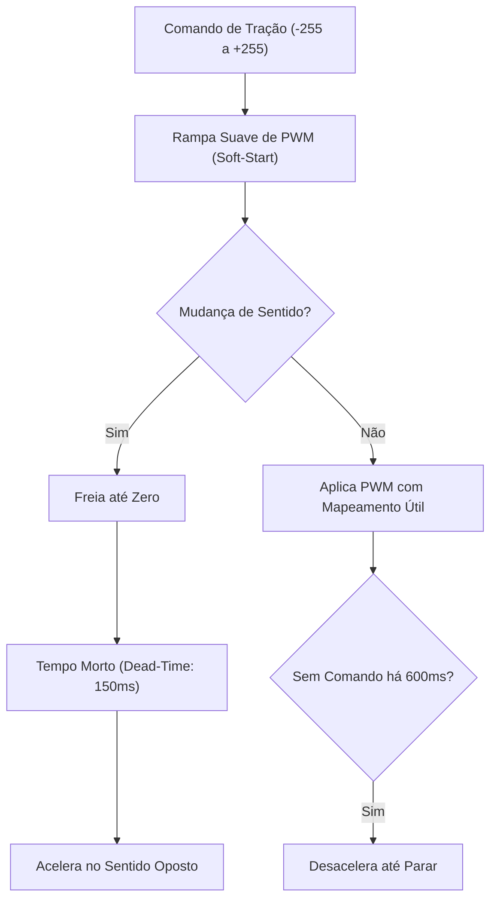

# ⚡ Tração 4WD, Prevenção de Brown-Out e Rampa de Aceleração (TB6612FNG)

Este guia documenta a engenharia do subsistema de tração com **4 micromotores DC JGA16-050**, explicando por que o Arduino Nano apresentava desligamentos/reinicializações intermitentes e como o módulo [`nano_motores.h`](file:///c:/Users/caihe/Documents/develop/rover/src/firmware/comum/nano_motores.h) resolve essa instabilidade através de rampas de aceleração e controle de tempo morto.

---

## ⚡ A Causa Raiz: Por que o Arduino Nano desligava/reiniciava?

O microcontrolador ATmega328P do Arduino Nano possui um circuito interno de monitoramento de alimentação denominado **BOD (Brown-Out Detection)**, configurado por fusíveis de fábrica para **4,3V** (em placas de 16 MHz).

Se a alimentação de 5V cair abaixo de 4,3V por apenas **1 microssegundo**, o hardware dispara um sinal de reset forçado imediato. Para o operador, a placa parece desligar e religar subitamente.

### O Mecanismo da Queda de Tensão (*Voltage Sag*)
1. **Corrente de Bloqueio (*Stall / Inrush Current*):**
   * Cada motor JGA16-050 consome cerca de **100 mA a 200 mA** girando livre.
   * No entanto, no instante exato da partida (saindo do repouso com $v=0$) ou ao inverter o sentido da rotação, a força contra-eletromotriz é nula. A corrente é limitada exclusivamente pela resistência ôhmica dos enrolamentos:
     $$I_{\text{partida}} = \frac{V_{\text{bat}}}{R_{\text{motor}}} \approx \mathbf{0{,}8\text{A a } 1{,}2\text{A por motor}}$$
2. **Pico Simultâneo nos 4 Motores:**
   * Quatro motores partindo bruscamente de uma vez somam um pico transitório de **3,0A a 4,8A**.
3. **Queda na Resistência Interna da Bateria 2S:**
   * A resistência interna das células Li-Ion, dos contatos do conector JST e da fiação faz a tensão da bateria sofrer um afundamento (*sag*) passageiro:
     $$V_{\text{terminal}} = V_{\text{oc}} - (I_{\text{pico}} \cdot R_{\text{interna}})$$
   * Se a bateria estiver com carga média (ex: 7,2V), um pico de 4A pode fazer a tensão da linha cair temporariamente para 5,8V.
   * Como o regulador Step-Down Mini 560 precisa de uma margem de queda (*dropout voltage*) para regular 5,0V fixos, a linha lógica de 5V oscila abaixo de 4,3V, disparando o **Brown-Out Reset** do Nano.

---

## 🛡️ A Solução no [`nano_motores.h`](file:///c:/Users/caihe/Documents/develop/rover/src/firmware/comum/nano_motores.h)

O firmware implementa 4 proteções ativas que eliminam os picos de sobrecorrente:



---

### 1. Rampa de Aceleração Suave (*Soft-Start PWM*)
* O valor de velocidade solicitado pelo usuário nunca é aplicado diretamente aos registradores de PWM da ponte H.
* O firmware calcula uma evolução gradual da saída a cada **10 ms**, utilizando aritmética de ponto fixo de 16 bits:
  * **Taxa de Subida (`rampaMs`):** Padrão de 800 ms para ir de 0 a 100%. A corrente de partida é fracionada ao longo de dezenas de ciclos de modulação, permitindo que a força contra-eletromotriz do motor suba em sincronia com o torque. O pico de corrente cai em mais de **70%**.
  * **Taxa de Frenagem:** Opera com o dobro da velocidade de subida para garantir paradas rápidas e seguras.

---

### 2. Tempo Morto Obrigatório na Reversão (*Dead-Time*)
* Inverter o sentido de rotação dos motores enquanto as rodas ainda estão girando para frente é a situação mais crítica em robótica: as escovas entram em curto regenerativo contra a fonte de alimentação, drenando correntes que podem ultrapassar **5A instantâneos**.
* O controlador proíbe a inversão direta:
  1. Ao receber ré com o robô em movimento frontal, a saída é desacelerada até zero.
  2. O motor permanece desenergizado por uma janela de tempo morto configurável (`deadMs = 150 ms`), permitindo que a inércia mecânica e a indução magnética dissipem.
  3. Somente após essa pausa o sentido das pontes H (`AIN1/AIN2`, `BIN1/BIN2`) é invertido e a rampa sobe suavemente.

---

### 3. Mapeamento da Faixa Útil de PWM (`pwmMin`)
* Caixas de redução metálica com relação alta (como a série JGA-050) possuem atrito mecânico inicial que impede o movimento com sinais PWM muito baixos (ex: $< 50/255$).
* O firmware mapeia a faixa de entrada útil $[1 \dots 255]$ para o intervalo $[60 \dots 255]$:
  * O motor não fica "zumbindo" parado em velocidades baixas.
  * O operador tem controle progressivo em toda a extensão do joystick.

---

### 4. Watchdog Failsafe de Perda de Sinal
* Ao pilotar via Wi-Fi ou celular, é comum ocorrer desconexão temporária de rede, fechamento acidental do navegador ou travamento do app.
* O Arduino Nano monitora a chegada contínua de pacotes `<M,esq,dir>`. Se nenhum pacote for recebido por mais de **600 ms**, os motores entram em desaceleração controlada até a parada total, evitando que o rover continue andando desgovernado.

---

## 📊 Diagnóstico de Reset pelo Registrador `MCUSR`

O módulo [`nano_diag.h`](file:///c:/Users/caihe/Documents/develop/rover/src/firmware/comum/nano_diag.h) implementa uma rotina em Assembly puro na seção `.init0` (executada antes da inicialização do runtime C):

```cpp
uint8_t g_resetFlags __attribute__((section(".noinit")));
void nanoCapturaReset(void) __attribute__((naked, used, section(".init0")));
void nanoCapturaReset(void) { __asm__ __volatile__("sts g_resetFlags, r2 \n\t" ::); }
```

O bootloader Optiboot salva o registrador de causa de reset `MCUSR` no registrador `r2` antes de zerá-lo. Ao ligar ou reiniciar, o Nano transmite via serial `<R,flags>`:
* **Bit 2 (`0x04`):** `BROWN-OUT` -> Confirma com 100% de certeza que o desligamento foi causado por afundamento de tensão elétrica na linha de 5V.
* **Bit 0 (`0x01`):** `Power-on` -> Ligou pela chave geral.
* **Bit 1 (`0x02`):** `Reset externo` -> Botão de reset ou conexão serial USB.
* **Bit 3 (`0x08`):** `Watchdog` -> Reset pelo temporizador de estouro de código.

Essa telemetria aparece instantaneamente nos painéis web dos POCs e permite comprovar na bancada se as proteções de rampa estão funcionando perfeitamente.
