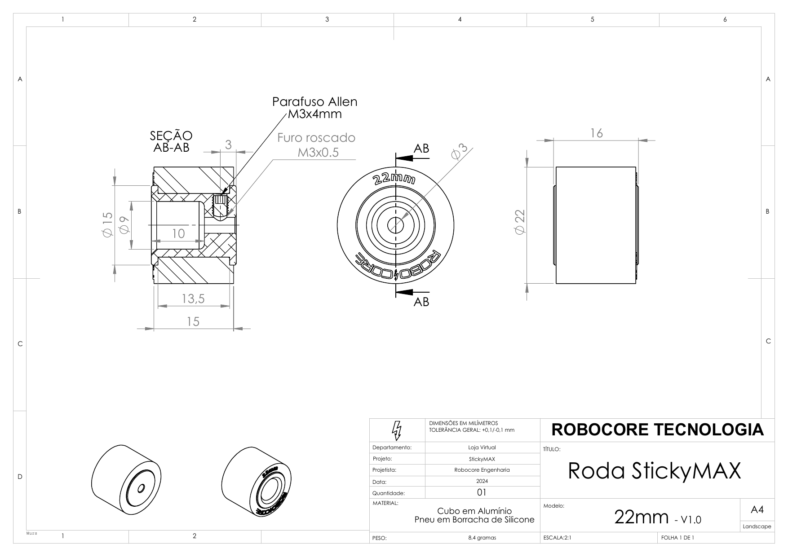
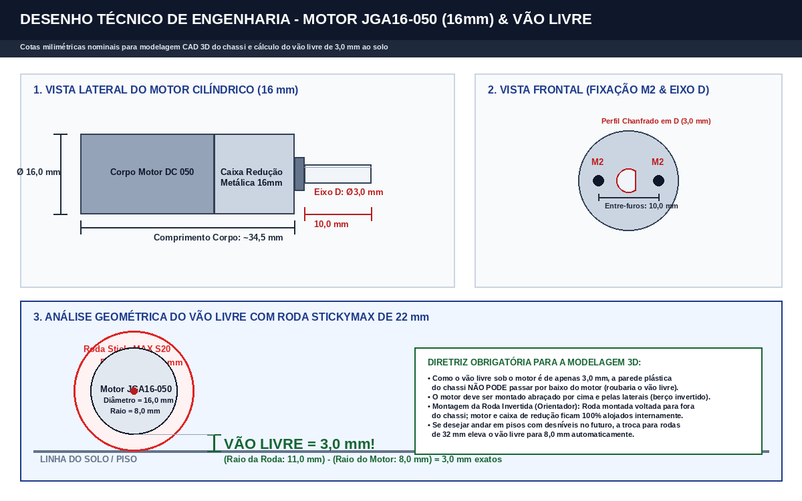
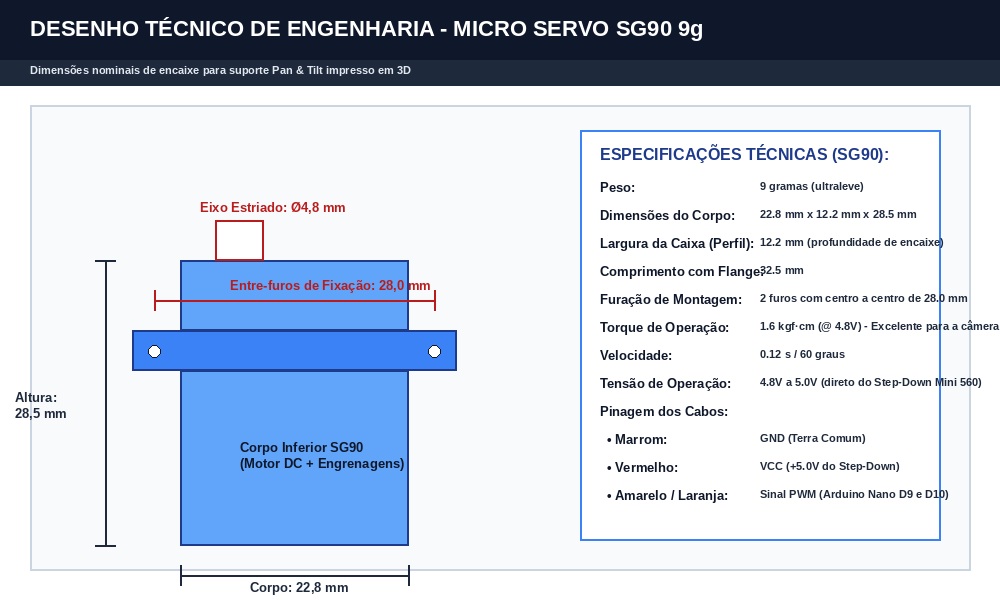
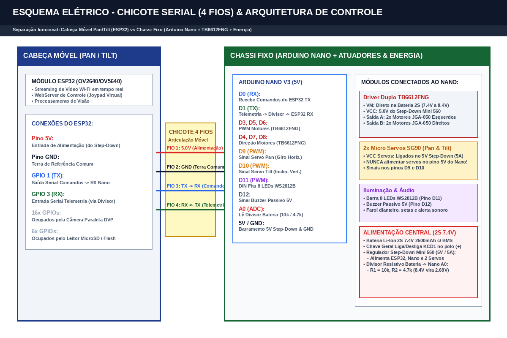
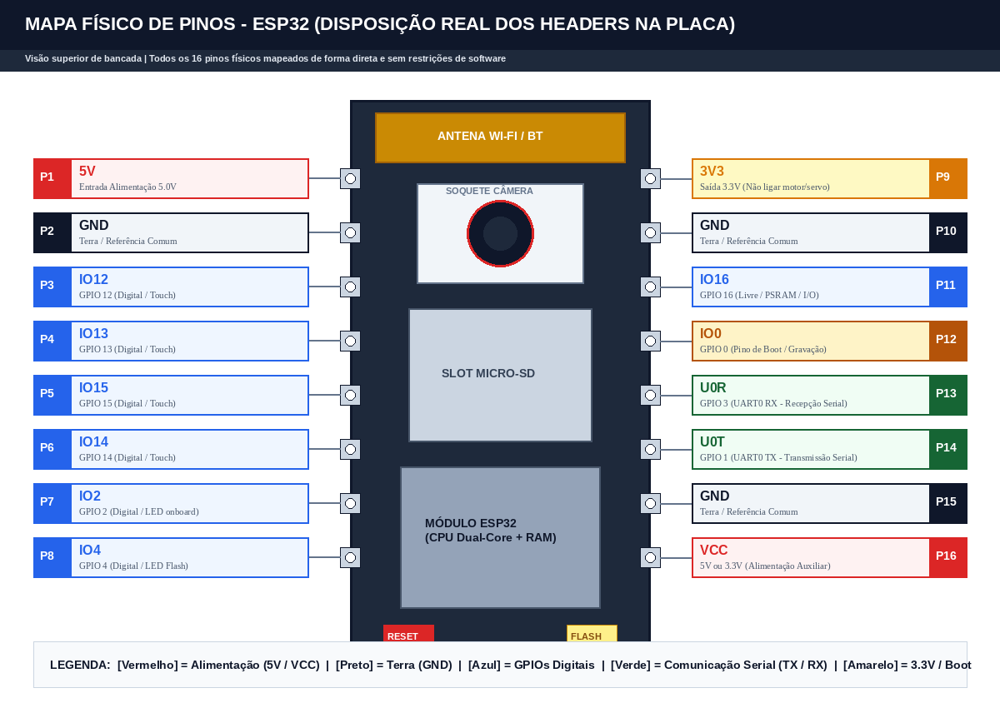
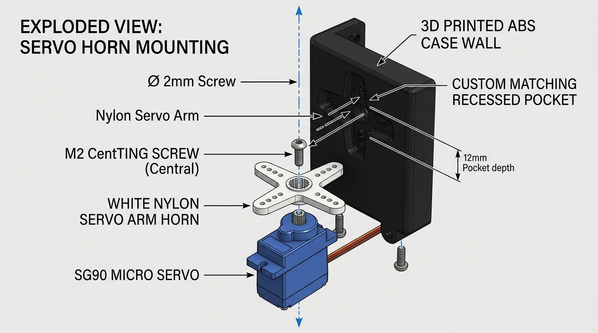

# 📐 Especificações Técnicas de Engenharia & Cotas Dimensionais

Documentação contendo os **desenhos técnicos oficiais, cotas milimétricas e esquemas elétricos** indispensáveis para a modelagem CAD 3D do chassi fechado e para a montagem da eletrônica.

---

## 🛞 1. Roda StickyMAX S20 (22 mm) & Cubo Usinado de Alumínio

Desenho técnico oficial de engenharia da RoboCore com o corte dimensional da roda e do cubo de fixação:

* **Cotas e Especificações Nominais:**
  * **Diâmetro Externo Total:** **22,0 mm** (Raio = 11,0 mm do centro do eixo ao solo).
  * **Largura da Banda de Rodagem:** **12,0 mm**.
  * **Cubo Usinado Incluso:** Alumínio liga 6351-T6 com parafuso M3 sem cabeça (Allen) para travamento.
  * **Furo de Encaixe:** **Eixo D de 3,0 mm** com rebaixo plano (encaixe com interferência suave).
  * **Montagem Invertida (Recomendação do Orientador):** O cubo e a roda são montados virados para fora do chassi. A carcaça do motor de 16 mm fica 100% alojada dentro do chassi, sem conflito de espaço com o miolo da roda.

---

## ⚙️ 2. Motor JGA16-050 (16 mm) & Cálculo do Vão Livre (Ground Clearance)

Cotas do micromotor de redução metálica JGA16-050 e análise geométrica da folga para o piso:

* **Cotas e Especificações Nominais:**
  * **Diâmetro do Corpo Cilíndrico:** **16,0 mm** (Raio = 8,0 mm).
  * **Comprimento do Corpo:** **~34,5 mm** (Motor DC 050 + Caixa de Redução Metálica).
  * **Eixo de Saída:** Aço com **perfil em D de 3,0 mm**, comprimento de **10,0 mm**.
  * **Fixação Frontal:** 2 furos roscados **M2** com distância entre centros de **10,0 mm**.
  * **Análise Geométrica do Vão Livre:**
    $$\text{Vão Livre} = \text{Raio da Roda (11,0 mm)} - \text{Raio do Motor (8,0 mm)} = \mathbf{3,0\text{ mm}}$$
  * **Regra Obrigatória para a Impressão 3D:**
    * O chassi plástico **NÃO PODE** ter assoalho fechado passando por baixo da carcaça do motor, pois qualquer espessura de parede plástica (ex: 2 mm) reduziria o vão livre para apenas 1 mm.
    * O motor deve ser abraçado por cima e pelas laterais (berço superior invertido), deixando o fundo do motor nivelado/exposto com 3,0 mm livres para o piso.

---

## 🔄 3. Micro Servo SG90 9g (Mecanismo Pan & Tilt)

Cotas milimétricas nominais para a modelagem dos berços de fixação dos eixos de rotação:

* **Cotas e Especificações Nominais:**
  * **Dimensões do Corpo:** **22,8 mm** (comprimento) x **12,2 mm** (largura do perfil) x **28,5 mm** (altura total).
  * **Flanges de Fixação:** Comprimento total de **32,5 mm** com 2 furos de montagem espaçados em **28,0 mm**.
  * **Eixo Estriado de Saída:** Diâmetro **4,8 mm** com altura de **4,0 mm**.
  * **Torque:** **1,6 kgf·cm** (@ 4,8V / 5,0V).
  * **Alimentação:** Fios de potência (Vermelho 5V e Marrom GND) devem ser ligados diretamente na saída do Step-Down Mini 560 (5A). **Nunca** alimentar pelo regulador onboard do Arduino Nano.

---

## ⚡ 4. Esquema Elétrico: Chicote Serial (4 Fios) & Interligação Chassi

Diagrama elétrico completo da separação funcional entre a Cabeça Móvel (ESP32) e o Chassi Fixo (Arduino Nano + TB6612FNG):

* **Detalhamento do Chicote Móvel (4 Fios Flexíveis):**
  1. `Fio 1 (Vermelho)`: **5,0V Potência** (Saída do Step-Down Mini 560 $\rightarrow$ Pino 5V do ESP32).
  2. `Fio 2 (Preto)`: **0V GND** (Terra de referência comum para sinal e alimentação).
  3. `Fio 3 (Azul/Amarelo)`: **Serial TX $\rightarrow$ RX** (ESP32 GPIO 1 TX [3,3V] $\rightarrow$ Arduino Nano D0 RX [5V]). Conexão direta.
  4. `Fio 4 (Verde/Branco)`: **Serial RX $\leftarrow$ TX** (Nano D1 TX [5V] $\rightarrow$ Divisor de Tensão 1k/2k $\rightarrow$ ESP32 GPIO 3 RX [3,3V]).
* **Driver TB6612FNG:**
  * Pino `VM`: Direto no positivo da bateria Li-Ion 2S (7,4V a 8,4V).
  * Pino `VCC`: Alimentação lógica em 5,0V do Step-Down.
  * Canal A (PWMA, AIN1, AIN2 nos pinos D3, D4, D5 do Nano): 2 motores esquerdos em paralelo.
  * Canal B (PWMB, BIN1, BIN2 nos pinos D6, D7, D8 do Nano): 2 motores direitos em paralelo.
* **Monitor de Bateria 2S (Pino A0 do Nano):**
  * Divisor com $R_1 = 10\text{ k}\Omega$ e $R_2 = 4,7\text{ k}\Omega$.
  * Bateria cheia ($8,4\text{ V}$) gera $2,68\text{ V}$ no pino A0 (totalmente seguro para o ADC de 5,0V).

---

## 📍 5. Mapa Físico de Pinos - ESP32 (Visão Superior de Bancada)

Disposição real de todos os 16 pinos físicos nos dois headers da placa para consulta direta e livre de restrições na bancada:

* **Header Esquerdo (8 Pinos):** `5V`, `GND`, `IO12`, `IO13`, `IO15`, `IO14`, `IO2`, `IO4`.
* **Header Direito (8 Pinos):** `3V3`, `GND`, `IO16`, `IO0`, `U0R (RX0)`, `U0T (TX0)`, `GND`, `VCC`.

---

## 📍 6. Mapa Físico de Pinos - Arduino Nano V3 (Visão Superior de Bancada)

Disposição física dos 30 pinos (15 à esquerda e 15 à direita) do microcontrolador ATmega328P:

* **Header Esquerdo (15 Pinos):** `TX1`, `RX0`, `RST`, `GND`, `D2`, `D3 (PWM)`, `D4`, `D5 (PWM)`, `D6 (PWM)`, `D7`, `D8`, `D9 (PWM)`, `D10 (PWM)`, `D11`, `D12`.
* **Header Direito (15 Pinos):** `VIN`, `GND`, `RST`, `5V`, `A7`, `A6`, `A5`, `A4`, `A3`, `A2`, `A1`, `A0`, `REF`, `3V3`, `D13`.

---

## 🔩 7. Encaixe do Horn do Servo SG90 na Parede do Case 3D (Horn Pocket)

Diagrama de engenharia em vista explodida mostrando a cavidade em baixo-relevo projetada na lateral da caixinha impressa em 3D (ABS) para receber a cruzeta/braço de nylon do micro servo SG90:

* **Diretrizes para Modelagem CAD (Filamento ABS na Creality):**
  * **Profundidade do Rebaixo (Cavidade):** **1,6 mm a 1,8 mm** (a cruzeta plástica original de nylon mede ~1,5 mm de espessura).
  * **Offset de Tolerância Dimensional (ABS):** Aplicar **+0,25 mm a +0,35 mm** no contorno da cruzeta no sketch para compensar a contração térmica típica do ABS (~0,7%). A peça de nylon entra justa com interferência suave (*press-fit*).
  * **Furo Passante Central:** **2,4 mm a 2,5 mm** de diâmetro para permitir a passagem do parafuso M2 que trava a cruzeta diretamente no eixo estriado do SG90.
  * **Furinhos de Retenção Auxiliares:** 2 furos de **1,2 mm** nas extremidades para fixação com micro parafusos autorroscantes, eliminando qualquer folga ou jogo angular durante o movimento de Tilt.

