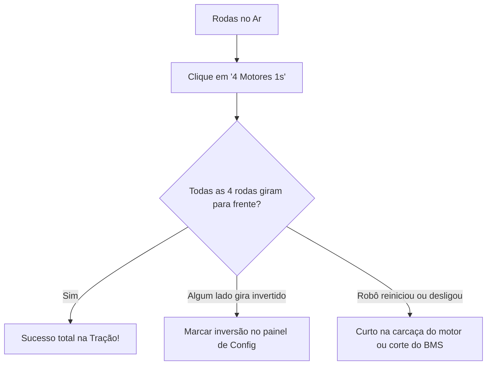

# 🔬 Guia Passo a Passo: Testes Integrados de Bancada

Este guia contém o roteiro prático e seguro de testes para revalidar todos os subsistemas físicos do Rover (Serial, Atuadores e Câmera) após a montagem mecânica do chassi, permitindo identificar com precisão qualquer falha de chicote, curto ou configuração.

---

## 📦 1. Ambientes de Compilação & Gravação (`platformio.ini`)

Você pode usar tanto a pasta dedicada [`src/firmware/testes_bancada/`](file:///home/usuario/Documentos/rover/src/firmware/testes_bancada/) quanto o firmware integrado [`src/firmware/producao/`](file:///home/usuario/Documentos/rover/src/firmware/producao/). Ambos contêm suporte total ao diagnóstico por LED (D13), motores 4WD, Pan/Tilt e câmera.

### Comandos de Gravação (PlatformIO)

**Opção A: Firmware de Testes de Bancada**
```bash
# No ESP32-S3:
pio run -e testes_bancada_esp32 -t upload

# No Arduino Nano (enlace direto no pino D0):
pio run -e testes_bancada_nano -t upload
```

**Opção B: Firmware Rover Total (Produção)**
```bash
# No ESP32-S3:
pio run -e rover_total_esp32 -t upload

# No Arduino Nano (enlace direto no pino D0):
pio run -e rover_total_nano -t upload
```

> [!IMPORTANT]
> **Dica de gravação do Nano via D0:** Se o pino D0 do Nano estiver conectado ao pino IO43 do ESP32 durante a gravação via cabo USB, pode haver conflito de sinal com o conversor USB (CH340/FTDI). Se o upload der erro ou timeout, desconecte apenas o jumper do pino D0 enquanto grava e reconecte em seguida.

---

## 🛠️ 2. Sequência de Testes Passo a Passo

### 🟢 Teste 1: Validação do Enlace Serial & LED de Vida do Nano (Pino 13)
* **Objetivo:** Ter 100% de certeza de que o ESP32 está transmitindo pelo pino IO43 e o Nano está recebendo pelo pino D0 e respondendo pelo D1.
* **Por que este teste é vital:** O LED "RX" físico da plaquinha do Arduino Nano só pisca quando dados chegam via cabo USB pelo computador. Ele **nunca** pisca quando os dados chegam pelo pino D0 externo. Por isso, implementamos o comando `<L,estado>` para acionar o LED `L` (D13) via protocolo.
* **Procedimento:**
  1. Conecte o celular ou PC à rede Wi-Fi **`Rover-Bancada`** (ou **`Rover-Total`**), senha: `12345678`.
  2. Abra o navegador em **`http://192.168.4.1/`** (ou no IP da sua rede local).
  3. No cabeçalho, confira se o indicador exibe **`NANO ok`**.
  4. Na barra **Diagnóstico & LED Nano (D13)**:
     * Clique em **"Ligar LED"** $\rightarrow$ O LED `L` (D13) na placa do Nano deve **acender** imediatamente e a etiqueta na tela muda para **`LED ON`**.
     * Clique em **"Desligar LED"** $\rightarrow$ O LED apaga e a etiqueta exibe **`LED OFF`**.
     * Clique em **"Alternar"** $\rightarrow$ O LED inverte de estado a cada clique.
     * Clique em **"Ping"** $\rightarrow$ Exibe a latência de ida e volta do pacote serial (ex: `18ms`).
* **Diagnóstico:** Se o LED D13 responder aos cliques, o enlace físico bidirecional (IO43 $\rightarrow$ D0 e D1 $\rightarrow$ IO44) está 100% perfeito e livre de falhas elétricas!

---

### 🎯 Teste 2: Servos do Pan / Tilt (SG90)
* **Objetivo:** Validar movimentação suave dos eixos sem vibração e sem causar queda de tensão (*brown-out*) no microcontrolador.
* **Procedimento:**
  1. No painel, mova o Pan e o Tilt usando o **D-Pad** ou os **Joysticks Virtuais**.
  2. Use os botões direcionais do Pan/Tilt: observe a rotação suave do suporte articulado.
  3. Clique no botão de centralizar para alinhar ambos em 90°/90°.
  4. Se o Nano reiniciar ao mover os servos bruscamente, certifique-se de que a alimentação 5V dos servos vem direto do conversor Step-Down Mini 560 (5A), e **nunca** do regulador interno do Nano.

---

### ⚙️ Teste 3: Tração 4WD com Rodas Suspensas (TB6612FNG)
* **Objetivo:** Comprovar o funcionamento dos 4 motores JGA16-050 simultaneamente sem travamento mecânico ou curto.
* **Atenção:** **Coloque o robô sobre um suporte para manter todas as 4 rodas suspensas no ar.**



* **Procedimento:**
  1. Clique em **"4 Motores 1s"** $\rightarrow$ Os dois lados (4 rodas) aceleram suavemente em rampa, rodam por 1 segundo e freiam até parar.
  2. Clique em **"Ré 1s"** $\rightarrow$ Rotação inversa suave.
  3. Clique em **"Giro Esq"** e **"Giro Dir"** $\rightarrow$ Um lado roda para frente e o outro para trás.
  4. Teste manual contínuo: Arraste o **Joystick de Drive** ou use o D-Pad de tração.
  5. Clique no botão vermelho **"PARADA IMEDIATA"** para validar o corte de emergência.

---

### 🛡️ Teste 4: Failsafe / Watchdog (Perda de Conexão)
* **Objetivo:** Garantir que o robô nunca dispare descontrolado caso o sinal Wi-Fi caia.
* **Procedimento:**
  1. Mantenha o carrinho acionado para frente.
  2. Desative o Wi-Fi do celular/computador ou feche a aba.
  3. **Resultado esperado:** Em 600 ms sem novos pacotes, o Nano entra em corte automático de segurança (watchdog) e desliga a ponte H (STBY em LOW).

---

### ❄️ Teste 5: Câmera OV5640 & Gestão de Temperatura
* **Objetivo:** Imagem nítida e operação com câmera fria.
* **Procedimento:**
  1. Clique no botão **"▶ Vídeo"** no canto do vídeo para recarregar o stream MJPEG (porta 82).
  2. Use o botão **"↻ Girar"** se precisar ajustar a orientação da imagem para a posição do berço mecânico.
  3. No menu **Config (⚙️)**, teste os presets: **Frio** (QVGA), **Equilibrado** (VGA) ou **Qualidade** (SVGA).
