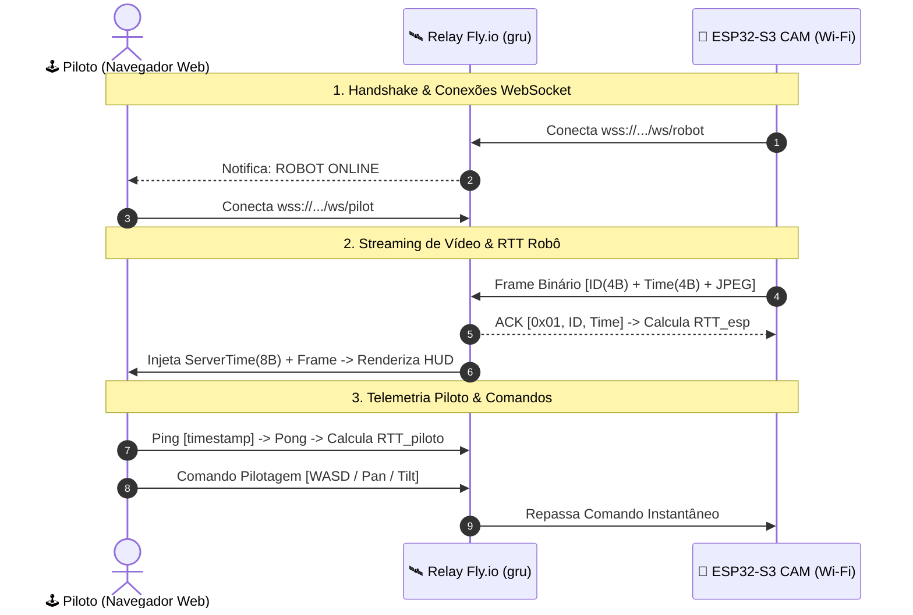

# 🛰️ Rover Cloud Relay & Cockpit FPV (Fly.io)

Servidor de retransmissão de vídeo de baixa latência e telemetria para o Rover FPV, hospedado no datacenter de São Paulo (`gru`) da Fly.io.

---

## 🏗️ Arquitetura Distribuída



---

## 📡 Endpoints Públicos

* **Interface Web do Cockpit (HUD):** `https://rover-relay-fpv-sp.fly.dev/`
* **Healthcheck:** `https://rover-relay-fpv-sp.fly.dev/health`
* **WebSocket do Robô (ESP32-S3):** `wss://rover-relay-fpv-sp.fly.dev/ws/robot`
* **WebSocket do Piloto (Navegador):** `wss://rover-relay-fpv-sp.fly.dev/ws/pilot`

---

## ⏱️ Protocolo de Medição de Latência (Two-Leg RTT)

1. **Perna Robô $\leftrightarrow$ Nuvem:**
   * O ESP32 envia `uint32_t millis()` junto ao frame.
   * O Relay responde imediatamente com o ACK de 9 bytes.
   * Latência de subida estimada: $\Delta t_{esp} = \frac{RTT_{esp}}{2}$.

2. **Perna Nuvem $\leftrightarrow$ Piloto:**
   * O navegador do piloto envia pacotes `{ type: "ping", t: performance.now() }` a cada 1 segundo.
   * O servidor responde instantaneamente `{ type: "pong", t: ... }`.
   * Latência de descida estimada: $\Delta t_{pilot} = \frac{RTT_{pilot}}{2}$.

3. **Latência Total Fim-a-Fim:**
   $$\Delta t_{total} \approx \Delta t_{esp} + \Delta t_{pilot}$$

---

## 🚀 Comandos de Gerenciamento

```bash
# Testar localmente:
npm start

# Visualizar logs em tempo real na nuvem:
fly logs -a rover-relay-fpv-sp

# Fazer novo deploy:
fly deploy
```
