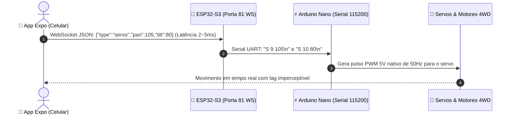

# 📡 Firmware de Controle WebSocket (ESP32-S3-CAM + Arduino Nano)

Este diretório contém o firmware de produção para comunicação bidirecional de **baixa latência** entre o aplicativo Expo e o Rover usando **WebSocket**.

---

## 🏗️ Como Funciona o Pipeline

---

## 💻 Como Gravar na Arduino IDE

### 1. ESP32-S3-CAM ([`esp32_rover_ws.ino`](file:///home/usuario/Documentos/rover/src/firmware/rover_control_ws/esp32_rover_ws/esp32_rover_ws.ino))
1. Instale a biblioteca **WebSockets** por *Markus Sattler* na Arduino IDE (**Ferramentas ➔ Gerenciar Bibliotecas ➔ buscar por "WebSockets"**).
2. Selecione a placa: **ESP32S3 Dev Module** (com USB-CDC ativado).
3. Conecte o cabo USB-C e faça o upload.
4. No Serial Monitor (115200 baud), anote o IP exibido (ex: `192.168.1.150` ou `192.168.4.1`).

### 2. Arduino Nano ([`nano_pinos_serial.ino`](file:///home/usuario/Documentos/rover/src/firmware/controle_pinos_nano_web/nano_pinos_serial/nano_pinos_serial.ino))
1. Abra o arquivo do Nano.
2. Desconecte temporariamente o jumper do pino `RX / D0` durante o upload.
3. Grave selecionando **Arduino Nano** com processador **ATmega328P**.
4. Reconecte o pino `RX`.
